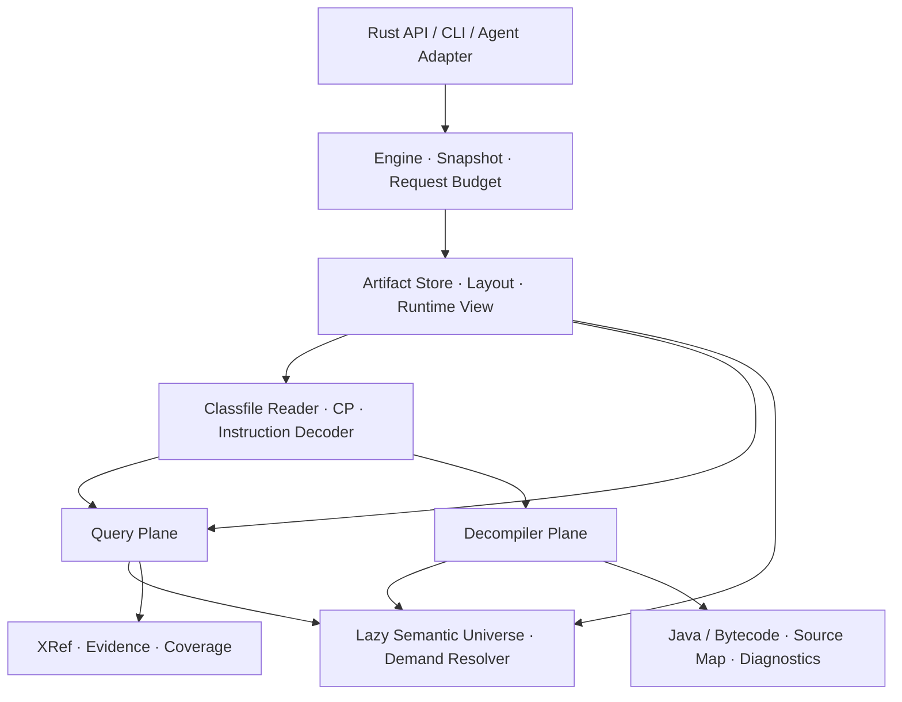
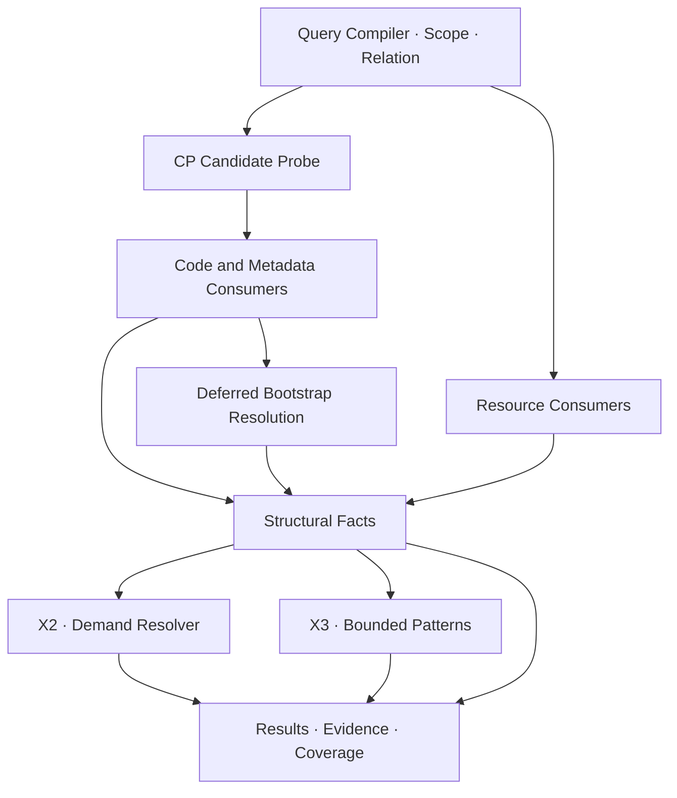
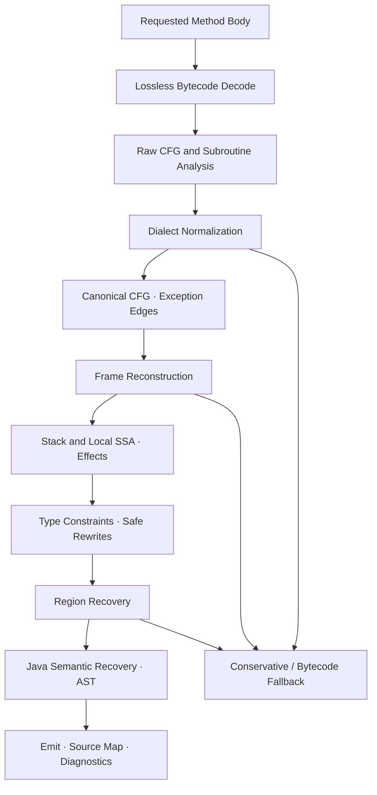

# 纯 Rust JVM 静态分析与按需反编译引擎：最终架构

> 版本：1.1 · 架构基线与渐进式核心结果设计
>
> 架构基线日期：2026-09-16；核心需求与结果边界更新：2026-09-21
>
> 交付定位：可用于实现拆分、接口设计和评审的技术设计；本文不是已实现能力或实测性能报告。  
> 核心目标：独立、纯 Rust、library-first，原生处理 `.class`、`.jar`、`.war`；无需 JVM/JADX 运行依赖，支持直接查询 artifact、精确结构引用和按需 Java 反编译。

## 目录

1. [目标与最终决策](#s01)
2. [架构不变量](#s02)
3. [整体架构与模块边界](#s03)
4. [版本体系与 Java 8 兼容基线](#s04)
5. [Artifact、容器布局与 Runtime View](#s05)
6. [按需物化与物理 I/O 边界](#s06)
7. [Classfile Reader 与共享解码底座](#s07)
8. [身份、符号与证据模型](#s08)
9. [Query Plane 与 XRef 正确性契约](#s09)
10. [Lazy Semantic Universe 与 Demand Resolver](#s10)
11. [Decompiler Plane 与 IR 管线](#s11)
12. [Java 语义恢复与历史编译器差异](#s12)
13. [输出、降级和源码映射](#s13)
14. [Phase、Pass 与扩展机制](#s14)
15. [Rust API 与调用方式](#s15)
16. [缓存、并发、取消与快照](#s16)
17. [不可信输入与资源预算](#s17)
18. [性能模型与优化次序](#s18)
19. [关键 Challenge 与解决方案](#s19)
20. [验证体系与发布门槛](#s20)
21. [实施阶段与依赖顺序](#s21)
22. [本次纠正、补充与 ADR](#s22)
23. [规范与项目参考](#s23)

<a id="s01"></a>
## 1. 目标与最终决策

### 1.1 产品定义

实现一个以 Rust crate 为主要交付形式的 JVM artifact 分析引擎。调用方可以只打开一个 JAR 搜索字符串/类型/成员引用，也可以只反编译某个类或方法；不要求先建立全程序对象图、全局 XRef 数据库或反编译全部依赖。

保留两项核心思想：

- **Artifact as database**：编译产物本身就是可查询的数据源；索引是可选加速器。
- **Demand-driven reconstruction**：只有请求需要时才构造 Header、方法 Body、IR 和 Java 输出，并限制其依赖闭包。

借鉴 ASC 的按需检索与局部重建思想，借鉴 JADX 的多阶段反编译组织方式，但独立实现 JVM 栈机语义和 Rust 对象模型。ASC 官方仓库当前定位为 Android 反编译前端；其 DEX/R8 布局优化和性能数据不能直接移植为本项目的 JVM 能力承诺。[ASC 项目](https://github.com/MG1937/ASC)

### 1.2 范围

| 维度 | 最终范围 |
| --- | --- |
| 实现形态 | 纯 Rust 引擎库；CLI、Agent/MCP、服务接口为外层适配器 |
| 必须输入 | 单独 CLASS、标准 JAR、WAR、混合版本依赖 |
| 常见打包 | Spring Boot JAR/WAR；通用嵌套 ZIP 容器能力 |
| 查询 | 符号/字面量搜索、结构 XRef、按需解析、可选动态模式分析 |
| 反编译 | 方法、类、源文件单元三个粒度；默认只扩展最小必要闭包 |
| 兼容基线 | Java 8 Runtime Profile，包含历史 classfile 的明确支持和降级策略 |
| 演进范围 | classfile 45–71 的版本建模，按逐项能力矩阵验收；后续通过 Registry 扩展 |
| 输出 | 类型化 Rust 结果、可序列化结果、Java 文本、字节码回退、证据与覆盖范围 |
| 非必需 | 全局预索引、JVM 安装、远程依赖下载、持久数据库、GUI |
| 暂不作为核心目标 | DEX/APK、还原 Kotlin/Scala 原始源码、执行目标代码、完整 whole-program call graph、通用源码降级编译器 |

“没有 JVM 运行依赖”不等于“解析 Java 平台类型时无需平台定义”。平台 class headers 由调用方提供或由显式配置的数据集提供；测试环境可以使用 JDK。

### 1.3 四个必须区分的承诺

1. **可解析**：能够安全识别文件结构和指令。
2. **可提取事实**：能够在声明的 consumer 集合内返回结构引用。
3. **可恢复源码**：能够输出某一质量等级的 Java 表达。
4. **可在指定 JVM 运行**：取决于平台、加载器、依赖和运行环境；静态引擎只能做有范围的兼容诊断。

这四项不能合并为一个 `supported = true`。

<a id="s02"></a>
## 2. 架构不变量

| 编号 | 不变量 | 直接后果 |
| --- | --- | --- |
| I1 | Query 不依赖 Decompiler | X0/X1 不构造 CFG、SSA、Region 或 Java AST |
| I2 | Decompiler 不依赖全局 XRef | 单方法请求不先扫描所有方法体 |
| I3 | 原始 artifact 是事实来源 | 恢复、去糖、重命名不覆盖原始引用 |
| I4 | 符号引用、定义解析、运行时派发分离 | `mentions_symbol`、`resolves_to`、`may_dispatch_to` 是不同关系 |
| I5 | 没有 mandatory whole-program load | 允许按需扫描全部 Header，但不强制物化全部 Body/IR |
| I6 | 依赖默认只到 Header | 升级 Body 必须有具体分析需求和预算 |
| I7 | 缓存只是 accelerator | 完整执行时冷/热缓存结果一致；预算中断状态显式返回 |
| I8 | 每个结果携带 provenance | 至少能定位到物理 entry 与 Code BCI、attribute 路径或 resource 位置 |
| I9 | 不执行被分析代码 | 不调用 bootstrap、类初始化器、JNI、反射或目标 classloader |
| I10 | 缺失、歧义、失败不能伪装为否定 | “未发现”必须同时报告范围与覆盖状态 |
| I11 | 复杂恢复可降级 | 保留可验证事实，允许 Conservative/Bytecode 输出 |
| I12 | 所有扩展工作有预算 | 容器递归、解析、闭包、IR 和输出均可限制和取消 |

<a id="s03"></a>
## 3. 整体架构与模块边界



图中的共享服务不构成相互启动关系：X1 无需调用 Resolver；X2、X3 才按需调用。Decompiler 可以调用 Resolver，但不能隐式调用全局 XRef 构建。

### 3.1 建议模块

下表是逻辑边界，不按每个模块建立独立发布包。当前已形成 reader/query/jvm/java、根门面与 CLI 六包；实际归属和后续交接见 3.3。

| 模块 | 责任 | 不承担的责任 |
| --- | --- | --- |
| `artifact` | ByteSource、ZIP/ZIP64、嵌套容器、Layout、物理快照 | Java AST、类加载执行 |
| `classfile` | CP、Header、attributes、descriptor/signature、instruction cursor | 全局解析、源码生成 |
| `model` | ID、SymbolRef、UseSite、Evidence、Coverage、Diagnostics | 文件 I/O 和调度策略 |
| `universe` | Runtime View、平台数据、Header 提供、按需定义解析 | 必须存在的全程序图 |
| `query` | Query 编译、候选过滤、consumer 扫描、可选模式分析 | 反编译作为 XRef 前置步骤 |
| `ir` | 原始方法、规范化 CFG、Frame/SSA、Types、Effects、Regions | 源码文本管理 |
| `decompile` | Phase/Pass、恢复、最小闭包、降级协调 | ZIP 格式实现 |
| `java` | Java AST、命名、表达式优先级、格式化、源码映射 | 覆盖 artifact 事实 |
| `engine` | 无状态门面、公共 API、请求预算、显式事实复用与任务组合 | 框架私有规则 |
| `adapters` | CLI、JSON、MCP/服务等薄封装 | 另一套分析语义 |

共用一套 instruction boundary decoder，避免 Query 和 Decompiler 对 `wide`、switch 等指令长度产生分歧。Query 使用无对象或轻量 cursor；Decompiler 选择将相同解码事件物化为 IR。

### 3.2 与 JADX 的关系

JADX 的公开 API 实现存在 RootNode、加载阶段和后续反编译调度等组织方式；本项目借鉴阶段划分和算法问题分解，不复制以全局可变节点为核心的对象图。[JADX API 实现](https://github.com/skylot/jadx/blob/master/jadx-core/src/main/java/jadx/api/JadxDecompiler.java)

JVM 是操作数栈模型，不能把 DEX 的寄存器模型直接当输入 IR。必须先处理 JVM Frame、异常边、构造器未初始化值、category-2 值和历史子程序，再进入统一的值/控制流分析。

### 3.3 Workspace crate 分层（2026-09-20，六包已落地）

reader/query/jvm 与根门面的分层已按 7/7 归档；`jarde-java` 已随 P3 加入。MethodIr 已交接同次三表、code/CP/bootstrap、声明/receiver/debug 与物理方法身份，门面/CLI 已接通恢复和按需同类 callee；见 [P3 归档设计](openspec/changes/archive/2026-09-20-p3-java8-recovery/design.md)。R8/R9 是恢复产物正确性缺口，已由 [收尾 change](openspec/changes/archive/2026-09-20-close-recovery-correctness-gaps/design.md) 关闭。

| crate | 归属 | 项目内生产依赖 |
| --- | --- | --- |
| `jarde-reader` | artifact、唯一 classfile reader、共享身份/预算/错误、声明式 view、MR 选择与检查入口 | 无 |
| `jarde-query` | X0/X1、query+xref、候选扫描与报告 | reader |
| `jarde-jvm` | 环境/providers/resolver/dispatch、CFG/normalization/Frame/SSA/effects、pass 与方法 driver | reader、query（声明引用候选复用） |
| `jarde` | 统一 Engine 门面与选定再导出，不留分析循环 | reader、query、jvm、java |
| `jarde-cli` | 参数与 JSON 适配 | jarde |
| `jarde-java`（已创建） | 源码语义证明与拼写、Region、recovery AST、核心投影证明、命名、source map 与输出 | jvm、reader；复用 petgraph；由 jarde 聚合 |

轻量调用方直接依赖 reader/query；query 的生产依赖闭包不得出现 resolver/IR/Java 恢复。`jarde-jvm → jarde-query` 不授权单方法分析隐式全局扫描。中端内部模块保持私有，向恢复层提供所需的只读 facts；不能因拆包把全部内部结构改成 public。共用同一身份和预算，不新增 speculative core/common 包或跨项目通用 IR。P2/分层已完成归档；P3–P5 也已按各自范围归档；上述原反例已独立闭环；当前新增的渐进式结果设计见 §13.4、§15.1 与其实施 change，不重复拆包或重做已共享的 CP/Header。

### 3.4 S1 当前落地边界（2026-10-26）

当前后继正在完成 [D12有限退出](openspec/changes/restructure-demand-driven-recovery/design.md#d12-s1-有限退出与恢复主线优先级)，实际证据集中在[architecture-completion-v1](openspec/changes/restructure-demand-driven-recovery/results/architecture-completion-v1/progress.json)。共享停止现在保留原始预算维度和配额，elapsed 为 `StopReason::Budget`；`Interrupted` 只表示结构中断或无法从旧报告重建原Error的适配。Reader的Code facts保留原停止Error，query/callee消费它而不重新检查预算覆盖首因；辅助Body预算停止立即截断后继需求，owner census保留原Report/diagnostics。预取消的resolver先声明未搜索范围，再返回取消，仍然零Header读取。恢复合同50、解析合同5；产物binding schema12、输入摘要域9保持独立。以下带日期收据保留当时实现与限制，当前已按D12完成S1有限退出，见[验收矩阵](openspec/changes/restructure-demand-driven-recovery/results/architecture-completion-v1/acceptance.json)：适用30配置原时间/RSS门通过，2469及408核心完整报告保持；原bulk失败/E1–E7/具体语法暂存仍独立，下一步S2a。

[架构调整提案](openspec/changes/restructure-demand-driven-recovery/design.md)的 2.1–2.8 已验收：`source_proof` 与 `generic_source_proof` 承接 Java 源码证明和拼写；Engine 门面仍负责在原环境下选择与读取事实、传递预算/停止、安装或回滚类级事务。crate 依赖方向不变，没有新增 Session 或 presentation crate。

截至 [CA helper停止检查点](openspec/changes/restructure-demand-driven-recovery/results/s1-enum-helper-stop-v1/README.md)，原Error/Report经Java政策透传、root统一消费，helper全局报告不再降成字符串拒绝或继续后继helper；470项选定native、2407/2449全JSON相同与42份已审查停止metadata修正、408核心保持，恢复46。共享Interrupted、其余全停止/资源/API和raw/匿名专用族仍开放，S2未进入。

恢复产物以 `ClassSourceRecovery` 和 `ClassSourceCandidates` 传递至真实消费者。必要投影证明由同次 emission 按需保留，公开 SourceMap 等 evidence 按请求单独物化，不能再用是否请求 evidence 决定类族是否可恢复。保留过滤不充当身份或类型证明，真实缺少必要 origin 仍拒绝；无候选的普通恢复不常驻整套 AST。

[验收报告](openspec/changes/restructure-demand-driven-recovery/results/s1-core-v1/README.md)记录既有成功与来源保留、三种 evidence 的正文/决定一致，以及测得的新增证明成本。[2.3 复用验收](openspec/changes/restructure-demand-driven-recovery/results/s1-demand-v1/README.md)补充：PreparedClass 在顺序类任务内按需保留完整 Body Arc，driver/MethodIr/callee 复用同次事实，独立于 ArtifactCache；同方法四类 Java 证明共享成功 Header，未知或 incomplete 不负缓存。原解码 execution 与当前消费费用分别保留，类任务释放后不全局保留。[2.4 状态/停止验收](openspec/changes/restructure-demand-driven-recovery/results/s1-demand-state-v1/README.md)将 Header 结果分为 Found/Missing/Ambiguous/Unknown，Stop 保留原错误/报告；HeaderClosure 命中先 poll，driver、类族阶段与多候选重恢复的拥有者在全局停止后截断后续 Body。平台只消费有效搜索顺序的 clean Missing，循环沿已有路径/gap 处理。[2.5 源码目标验收](openspec/changes/restructure-demand-driven-recovery/results/s1-source-target-v1/README.md)将 SourceTarget 与 RuntimeProfile 分离，覆盖源码 7/8、MR/共同符号独立性及库/CLI 一致性。[2.6 环境/loader 验收](openspec/changes/restructure-demand-driven-recovery/results/s1-environment-v1/README.md)补全 domains/providers 声明，Header 需求按 initiating loader/raw name 记忆，后继从 defining loader 发起，图节点以 loader/物理定义区分，binding schema 为 3。[2.6 当前构建复核](openspec/changes/restructure-demand-driven-recovery/results/s1-environment-recheck-v13/README.md)实际重现旧2+7失败；当前A1.4全11项及相邻回归286 passed / 0 failed / 1既有ignored。当前601项源码/资产、源码包及56二进制匹配Outer.super R3，核验12121个冻结payload，target当前不存在；复用固定构建，无新增Cargo或2.6产品/测试体修改。恢复保留引用同源码与二进制既有oracle，本轮未重跑矩阵/JDK；本次止于2.6。扩大回归确认的预取消 skipped 缺口及 EM11 cap2 旧断言保留给 2.10；非 caller uncertainty 的平台契约消费列为 3.3 静态复核输入。[2.7 语义绑定验收](openspec/changes/restructure-demand-driven-recovery/results/s1-semantics-v1/README.md)将方法 binding 升为 schema 4，分开解析/恢复合同及源码 ID，保留实际物理依赖和词法/投影 handoff，实际构建验证同版本同文本语义变更拒绝旧证据、normal/test-support 与独立构建目录身份一致。源码 ID 保守包含注释/tests，不声称语义等价；运行收据另 pin 二进制。[2.8 输入来源验收](openspec/changes/restructure-demand-driven-recovery/results/s1-trust-v1/README.md)将公开 Java 输入视为 caller-supplied 断言并返回 unbound 预览；Engine 以私有同次读取检查和正文提交闭包建立 binding，公开 metadata 构造器/callback 不授予来源。41 目标、真实假构造器与错 facts/subject/runtime、136×3 及受控 oracle 均验收，恢复合同 revision 2，schema 保持 4。S1 的 2.9–2.10 尚未完成；raw 名称及全阶段资源仍有验收门，原时间超门继续保留。S2 未进入。

<a id="s04"></a>
## 4. 版本体系与 Java 8 兼容基线

### 4.1 源码目标、运行环境与验证配置分别声明

| 概念 | 回答的问题 | 示例 |
| --- | --- | --- |
| `ClassfileDialect` | 这些字节怎样解读、哪些结构合法？ | `major=52, minor=0` |
| `RuntimeProfile / RuntimeView` | 在何种 Java/加载规则下选中哪些定义？ | Java 8、Java 17、Boot launch mode |
| `PlatformUniverse` | 解析时使用哪组平台类和依赖定义？ | 某个 JDK 8 的 `rt.jar` headers |
| `SourceTarget` | 允许生成哪些 Java 源码语法？ | 当前仅注册 Java 7、8 |
| 外部验证配置与收据 | 用哪个编译器、依赖和 JVM 验证产物？ | JDK 8 source/target 7、JDK 23 release 8 |

上表的文件格式、运行视图和平台依赖是架构维度；当前源码配置的实际 API 是 `SourceTarget`，与 `RuntimeProfile` 分别进入恢复请求/报告。源码目标不参与 reader/JVM 的纯分析请求，也不选择 MR 或平台契约。编译器来源是输入/验证证据，恢复规则必须验证字节码前提，不以编译器标签放行。普通恢复报告的 CompileStatus 仍为 NotAttempted，外部编译/JVM 收据单独保存。

Java 8 Runtime View 只选择其模型下可见的定义；物理查询仍应能看见包内不兼容或未激活的高版本 class。由此，**先枚举物理 artifact，再建立运行视图**，不能先用 Runtime Profile 把物理证据丢弃。

### 4.2 Java 8 是完整的目标配置

Java 8 输入可能混合 Java 5、6、7、8 的编译产物。因此基线必须包含历史格式、旧编译器模式、无调试信息、lambda 和 interface default/static methods。Java 8 规范描述的 classfile 支持范围上界为 52.0；历史 minor 规则必须按该版本规范检查，不可写成“所有 major 的 minor 都必须为 0”。[JVMS 8 §4.1](https://docs.oracle.com/javase/specs/jvms/se8/html/jvms-4.html#jvms-4.1)

版本兼容检查分三步：

1. Reader 能否识别结构；
2. 该结构是否符合 classfile 自身 dialect；
3. 选定 Runtime Profile 是否接受该 dialect 及其所需平台能力。

静态解析成功不能作为 JVM verifier 验证通过的替代证明。

### 4.3 Feature Registry

| 世代 | major | 应重点覆盖的特性 |
| --- | ---: | --- |
| 早期 Java–1.4 | 45–48 | 历史 minor 规则、`jsr/jsr_w/ret`、旧 finally |
| Java 5 | 49 | Signature、annotations、enum 与 bridge 模式 |
| Java 6 | 50 | StackMapTable、历史 verifier 特殊情况 |
| Java 7 | 51 | MethodHandle、MethodType、InvokeDynamic、BootstrapMethods |
| Java 8 | 52 | Type annotations、MethodParameters、lambda、interface default/static |
| Java 9 | 53 | Module/Package CP、模块属性、interface private 方法 |
| Java 11 | 55 | ConstantDynamic、nestmates |
| Java 12+ | 56+ | preview minor 规则与版本绑定 |
| Java 16/17 | 60/61 | 正式 Record / PermittedSubclasses；更早 preview 单独建模 |
| Java 21/25/26/27 | 65/69/70/71 | 根据对应规范增量登记；不能只提升允许的 major 上限 |

Java 27 已于 2026-09-15 GA；其 classfile major 为 71。本文件将 71 作为当前设计覆盖上界，而非宣称所有 Java 27 源码恢复已实现。[OpenJDK 27](https://openjdk.org/projects/jdk/27/)、[Java 27 ClassFile 常量](https://docs.oracle.com/en/java/javase/27/docs/api/new-list.html)

Registry 至少记录 CP tag、attribute 合法位置/版本/基数、flags、opcode 约束及对应测试。Preview 支持必须绑定具体 release 和已实现特性；不能把旧版本的 `65535` preview class 当成新 JVM 普通 class。[现代 classfile 版本规则](https://docs.oracle.com/en/java/javase/26/docs/specs/jvms/jvms-4.html#jvms-4.1)

### 4.4 平台与输出不能偷换

- 解析 Java 8 artifact 时，不默认使用宿主机最新 JDK 的类定义。
- 平台输入可来自显式选择的 `rt.jar`、模块化 JDK 的 JMOD、预生成 Header 数据集；JRT image、`ct.sym` 等需要各自适配，不能当成普通等价 JAR。
- 平台缺失时保留 SymbolRef 和 MissingDependency；不要伪造平台方法。
- 把 Java 17 class 输出成 Java 8 语法不是一个开关能保证的功能。Record、sealed、现代 bootstrap 或 API 可能无法等价降级；返回 `OutputLevelConflict` 或保守输出。
- `PlatformUniverse` 指纹、Runtime View 和 Output Level 都进入相应缓存键。

<a id="s05"></a>
## 5. Artifact、容器布局与 Runtime View

### 5.1 Container 与 Layout 分离

Container 负责字节定位；Layout 负责“哪些 entry 构成类路径根、库、资源与启动元数据”。建议内建：

| Layout | 应用类位置 | 依赖位置 | 必须记录的差异 |
| --- | --- | --- | --- |
| `SingleClassLayout` | 单个 CLASS | 外部配置 | 路径不一定等于类内部名称 |
| `StandardJarLayout` | 归档根 | 外部 classpath / Manifest | JAR 内的任意嵌套 JAR 不自动激活 |
| `WarLayout` | `WEB-INF/classes` | `WEB-INF/lib` | Servlet 容器加载规则是配置，不是统一常量 |
| `SpringBootJarLayout` | `BOOT-INF/classes` | `BOOT-INF/lib` | 启动类、classpath index、外部 loader 配置 |
| `SpringBootWarLayout` | `WEB-INF/classes` | `WEB-INF/lib`、`WEB-INF/lib-provided` | executable 与 deployed 模式下的可见性不同 |

Spring Boot 的嵌套布局及 `classpath.idx` 会影响类路径解释；`layers.idx` 用于镜像分层，不应误当成运行时类路径顺序。[Spring Boot 嵌套归档规范](https://docs.spring.io/spring-boot/specification/executable-jar/nested-jars.html)

布局识别综合目录、Manifest 和配置证据，返回识别置信/冲突信息。用户显式配置优先；多个布局候选未能消歧时保留候选，不能静默选择一个“像是”的启动模型。

### 5.2 物理访问模式

| 嵌套 entry 状态 | 子容器访问 | 成本与约束 |
| --- | --- | --- |
| 外层 entry 为 STORED | `SeekableSubcontainer`，可映射到父容器字节区间 | 内层 class entry 仍可能压缩 |
| 外层 entry 为 DEFLATED | `MaterializedSubcontainer` | 先在预算内解压到内存或临时 backing file，再读取内层目录 |
| 仅顺序流输入 | 显式 spool 或顺序扫描 | 不承诺随机访问；报告物化成本 |
| 加密/未知压缩方法 | Unsupported | 不返回空容器冒充成功 |

Spring Boot 规定嵌套 JAR 的外层 ZIP entry 使用 STORED，以便直接定位内部内容；这不意味着内层文件没有压缩。[Spring Boot 归档限制](https://docs.spring.io/spring-boot/specification/executable-jar/restrictions.html)

保存原始 entry 名与规范化显示名。重复 ZIP entry、路径不一致、中央目录与局部头冲突要形成诊断；身份使用 entry ordinal/稳定 locator，不能用路径字符串覆盖重复项。ZIP64、data descriptor、前置启动脚本等格式差异属于容器层。

### 5.3 MR-JAR：Physical View 与 Runtime View

**Physical View** 返回所有 entry，包括 root 和 `META-INF/versions/N`。**Runtime View** 在声明的标准/自定义加载模型中选择定义，保留未选中项及原因。

对标准 MR-JAR 模型，`Multi-Release: true` 生效且目标 Java ≥9 时，按最高的 `N <= target` 选择变体，然后回退 root；Java 8 不通过 MR 机制选择版本目录。MR 也涉及资源，但 `META-INF` 下资源不能按普通 MR 资源规则版本化。[JAR 规范：Multi-release](https://docs.oracle.com/en/java/javase/26/docs/specs/jar/jar.html#multi-release-jar-files)

例：某 JAR 同时具有 root `Foo.class`、versions/11/Foo、versions/17/Foo。

| 运行视图 | 选中定义 |
| --- | --- |
| Java 8–10 | root |
| Java 11–16 | versions/11 |
| Java 17+ | versions/17，直到存在更高适用覆盖版本 |

如果仅 versions/11 中存在对 `Runtime.exec` 的引用，其 MR 选择区间可记为 `[11,17)`。这表示**该定义的选择条件**，不证明方法会执行，也不保证应用在整个区间可运行。

`RuntimeMatrix` 对有限的 Runtime Profiles 批量生成视图，并共享物理扫描。只有选择函数在区间内稳定时，才合并成区间；module/classpath、loader policy、平台和外部依赖变化需纳入条件。

MR 合规性检查与变体选择分离。版本目录名、classfile 版本、公开 API 等违规需要报告；不能把“JAR 作者应满足规范”作为丢弃样本的依据。标准 boot class path 等例外通过 Profile 表达。

### 5.4 类加载领域

`LoadDomain` 至少包含 loader 身份、父/子委派策略、有序 classpath/module roots、模块配置与外部覆盖规则。Loader identity 才是 JVM 类型身份的重要组成部分；module 是解析/访问上下文，不能替代 loader。[JVMS：类创建与解析](https://docs.oracle.com/en/java/javase/26/docs/specs/jvms/jvms-5.html#jvms-5.3)

未知的应用服务器、OSGi、自定义 classloader 或 agent transformation 返回 `UnknownLoaderPolicy` / `RuntimeTransformationPossible`，不宣称一个静态 root 顺序就等价真实运行时。

Manifest 的 Class-Path 只形成依赖声明与解析请求；默认不自动联网、也不越过调用方授权的本地 artifact 范围。

<a id="s06"></a>
## 6. 按需物化与物理 I/O 边界

保留 Materialization Ladder，但将它定义为**可请求能力**，而不是必须逐级执行的单一状态机。

| 能力 | 内容 | 典型请求 |
| --- | --- | --- |
| Locator | archive entry、字节范围、名称候选、变体 | enumerate / locate |
| CP | CP 结构和必要字符串，不含完整方法 IR | X0 候选探测 |
| Header | 类/成员声明、父类、接口、所需 metadata、Body spans | 类型解析、成员枚举 |
| Consumer facts | Code/metadata/resource 的结构引用 | X1 |
| Body | 一个或少数方法的原始 Code、异常表与属性 | decompile / X3 |
| IR | CFG、Frames、SSA、Types、Regions | 局部语义分析和恢复 |
| Source | Java AST、文本、映射和诊断 | 用户请求输出 |

X1 可以从解码流直接发出事实而不保留 Body。Header-only 也可能需要越过大量 Code 字节才能读取 class 尾部属性；压缩输入上的“跳过”可能仍需 inflate，不能等同于磁盘 seek。

按需的主要保证是**不建立无用的语义对象、不保留无用的 IR**，而非每个请求都只读几个字节。要定位首次请求的方法，通常需要遍历该 class 的布局；后续才能利用已缓存 spans。

冷启动不强制读取所有 class。若用户明确请求“整个 WAR 中所有引用”，仍须遍历声明的搜索范围；CP Probe 只能减少深入 consumer 解析和对象分配，不能神奇消除首次全局发现成本。

<a id="s07"></a>
## 7. Classfile Reader 与共享解码底座

### 7.1 Reader 三层职责

1. **Bounds-safe structural read**：检查长度、索引、溢出、CP 双槽、递归深度，生成 spans/events。
2. **Dialect validation**：按 Registry 检查版本、flags、attribute 位置与基数、CP/opcode 组合。
3. **Requested interpretation**：只解析查询或反编译所需的 descriptor、signature、annotation、Code 等内容。

支持 `Strict` 和 `Forensic` 策略。Forensic 可以返回已有可靠事实及违规说明，但不能越过无法确定边界的结构继续猜测解码。

| 输入情况 | 处理 |
| --- | --- |
| 未知 attribute | 在长度合法时 bounded-skip，保留名称/span；相应扩展语义覆盖未知 |
| 未知 CP tag | 无通用长度，停止该 class 的可靠顺序解析 |
| 未知/非法 opcode | 停止该 Code 的完整扫描，返回 partial diagnostic |
| 错误 CP index/type | 定位出错 consumer；该事实不可标为已验证结构事实 |
| 未来 major | 可进入明确标识的结构探测模式，但不能报告 dialect 已受支持 |

### 7.2 字符串不是普通 Rust UTF-8

CP 使用 Modified UTF-8，Java 字符串语义基于 UTF-16 code units。实现应保留原始 bytes，按上下文解码为名称或字符串值；字面量可保留 `Vec<u16>` 等无损形式。孤立 surrogate、NUL 编码、非法序列不能经过 lossy conversion 后参与精确匹配。

同时暴露 escaped display，防止 bidi/control 字符、路径片段和换行污染诊断、CLI 或 Agent 输出。显示转义不改变匹配身份。

### 7.3 Instruction Cursor

返回 `bci, opcode, width, operands/span`，按需暴露 CP index。必须正确处理 switch 相对 Code 起点的对齐、`wide`、变长表项及乘加溢出；不能做 opcode 字节搜索。[JVMS 8 指令集](https://docs.oracle.com/javase/specs/jvms/se8/html/jvms-6.html)

X1 扫描需要确定边界和 consumer 操作数；不要求证明指令可达或栈类型合法。完整 verifier 是另一个承诺。将 `instruction_decoded`、`structurally_valid`、`verified` 分开，避免把扫描成功包装成验证通过。

### 7.4 Header 保留的内容

Header 包含原始名称、成员 descriptor、flags、继承信息、泛型/annotations 索引和相关 attributes 的定位；Body spans 不等于已经解码 Body。需要多少 metadata 由能力请求决定，不能为了“轻量 Header”丢弃后续解析所需证据。

<a id="s08"></a>
## 8. 身份、符号与证据模型

### 8.1 三种身份

| 身份 | 组成与用途 |
| --- | --- |
| `PhysicalDefinitionId` | artifact snapshot + nested container chain + entry ordinal/locator + class bytes identity + physical variant |
| `SymbolRef` | class 或 owner/name/descriptor + member kind；表示 classfile 中出现的符号，不要求已有定义 |
| `ResolvedDefinitionId` | PhysicalDefinitionId + RuntimeView/LoadDomain 中的选择绑定；表示该模型实际选中的定义 |

方法和字段以完整 descriptor 标识；方法 descriptor 包含返回值，不能只按源码式参数列表去重。Array/primitive types 具有独立类型节点，不强行映射为 `.class` entry。

字节完全相同的类可共用解析缓存，但位于不同包、容器位置、加载器或应用视图的 origin 不能被合并。显示名称、恢复名称、去混淆别名都不是稳定身份。

`com/example/Foo@a91f` 可以作为当前结果中的显示标签；后缀来自完整物理身份，不能仅取 class 内容摘要。短后缀遇到冲突必须扩长，调用与证据绑定仍传完整身份，不解析标签来选第一个候选。同名符号数量、物理定义数量和特定运行视图选中数量是三个口径；物理盈余保留，不为匹配其它工具的类数而去重。具体例子与成本约束见本轮 [设计 §3.1](openspec/changes/add-demand-driven-core-results/design.md#31-同名类物理身份与显示标签)。

### 8.2 UseSite 的正交字段

```text
UseSite
  source: physical_definition + member_or_container
  location: Code(bci) | Metadata(attribute_path, span) | Resource(line/span)
  target_symbol: SymbolRef | LiteralRef | ResourceRef
  usage_category: Code | Signature | Annotation | Hierarchy | Exception
                  StructuralRelation | Constant | Module | Bootstrap
                  Verification | Debug | Resource
  operation: InvokeVirtual | FieldWrite | CatchType | ...
  evidence: opcode/attribute/resource + original bytes span
  relation: mentions_symbol | bootstrap_argument | resolves_to
            may_dispatch_to | pattern_inferred_target | ...
  derivation: Structural | Resolution(rule, inputs) | Pattern(rule, evidence)
  resolution: NotRequested | ResolvedSingle | Ambiguous | Missing | DynamicUnknown
  applicability: Physical | Runtime(view_id, selection_conditions)
  validity: ValidatedStructure | Unverified | InvalidPartial
```

纠正早先将 `ExactSymbolic / PossibleDispatch / DynamicPattern` 放在一个 resolution 枚举中的做法：它混合了证据来源、关系语义和解析状态。采用上述正交维度后，一条关系可以同时表达“结构事实精确、目标定义缺失”。

结构引用只表示 classfile 中存在 consumer；不表示可达、成功链接、一定执行或已经发生利用。若以后加入可达性分析，另附结果及其假设，不改写结构事实。

<a id="s09"></a>
## 9. Query Plane 与 XRef 正确性契约

### 9.1 成本阶梯

| 层级 | 功能 | 核心输入 | 是否要求反编译 |
| --- | --- | --- | --- |
| X0 | CP/资源候选过滤 | CP、entry/resource 元数据 | 否 |
| X1 | Structural Consumer Scan | 指令流、attributes、资源内容 | 否；不需要 CFG/SSA |
| X2 | Definition Resolution / Dispatch | Header、hierarchy、Runtime View | 否；广域查询可能扫描全范围 Header |
| X3 | Bounded Semantic Patterns | 局部常量/值传播、已知 API 模式 | 否；跨分支分析可能需要局部 CFG |

X3 仍然不生成 Region、Java AST 或源码，但不能宣称所有反射分析都无需控制流。局部直线模式可不建 CFG；跨分支、局部变量和异常流必须使用有预算的分析，并返回未知值。



### 9.2 Query Compiler：先定义问题，再选择过滤器

必须区分：

- `mentions_symbol(owner, name, descriptor)`：查字节码/metadata 中记录的符号；
- `references_definition(definition_id)`：查经过解析指向某个定义的引用；
- `may_dispatch_to(definition_id)`：查模型下的可能派发；
- `literal_value(value)`：查 consumer 实际使用的值；
- `constant_pool_contains(value)`：专用原始 CP 检索，不包装为 XRef。

例如方法声明在 `Base` 中，CP owner 可能是 `Sub`。仅过滤 `Base.foo` 会漏掉最终解析到该定义的引用。`references_definition` 必须采用能覆盖继承 owner 的候选扩展，或按 name/descriptor 扫描后解析；无法证明过滤安全时，退化为更宽扫描。

过滤器契约：**允许假阳性，不允许因过滤产生假阴性；无法判定时返回 Unknown 并继续扫描。** 预算不足只能导致 Partial，不能把 Unknown 变成 NoMatch。

### 9.3 X0：CP 只是候选

CP 中存在 `Methodref Runtime.exec` 不代表 Code 使用它。没有对应 consumer，只能报告 pool entry，不能报告调用。

同样不能只检查某一种 CP tag：

- 类型可以只出现在 descriptor、Signature、annotation descriptor 中，没有独立 `CONSTANT_Class`；
- annotation 字符串值可能通过 Utf8 表达，不能只查 `CONSTANT_String`；
- generic signature 有自己的语法，不能把任意字符串子串匹配当成类型引用；
- 使用中的 MethodType/MethodHandle/bootstrap descriptor 也可能携带目标类型；
- 资源引用根本不经过 class CP。

候选探测按 Query 的 consumer 范围覆盖必要表示形式。CP 未命中不自动否定 resource/plugin 命中。

### 9.4 X1：Code consumers

| Consumer | 输出事实 | 必须保留 |
| --- | --- | --- |
| `invokevirtual/invokespecial/invokestatic/invokeinterface` | 调用点与符号引用 | invoke kind、完整 descriptor、BCI |
| `getfield/getstatic/putfield/putstatic` | 字段读写 | static/instance、读/写、BCI |
| `new/anewarray/multianewarray/checkcast/instanceof` | 分配/数组/类型操作 | 原始类型形式、维数等操作数 |
| `ldc/ldc_w/ldc2_w` | 消费的 string、class、method handle/type 或 dynamic 常量等 | 实际 CP tag 与值类别，不能一律当字符串 |
| `invokedynamic` | 动态调用点 | NameAndType、bootstrap index、BCI |
| Code exception table | catch 类型引用 | handler 序号、保护区间、handler BCI；catch-all 无具名 catch 类型 |

线性扫描可以返回不可达指令中的结构引用。它不是执行追踪，也不因为 Decompiler 删除死代码而删除事实。

### 9.5 X1：Metadata consumers

| 分类 | 应支持的位置 | 默认查询 |
| --- | --- | --- |
| Hierarchy | super class、interfaces | 包含 |
| Signature | field/method descriptor、Generic Signature、Record components | 包含 |
| Exception | Exceptions attribute、Code catch types | 包含 |
| Annotation | 可见/不可见注解、参数/类型注解、AnnotationDefault、嵌套/数组值 | 包含 |
| Structural relations | InnerClasses、EnclosingMethod、NestHost/NestMembers、PermittedSubclasses | 包含，保持关系种类 |
| Constant | ConstantValue 中的值引用 | 包含，标为值使用 |
| Module | uses/provides、module/package 关系、主类等已支持模块属性 | 包含，区分 class/package/module 节点 |
| Verification | StackMapTable 中类型 | 默认排除，可显式开启 |
| Debug | LVT/LVTT 中类型、其他可解释调试信息 | 默认排除，可显式开启 |

`MethodParameters` 主要提供参数名称/flags，并不会自动增加类型引用；`LineNumberTable` 提供位置映射，也不应被虚构为类型使用。声明节点与引用关系分别存储：`this_class` 主要是定义身份，不应默认生成无意义的 self-use。

未知 attribute 不影响已读标准 consumer 的可靠性，但其自定义语义必须标为未覆盖。因此完整性是“对声明的 consumer schema 完整”，不是“理解任意第三方 attribute”。

### 9.6 Bootstrap、Lambda 和 ConstantDynamic

Code 中遇到动态点时记录轻量 deferred site；读到 class-level `BootstrapMethods` 后补齐。这样可以单次顺序读取 class 而不保存完整方法 IR。

建议把 bootstrap 关系建为共享图：

- 调用点/常量消费点 → CP Dynamic/InvokeDynamic；
- 动态节点 → bootstrap method handle；
- 动态节点 → bootstrap arguments；
- 被实际使用的 MethodHandle/MethodType → 其成员或 descriptor 类型。

**只从实际 consumer 出发解释其 bootstrap 依赖。** 不能把未被使用的 BootstrapMethods 项或 CP handle 自动作为执行引用。可另外提供全部 metadata/pool 检查接口。

Condy 可以嵌套；遍历必须有 visited set、深度/边数预算和 cycle diagnostics。共享节点避免将同一 bootstrap 子图在每个 use-site 下完全展开而导致结果爆炸，同时保留 `via` 路径。

| 情况 | 可准确输出 | 不应声称 |
| --- | --- | --- |
| 标准 LambdaMetafactory 形态 | implementation handle 参数、SAM/descriptor 关系及结构证据 | 创建 lambda 等于立即调用 implementation |
| Method reference | handle 指向的成员及适配信息 | 一定存在 `lambda$...` 方法 |
| 自定义 bootstrap | bootstrap 和参数引用 | 静态已求得最终 CallSite target |
| ConstantDynamic | bootstrap/argument 依赖 | 静态执行得到了常量值 |

Lambda 模式需验证 bootstrap 身份与参数形态，支持 `altMetafactory` 的额外信息；否则只保留一般 bootstrap 事实。其 linkage、capture 与后续 invocation 是不同阶段。[LambdaMetafactory API](https://docs.oracle.com/en/java/javase/26/docs/api/java.base/java/lang/invoke/LambdaMetafactory.html)

### 9.7 Resource Reference Scanner

核心内建 JVM 标准机制：

- Manifest 中有明确语义的 Main-Class、agent 类名、Class-Path、Automatic-Module-Name、Multi-Release 等；不同字段产生不同节点/关系；
- `META-INF/services/<service>` 中服务接口与 provider 声明；
- `module-info.class` 的 uses/provides，由 classfile scanner 提供模块事实。

Service provider 声明是结构注册关系，不代表服务一定被加载、实例化或方法已经被调用。[ServiceLoader API](https://docs.oracle.com/en/java/javase/26/docs/api/java.base/java/util/ServiceLoader.html)

Spring `spring.factories`、XML bean、配置类名、Groovy/JSP 等放入 Framework XRef Plugin。插件必须标明规则版本、配置路径和覆盖范围，不能把任意 YAML 字符串默认当成精确类引用。

### 9.8 X3：反射与轻量语义模式

首批可实现：`Class.forName`、`Class.getMethod/getField`、`MethodHandles.Lookup.find*`、`ServiceLoader.load`，以及明确证明的 synthetic accessor/bridge 转发。

抽象值域至少有 `Unknown`、常量 string、class literal、有限值集合和方法/字段描述。跨分支 join 超出预算时扩大为 Unknown，不能保留单一路径值冒充唯一事实。

输出为 `pattern_inferred_target`，附 API overload、输入常量、传播范围、loader 假设和规则。配置加密、运行时拼接、网络返回、JNI、自定义 loader/transformer 等可能使动态目标无法确定。无需给任意数值 confidence；用证据和明确假设比“95%”更可复核。

### 9.9 完整性和信息丢失边界

Structural XRef 的契约：

> 对选定 artifact snapshot、physical/runtime view、查询范围和已支持 consumer schema，枚举仍存在于输入中的、被实际结构 consumer 使用的引用；不承诺恢复编译前已经丢失的源码引用。

编译期常量内联后，`A.TOKEN` 可能只剩 `ldc "abc"`。字符串相同不能证明其来源字段；优化、shading、instrumentation 也可能改变原始关系。[JLS：常量与二进制兼容](https://docs.oracle.com/en/java/javase/26/docs/specs/jls/jls-13.html#jls-13.1)

采用三个独立完整性维度，并附解释：

| 维度 | 示例状态 |
| --- | --- |
| Artifact structural coverage | complete-within-schema / partial / unsupported / not-requested |
| Runtime resolution coverage | complete-within-model / ambiguous / missing-dependencies / unknown-loader |
| Dynamic analysis coverage | bounded-patterns / unresolved-dynamic / not-requested |

还需独立返回搜索范围、unsupported consumer categories、已扫描/跳过数量、预算状态和分页状态。`complete-within-schema` 不是运行时闭世界证明。

<a id="s10"></a>
## 10. Lazy Semantic Universe 与 Demand Resolver

### 10.1 用提供者与不可变快照代替全局 RootNode

Universe 保存 locator 目录、Runtime View、平台与依赖 providers，以及按需加载的 Header facts。目录可以全量枚举；这与预先加载全部方法体是不同成本。

典型请求为：`lookup_class`、`lookup_member`、`direct_supertypes`、`resolve_symbol`、`possible_dispatch`、`request_body(reason)`。所有输出都与指定 view/snapshot 绑定。

### 10.2 解析契约

解析结果不能只有 `Option<Definition>`，应至少区分：

`Resolved`、`Missing`、`Ambiguous`、`Inaccessible`、`IncompatibleClassChange`、`UnsupportedPolicy`、`BudgetExceeded`。

解析按指令类别与 JVM 规则处理字段、方法、interface methods、`invokespecial`、构造器等；不能用通用“从父类递归找同名成员”替代。Java 8 default methods、bridge、signature-polymorphic MethodHandle 调用、数组方法和模块访问规则都需要专门覆盖。[JVMS：符号解析](https://docs.oracle.com/en/java/javase/26/docs/specs/jvms/jvms-5.html#jvms-5.4.3)

缺失定义时保留 SymbolRef、descriptor 类型和来源，不创建一个“看似真实”的空方法节点。类型分析可用有标记的 phantom/unknown facts，但它们不能参与“唯一解析成功”的证明。

### 10.3 Dispatch 不等于 resolution

对 `invokeinterface Service.run`：

1. Structural 记录 `Service.run`；
2. Resolution 解析声明；
3. Dispatch 在声明的候选类型集合中返回可能实现。

CHA 可基于 Header 工作；若请求整个范围的可能实现，就可能需要扫描该范围全部 Header。RTA/points-to 等更重分析不是默认 X2，必须单独启用并提供入口/闭世界假设。

“只找到一个实现”不等于唯一运行时目标：还要考虑缺失依赖、自定义加载、动态生成类与外部子类。输出 `KnownCandidates` 与 open-world 状态，不随意标 `ResolvedSingleRuntimeTarget`。

### 10.4 最小语义闭包

| 请求 | 默认扩展 | 可选升级 |
| --- | --- | --- |
| 单方法反编译 | 本类 Header、该方法 Body、必要平台/父类/接口 Header | 局部 lambda/accessor/outer context Body |
| 单类反编译 | 本类方法、必要 nest/inner 关系 Header | 对源文件组织确有帮助的伴生类 |
| Source unit 输出 | 有元数据证明关联的类集合 | 明确列出的预算内缺失成员 |
| 类型推断 | 需要的继承 Header | 一般不读取任意 callee Body |
| 结构 XRef | 所选范围的 consumer 读取 | 不扩展被引用类的 Body |

闭包是随需求扩展的工作集合，不预先做无限传递遍历。每次升级记录 reason，并受类数、方法数、深度、字节数和时间限制。

不根据 `$` 名称简单断言内部类，也不根据 SourceFile 名称把所有同名文件类合并；优先使用可靠 metadata，缺失时保持独立或标识启发式。

<a id="s11"></a>
## 11. Decompiler Plane 与 IR 管线

### 11.1 最终阶段顺序



图示是依赖主线，类型求解与部分 rewrite 可以在有上限的局部迭代中互相反馈；不能变成不受控的全管线反复执行。

### 11.2 Legacy Normalization 的准确位置

保留 `LegacySubroutineNormalizer`，但修正“在任何 CFG 之前完成”的说法。`jsr/jsr_w/ret` 的返回点和共享子程序需要原始控制流/returnAddress 分析，不能纯线性改写。

流程为：

1. 解码原始指令并建立保真的 raw control-flow facts；
2. 识别子程序调用点、返回地址传播、受影响 locals 和异常范围；
3. 在预算内按调用上下文克隆/消除子程序结构，维护 origin 映射；
4. 构建供现代 SSA 使用的 canonical CFG；
5. 不可规范化、非法或膨胀过大的方法保留 bytecode fallback。

Classfile 51+ 不允许 `jsr/ret` 这类历史子程序指令；高版本中出现时应视为违规，不因 Forensic 能显示就声称合法。[现代指令静态约束](https://docs.oracle.com/en/java/javase/26/docs/specs/jvms/jvms-4.html#jvms-4.9.1)

规范化节点可以一对多对应同一原始 BCI；XRef 始终使用原始 BCI，因此不会因克隆生成虚假的多次 artifact 引用。

### 11.3 Frame Engine

Frame 从方法 descriptor、静态/实例状态和数据流重建，显式处理：

- operand stack 与 local slots，category-1/category-2；
- `long/double` 双槽与 `dup*`/`swap` 合法组合；
- `uninitializedThis`、new-site 未初始化对象及 `<init>` 后的状态转变；
- null、数组、引用合流、缺失依赖的未知类型；
- handler entry 的异常值与 locals 状态；
- 历史 returnAddress 的规范化前处理。

这些属于 JVM 栈帧语义；不能从 Java AST 反推。[JVMS 8：Frames 与类型](https://docs.oracle.com/javase/specs/jvms/se8/html/jvms-2.html#jvms-2.6)

StackMapTable 用作约束、检查点和验证证据，不是唯一状态来源。但反向也不能忽略其规范意义：现代 class 缺少必要 frame 或 frame 不一致可能无法通过 JVM verifier，不能因为引擎自行推导成功就改判合法。

引擎 Frame Analyzer 服务于静态分析/反编译；若未完整实现规范 verifier，应明确输出 `verification=not_performed`。

### 11.4 IR 分层

| IR | 保留的信息 | 可允许的变换 |
| --- | --- | --- |
| `BytecodeIR` | 原 opcode、operands、BCI、异常表顺序 | 只增加注释/索引，不覆盖原始表示 |
| `CanonicalCFG` | blocks、normal/exception edges、legacy origin | 有证据的规范化 |
| `ValueIR / SSA` | stack/local values、phi、types、effect order | 保语义局部重写 |
| `RegionIR` | if/loop/switch/try/catch/finally 等结构 | 满足前提的区域恢复 |
| `JavaAST` | Java 表达式/语句/声明、命名、输出级别 | 源码层呈现与格式化 |

每层保留 OriginSet 和 diagnostic，不建立一个不断修改、难以判断当前语义的 giant IR。

### 11.5 异常与副作用是一等语义

异常边不能仅由 block 最后一条指令近似后用于任意优化。保护区间内多个 throwing instruction 可能具有不同 locals/effect 状态；使用 instruction-granularity throw sites，或足够细的 block splitting。

Exception table 的顺序影响 handler 选择；重叠保护区间、catch-all、monitor exit 和 finally 不能仅靠支配树恢复。需要独立 ExceptionRegion model。

为 calls、field/array operations、allocation、monitor、volatile、潜在抛异常操作和类初始化相关行为保留 effect 顺序。内联表达式不能重复一次调用、移动一次可能抛出的读取，或跨越同步/初始化边界。

反编译优化的目标是可读且保持可观察行为，不是 JIT 式激进优化。对缺失依赖或 unknown effects 默认保守。

### 11.6 Region Recovery

结合 dominators/post-dominators、loop analysis、异常模型和 switch 边恢复结构。不可约 CFG、混淆控制流、交叉异常区域不是必然有漂亮 Java 对应。

允许保留显式临时变量、重复的安全代码段、较低级控制结构；无法证明等价时转为 bytecode。禁止为追求可编译输出而偷偷改成 `return null`、空 body 或伪造 `UnsupportedOperationException`。

<a id="s12"></a>
## 12. Java 语义恢复与历史编译器差异

### 12.1 编译器模式必须建立在字节码证明上

Generic JVM semantics 是底座；javac、ECJ、AspectJ、Groovy、Kotlin、Scala、Clojure、JSP 编译器、instrumentation 和混淆器的模式都需要先验证前提，再触发恢复。

不能按 major 猜测唯一编译器：现代编译器可以输出旧版本 class。证据不足时保持泛化结构；不通过“看起来像 javac”改变正确性规则。

### 12.2 首批恢复能力

| 能力 | Java 8/历史侧 | 现代侧与共同限制 |
| --- | --- | --- |
| Lambda / method reference | LambdaMetafactory、bridge/适配、capture | 不执行 bootstrap；不能把所有 indy 输出成 lambda |
| 字符串拼接 | 已验证的 StringBuilder，必要时 StringBuffer 模式 | StringConcatFactory；保留求值顺序和转换行为 |
| 私有跨类访问 | synthetic accessor | nestmate 直接访问；访问关系仍保留原始事实 |
| Inner/local/anonymous class | outer capture、构造器参数、EnclosingMethod | 单方法输出可缺上下文，需显式说明 |
| Interface methods | default/static；无 `ACC_DEFAULT` | Java 9 private、具体版本的合法 flags/Code 规则 |
| Generics / bridge | Signature 与 descriptor 联合建模 | 泛型信息可能缺失，不能凭空恢复类型参数 |
| Enum / enum switch | 编译器生成字段、初始化与映射数组 | 保留未知 synthetic 行为 |
| try-with-resources | close、suppressed exception 模式 | 不改变异常优先级和资源关闭顺序 |
| synchronized / finally | monitor 与异常路径 | 复杂/混淆结构可保守输出 |
| Record / sealed | 不属于 Java 8 输出语法 | 单独 registry/recovery；不能仅由类名或方法名猜测 |
| 构造器/字段初始化 | `<init>`、`<clinit>`、多构造器共同初始化 | 移动代码须证明执行次数与顺序一致 |

### 12.3 Synthetic recovery 不覆盖 XRef

对于：`A.foo → Outer.access$000 → Outer.x`：

- X1 保留对 accessor 的真实引用，以及 accessor 自身对字段的真实引用；
- 可选派生层生成 `A.foo → Outer.x`，标明经 accessor 归一化；
- Java 输出可显示字段访问，但源码映射链接回两段字节码证据。

不能因为名字形如 `access$000` 就消除方法。需验证访问 flags、body 形态、额外副作用和调用适配。

### 12.4 无调试信息与命名

命名优先使用可信 metadata，并与 descriptor、SSA usage、类型约束和作用域综合校验。缺少 LVT、LineNumberTable、MethodParameters 不应导致分析失败。

同一 local slot 可在不同 BCI 区间容纳不同变量，不能固定为一个 Java 变量。SSA 合并与源码作用域恢复要分开；重命名映射必须稳定、避免关键字和冲突，并保留原始名字。

产生 `arg0`、`local3` 等确定性名称比猜错业务语义更好。核心引擎不依赖 LLM 命名；上层可提出别名，但须以 overlay 存在。

### 12.5 合法字节码也未必能原样表达为 Java

JVM 允许的名称、成员组合和控制流不总能直接以 Java 源码表示。混淆类、仅返回类型不同的方法、某些字节码生成器输出都可能遇到源码约束。

Readability 模式可使用稳定别名并提供映射；严格重编译模式必须报告限制。不能通过重命名后直接声称反射、序列化或外部链接语义完全保持。

对非 Java 编译来源，目标仍是 Java-like/JVM 可读表达，不承诺恢复原语言语法、coroutine、宏或源码级糖。

<a id="s13"></a>
## 13. 输出、降级和源码映射

### 13.1 分别描述形式、质量和验证

| 字段 | 取值示例 | 含义 |
| --- | --- | --- |
| `representation` | Java / Bytecode / Mixed | 输出是什么 |
| `quality` | Structured / Conservative / Fallback | 恢复程度 |
| `syntax_status` | Checked / Unchecked / NotJava | 是否验证生成语法 |
| `compile_status` | NotAttempted / Compiles / Failed | 是否在指定环境实际重编译 |
| `semantic_validation` | LocalInvariants / FixtureDifferential / Unproven | 已有的语义证据 |

`Structured` 不自动等于可编译，更不等于对所有输入证明等价。成员级返回状态：一个失败方法不必让整个类消失。

### 13.2 降级链

1. **Structured**：满足恢复规则前提时输出常规 Java 结构。
2. **Conservative**：保留明确 casts、临时变量、synthetic calls 和低层结构。
3. **Fallback**：输出带 BCI 的字节码、异常表、成员签名、已有推导和失败原因。

无法表达的方法与其他 Java 成员一起展示时，整体标记 Mixed。若要导出 `.java` 文件，可以包含明确的说明注释，但不能将不等价替代实现标为恢复成功。用于编译测试的 stub 属于单独测试工件，不属于反编译结果。

### 13.3 Source Map

恢复内部始终保留声明、表达式、语句与 fallback 的 origin。公开映射表按显式选择物化，支持一对多、多对一及 `GeneratedWithoutOriginalSpan`；未请求映射、检查后为空和映射构造中止必须区分。关闭详细映射不关闭类型/effect/恢复前提验证，也不能丢失必要拒绝位置。

保留四类位置的区别：artifact/container offset、class 内 offset、原始方法 BCI、生成文本位置。BCI 必须绑定物理方法，LineNumberTable 只是可选原源码行提示。callee 与 caller 的相同 BCI 不代表同一位置。

局部映射按当前方法 BCI 范围选择，补足相关记录的必要来源。任何附着到已有文本的映射均绑定输入、运行环境、恢复规则、输出配置和确切文本摘要；不能跨格式/规则版本复用字符偏移。释放临时 IR 后允许在新预算内重建并核对，产物身份不强制引擎永久持有 AST。

### 13.4 渐进式核心结果契约（目标设计，待实现）

每个核心请求回答明确的问题：定位目标、读取结构、取得引用、恢复方法或核验证据。目标范围、事实类别、分析强度与证据深度分别选择；已有 query consumers、analysis stages 和 class_view bodies 继续承载选择，恢复入口补齐证据选择，不新增公共 Session 或通用查询语言。

| 信息 | 普通请求的交付原则 |
| --- | --- |
| 目标、原始 descriptor、物理来源、请求范围 | 保留足以确定身份与含义的事实，不能按同名合并来源 |
| 实际答案、content/quality/validation、coverage/execution | 保留，不能用单一 success 或 produced 替代 |
| 歧义、未知分母、局部拒绝、缺失条件、停止 | 始终可定位；不能因省略明细被隐藏 |
| 完整源码映射、区域/规则/命名/读取明细 | 按类别与必要范围展开，显式完整选择保留原审计契约 |
| 重复正文、重复完整上下文、未请求范围的明细 | 不重复构造或交付；依赖仍须说明读取理由 |

计算所必需的 CFG/Frame/SSA、origin 与规则计划继续执行；没有选择公开明细时不构造对应拥有型报告表。正文先形成可信产物，可选证据随后停止时保留正文，整体 execution 如实反映未完成请求。默认结果仍受预算约束，不保证任意大小的必要结果都能交付。

增量查询必须同时约束 provider、consumer 与结果收集；页满后停止后续工作，未知后缀不提前诊断，完整续页无重复无遗漏。压缩读取、目录验证、成员布局定位等不可省略工作仍如实计费。

完整设计、接口轮廓、生命周期、反例和实施分工以 [add-demand-driven-core-results/design.md](openspec/changes/add-demand-driven-core-results/design.md) 为本轮唯一详细架构；[规格](openspec/changes/add-demand-driven-core-results/specs/demand-driven-results/spec.md) 定义可观察契约，[任务](openspec/changes/add-demand-driven-core-results/tasks.md) 定义实施与验收。本节表示目标能力，不能据此更新已交付支持矩阵。

<a id="s14"></a>
## 14. Phase、Pass 与扩展机制

### 14.1 固定 Phase，显式依赖的 Pass

固定阶段定义 IR 契约；阶段内部的 Pass 可以配置，但必须声明：

```text
PassDescriptor
  id + version
  phase
  required_facts / required_analyses
  produced_facts
  invalidated_analyses
  supported_dialects / required_capabilities
  scope: Method | Class | SourceUnit
  budget_class
```

不是任意可重排的 pass 列表。启动时检查依赖和环；改变 CFG 的 Pass 必须失效 dominators、liveness、SSA 等相关分析，不能复用过期结果。

Pass 输入尽量不可变，输出新 IR 或受控 rewrite transaction；提交前检查前置/后置不变量。可选恢复失败可撤销到最后有效阶段，核心解码失败不能被吞掉。

### 14.2 三类扩展点

| 扩展 | 接口边界 | 约束 |
| --- | --- | --- |
| Layout / provider | 新打包布局、平台 headers、加载模型 | 不自动执行 launcher/classloader |
| Query plugin | Framework resource、动态模式 | 输出 schema、rule version、evidence、coverage |
| Recovery pass | 特定编译器模式与 Java 呈现 | 不改写 X1 事实，不绕过 IR 不变量 |

第一阶段以编译期 Rust trait 注册为主，不承诺稳定的 Rust 动态库 ABI。原生插件与宿主进程处于同一信任域；若未来需要不可信插件，另加进程/Wasm 隔离，而不是宣称 trait 自带沙箱。

### 14.3 复用策略

复用成熟的 Rust ZIP、压缩、哈希等底层组件时，按本项目的恶意输入和预算需求评估其边界。Classfile/IR 核心不通过外部 Java 进程绕过独立实现目标。

对 ASC/droidsaw 的固定版本源码核对见 [P2 design §6.1](openspec/changes/archive/2026-09-19-p2-jvm-ir/design.md)。当前继续使用已准入的 reader/图算法库，JVM SSA 与区域恢复保持项目内实现，吸收名字分配与指令语义分离、Region 与 emitter 分离和独立小图对照；不直接引入整个 droidsaw-common，也不把 stack/register 差异当作通用 SSA 无法复用的理由。若薄适配能通过异常/origin/effect/资源停止契约且维护成本更低，再重评直接依赖，不把自研当成质量优势的证据。

JADX、其他反编译器和 JDK 工具可作为算法参考及测试 oracle；不存在唯一 oracle。若移植具体源码，按其许可证处理来源与义务；默认实现基于规范和独立设计，不把“参考算法”等同于直接复制代码。

<a id="s15"></a>
## 15. Rust API 与调用方式

以下为**目标 API 草案**，用于定义交互语义；不是可直接运行的已发布 crate 示例。最终名称可调整，结果契约应保留。

### 15.1 Engine、不可变输入与需求选择

沿用当前 `Engine + ArtifactSnapshot + request + Budget` 边界，调用方显式提供运行环境与可选有界 facts store。核心入口不要求全局 Session、常驻 IR 或预先索引；公共 API 保持同步、可取消，不强制 async runtime。

| 核心入口/选择 | 语义与计算边界 |
| --- | --- |
| `list_members` / `class_view` 空 bodies | 读取声明与成员，零 body 解码、零 IR/恢复 |
| `class_view` 显式 BodyRef | 同一可信类准备，仅读所选 body |
| `query` 的 relation + consumers | 对所选关系取得结构事实，不隐式恢复源码或解析其它关系 |
| `analyze_method` 的 stages | 固定依赖表补齐必要阶段，report 与 MethodIr payload 保持分离 |
| `recover_method` / 任务恢复入口 | 运行所需恢复依赖；目标默认必要结果，明细显式选择 |
| `class_source` / `recover_all` | 调用方明确要求整类/全量才启动对应范围与有界调度 |

同次目标绑定已取得的可信 read 交给下一消费者，避免把 identity 作为重读理由。跨独立请求是否保留由显式容量策略决定，未保留时允许在新预算内重建。

待实现的恢复选择包含证据类别集合、当前方法 BCI 范围，以及展开已有产物时的预期产物绑定值。默认 Essential 与显式 All 的完整结果必须具有相同正文和核心语义，差异仅来自所选证据及实际费用；紧预算的不同完成程度如实报告。具体类型轮廓和迁移规则见上述 change，本文不提供另一套可能分叉的草案 API。

### 15.2 QueryReport 结果形状

```json
{
  "snapshot_id": "snapshot-example",
  "view": {"kind": "physical_all"},
  "query_relation": "mentions_symbol",
  "items": [
    {
      "source": {
        "entry": "WEB-INF/lib/demo.jar!/example/A.class",
        "method": "run()V",
        "location": {"kind": "code", "bci": 50}
      },
      "target_symbol": {
        "owner": "java/lang/Runtime",
        "name": "exec",
        "descriptor": "(Ljava/lang/String;)Ljava/lang/Process;"
      },
      "usage_category": "code",
      "operation": "invokevirtual",
      "derivation": "structural",
      "resolution": "not_requested",
      "reachability": "not_analyzed",
      "evidence": {"cp_index": 12, "code_bci": 50}
    }
  ],
  "coverage": {
    "structural": "complete_within_schema",
    "runtime_resolution": "not_requested",
    "dynamic": "not_requested",
    "consumer_schema": "jvm-standard-v1",
    "excluded_categories": ["debug", "verification"],
    "scanned_entries": 420,
    "skipped_entries": 0,
    "uninterpreted_extensions": []
  },
  "execution": {"status": "complete", "budget_exhausted": false},
  "page": {"has_more": false, "cursor": null},
  "diagnostics": []
}
```

示例 ID、数量和位置仅展示格式。真实 API 使用稳定的 artifact/member IDs 和更完整 evidence；短路径是显示字段。

### 15.3 搜索终止与分页

`page.has_more` 与 `execution.status` 分开：拿到一页不代表搜索已经完整。达到命中数上限、取消、超时、unsupported class 都不能简单返回 `[]`。

批处理状态至少区分 Complete、Partial、Cancelled、Failed。流式接口发出 Header/Item/Diagnostic/Progress/Final；Final 携带覆盖与终止原因。中途断开时调用方不得自行标 Complete。

Cursor 绑定 snapshot、query、view、排序/扫描边界和引擎 schema 版本。恢复 token 只承诺已实现的检查点语义，不承诺可从任意 IR 指令中间继续。

<a id="s16"></a>
## 16. 缓存、并发、取消与快照

### 16.1 缓存分层

| 缓存 | Key 核心 | 可共享范围 |
| --- | --- | --- |
| 容器目录 | container identity + parser version | 同一只读快照 |
| CP/Header | class bytes identity + parser/registry schema + parse policy | 不同 Runtime View 可共享原始事实 |
| X1 facts | class/resource bytes + consumer schema + scanner version | 与定义解析解耦 |
| Resolution | symbol + source context + view/domain/platform/dependency snapshot | 仅相同解析模型 |
| IR | method bytes + dialect/profile + analysis versions + required dependency facts | 同等分析语义 |
| Java source | IR/recovery fingerprints + output level + naming/format config | 同等输出配置 |

失败/negative cache 同样绑定依赖和 view。缺少依赖产生的 Missing 不能在依赖补齐后继续命中。不同诊断模式和不完整结果不能覆盖完整缓存项。

### 16.2 快照一致性

分析使用不可变 ArtifactSnapshot。当前 open 固定输入字节并建立身份，后续不能混用路径变化后的新字节；源路径不等于已打开的 snapshot。

path/mtime/ZIP CRC 不能代替已验证的内容身份。渐进式保证约束 class/body/IR/证据的按需构造，不承诺 open 只读局部字节；现有 open 的读取和摘要成本计入冷端到端。mmap 或延迟摘要另行准入，不能降低不可变性与校验。

### 16.3 并发与循环依赖

- 按字节/预计内存权重限制并发，不只按任务数量。
- 跨独立请求的 single-flight 属后续候选，先有工作负载与收益证据；若实现，消费者取消不能无条件取消其他订阅者。
- 不持有全局锁执行 I/O、解压、Pass 或回调。
- Header/解析依赖可能成环；使用 request graph、in-progress handle 和有界 fixpoint/SCC 处理，避免互等 future 死锁。
- 不发布半初始化可变 ClassNode；只发布有效 Header snapshot 或显式 incomplete 状态。
- 物化、CP、IR、结果缓冲共用操作总预算，避免各层独立“合规”但累计 OOM。

可并行扫描不同 entry，但有序输出需缓冲和背压。默认确定性排序为 physical origin、member、location；极速 unordered stream 可以单独提供。预算中断下已完成子集可以受调度影响，必须承认 Partial，不宣称相同部分结果。

### 16.4 磁盘缓存

磁盘缓存为可选加速。使用版本化 schema、长度校验、原子提交、损坏回退；不能把可执行对象/插件混入缓存加载。原始完整 artifact 不需要因开启缓存而复制多份。

<a id="s17"></a>
## 17. 不可信输入与资源预算

供应链/恶意代码分析意味着 parser 面对的是对抗性输入，安全边界属于核心实现需求。

| 预算或约束 | 防止的问题 |
| --- | --- |
| archive entry 数、嵌套深度、总展开字节、压缩比 | ZIP bomb、递归容器、无界解压 |
| 单 class/attribute/code 长度、CP 索引与算术检查 | 越界、整数溢出、恶意长度 |
| signature/annotation/bootstrap 递归深度与节点数 | 栈溢出、循环、图展开爆炸 |
| CFG blocks/edges、legacy clone 数、SSA nodes、solver steps | 混淆输入导致分析爆炸 |
| class/method 闭包、Header 访问次数 | 看似局部请求扩成全程序 |
| 总内存、临时存储、worker 数和执行时间 | 累积资源耗尽 |
| result 数、输出字节和背压 | 海量命中拖垮调用方 |

所有预算都输出消耗维度和终止原因。达到上限时尽可能返回已验证的部分事实；不会把未扫描区域标为无命中。

默认不把归档 entry 解包到用户路径；必须物化时写引擎管理的 backing file。禁止 Zip Slip、符号链接逃逸和重名覆盖；临时文件生命周期由持有其 backing 的操作与消费者管理。

不执行目标代码、不调用其 bootstrap、不加载 JNI、不运行 JAR launcher，不自动解析远程 URL。扩展插件的信任边界另行管理。

“纯 Rust”减少部分内存错误，不自动消除逻辑漏洞、OOM 或算法 DoS。合作式取消也不能强制中断卡住的原生插件；需要硬时限时由外层 worker process 隔离，core 仍保持 library-first。

JAR 签名存在与签名已验证是不同事实。第一阶段记录签名 metadata/验证状态；在没有真正验证时输出 `not_verified`，不推断 artifact 可信。

<a id="s18"></a>
## 18. 性能模型与优化次序

### 18.1 可解释成本

设 `E` 为枚举 entry 成本，`Z` 为必须解压的字节工作量，`P` 为检查 CP 成本，`C` 为命中候选的 consumer 扫描成本，`H` 为请求的 Header 闭包成本，`I` 为 IR 分析成本。

- 单目标定位/反编译：`E(locator) + Z(selected) + H(required) + I(selected methods)`；
- 冷启动全范围 XRef：`E(scope) + Z(required prefixes/entries) + P(scope) + C(candidates)`；
- 热 XRef：按有效 facts/index 缓存降低重复成本，剩余成本取决于失效范围；
- X2/X3：额外付出明确声明的 Header 或局部数据流成本。

公式表示工作项，不是严格统一的复杂度等式。ZIP 每个 class 有独立 CP，不能套用 DEX 的全局字符串/方法表和特定 R8 物理布局假设。

CP 位于 class 前部，有时可以提前结束 inflate；完整 CRC 验证或尾部 metadata 读取则可能要求继续解压。I/O 优化不得默默改变声明的完整性/验证策略。

### 18.2 先正确，再按瓶颈优化

建议顺序：有界 cursor 和 spans → 无用对象消除 → CP candidate compilation → 按需 Body/闭包 → 有界并行 → 内容缓存 → 多查询合并扫描 → 可选索引。

Query 频繁命中大部分 classes 时，CP Probe 的收益可能较低；允许计划器选单遍 consumer scan。大量重复查询可显式构建 per-artifact facts index，仍不作为打开 artifact 的前置步骤。

Bloom/摘要等 negative filter 必须绑定正确版本、范围和快照；疑似命中继续精确确认，过期过滤器不能用于跳过扫描。

### 18.3 基准指标

分别记录 cold/warm、首次命中/完整扫描、CPU/墙钟、读取/解压字节、峰值 RSS、峰值缓存、被物化类/方法、取消延迟、输出质量和失败分布。

数据集覆盖小 JAR、大 WAR、Boot fat JAR、DEFLATED nested JAR、重复类、MR-JAR、无调试信息、旧 jsr 和混淆方法。每条 benchmark 固定硬件、压缩方式、缓存状态、输入哈希和配置。

本文不预设“毫秒级完成所有查询”或搬用 ASC 测试数字；性能目标在最小实现与代表性样本跑通后制定。架构验收可以先检查“X1 创建的 CFG/SSA 对象数为 0”等可观测的不变量。

<a id="s19"></a>
## 19. 关键 Challenge 与解决方案

| Challenge | 失败模式 | 采用的解决方案 | 剩余边界 |
| --- | --- | --- | --- |
| CP 中有符号但未被用到 | 假调用、假引用 | CP 只筛候选，consumer 生成事实 | 原始 CP 检查另设接口 |
| 引用不只存在于 Code | 漏掉继承、注解、catch、服务声明 | 完整 consumer 分类和测试矩阵 | 未知自定义 attributes 单独标未覆盖 |
| 继承 owner 与声明类不同 | 查某定义时过滤漏报 | Query relation 分离，扩展候选或宽扫后解析 | 依赖不足返回 partial/missing |
| invokedynamic/condy 不可静态执行 | 猜错目标、执行恶意 bootstrap | deferred graph、静态结构边、已知模式识别 | 任意运行时目标保持 unknown |
| reflection 与动态加载 | 静态图被误解为完整运行图 | 有界 abstract interpretation、明确 loader 假设 | 任意动态行为不能静态穷尽 |
| MR-JAR 变体覆盖 | 查询混淆版本、错误选中 | Physical/Runtime 双视图与选择条件 | 自定义 loader 必须单独建模 |
| JAR/WAR/Boot 类路径差异 | 依赖漏检、重复类误消歧 | Container/Layout/LoadDomain 分离 | 无启动配置时可能有多个候选模型 |
| Nested JAR 自身被压缩 | 伪承诺零解压随机访问 | STORED subrange、DEFLATED 有界物化 | I/O 下界不能消除 |
| 相同类名/重复 ZIP entries | 证据被覆盖、解析结果错误 | Physical ID、entry ordinal、runtime binding | 歧义无法依据真实 loader 消除时保留 |
| 旧 jsr/ret | CFG 错、returnAddress 丢失 | raw CFG/子程序分析后归一化 | 复杂重叠/恶意输入可以 fallback |
| 没有 StackMap/debug 信息 | 不能反编译或瞎猜变量 | 独立 Frame Engine、SSA、稳定命名 | 无法恢复原始变量名/源码排版 |
| 异常/monitor/finally | 输出语法漂亮但语义改变 | instruction throw sites、ordered handlers、effects | 无法证明的结构不强行恢复 |
| 混淆/非 Java 来源 | 生成不合法或不等价 Java | generic recovery、Conservative/Bytecode | 合法 JVM 程序未必有直接 Java 表达 |
| 最小反编译依赖闭包扩张 | 退化为全程序加载 | Header 默认、Body 升级理由与多维预算 | 高质量 inner/lambda 输出可能仍要邻接 body |
| 冷全局查询成本 | “按需”被误解为恒定时间 | 显式范围、成本报告、多查询合并 | 首次全域扫描无法零成本 |
| 并发循环与缓存污染 | 死锁、错误 negative cache、半初始化对象 | request graph、不可变 snapshots、上下文键 | 硬超时需外层进程隔离 |
| 高版本读入低版本输出 | 宣称 Java 8 兼容但 API/语义不支持 | 四维版本模型、OutputLevelConflict | 不承诺通用 downlevel transpilation |
| 部分结果/预算中断 | 空结果被当成没有引用 | Coverage/Execution/Page 三部分状态 | 调用方必须传播这些字段 |
| 输入恶意构造 | 爆炸解压、解析 OOM、IR 指数膨胀 | 所有层预算、fuzz、隔离 option | 纯 Rust 不等于没有 DoS |
| 产物信息已丢失 | 伪造源码级引用 | artifact-level correctness contract | 内联前来源需要额外构建/源码证据 |

这些 Challenge 的方案均反映在前述模块和 API 中，不作为“上线前再补”的外围事项。

<a id="s20"></a>
## 20. 验证体系与发布门槛

### 20.1 测试语料矩阵

| 维度 | 必须样本 |
| --- | --- |
| 版本 | 45–52 历史链；53–71 按 registry capability；正常/非法 minor、preview |
| 编译器 | 多代 javac、ECJ；代表性 Kotlin/Scala/Groovy/AspectJ/JSP/字节码生成样本 |
| 打包 | CLASS、JAR、WAR、Boot JAR/WAR、MR-JAR、STORED/DEFLATED nested、ZIP64 |
| 身份 | 重复类、同字节多 origin、同名 ZIP entry、不同 loader/module roots |
| 字节码 | switches、wide、category-2、uninitialized values、jsr/ret、异常重叠、monitor |
| 引用 | 未使用 CP、descriptor-only 类型、annotation 字符串、catch types、bootstrap/condy |
| 恢复 | lambda、accessor、concat、enum switch、bridge、inner capture、TWR、record |
| 退化 | 缺失依赖、无 debug metadata、混淆、不可约 CFG、非法 Java 名称 |
| 对抗 | 截断、未知 tag/opcode、超长 attribute、循环图、ZIP bomb、超预算 |

历史编译器不要求在生产环境安装。可固定真实历史 class fixtures 和来源；现代 `--release 8` 不能替代所有历史 javac/ECJ codegen 样本。手工生成 fixtures 用于覆盖规范边界，不冒充真实生态比例。

### 20.2 分层验证

1. **Reader/decoder**：golden bytes、边界检查、property tests、fuzz、不得 panic/hang；对不同输入逐项检验 partial/unsupported 状态。
2. **X1**：按 consumer 核对结果和 location；最重要的回归是未使用 CP 不生成引用、已声明完整 consumer 不漏报。
3. **Runtime View**：用受控 JDK/loader harness 验证 MR/路径选择，并分别测试不合规归档，不靠文件路径推断。
4. **Resolver**：同名类、继承 owner、default interface conflicts、missing dependencies 等与目标版本规则核对。
5. **IR**：每个 Pass 后检查 stack/SSA/CFG/origin/effect invariants；异常路径和 legacy clone 有专门断言。
6. **Source**：受支持的 Structured fixtures 做重编译；可信 fixtures 在隔离测试环境执行输入输出、异常和副作用对照。
7. **性能**：冷/热基准、最大内存和取消行为；检查局部请求的物化范围。

差分工具可用 `javap`、JDK classfile API、成熟 classfile 库或其他反编译器，但差分不一致时回到规范和可复现样本。再编译成功只证明该环境能编译，不能证明语义等价；不要求字节码逐字节相同。

生产引擎绝不执行用户 artifact；只有受控、已知的测试 fixtures 才参与动态等价测试。

### 20.3 关键验收例

| 编号 | 验收场景 | 通过条件 |
| --- | --- | --- |
| A01 | 未使用的 `Methodref Runtime.exec` | X0 可命中；X1 不生成调用 |
| A02 | `invokevirtual #12` 在 BCI 50 | 返回原方法、完整 symbol、BCI/opcode/evidence；不要求 CFG |
| A03 | 类型只存在 annotation/signature/catch | 对应类别开启时均命中，候选过滤不能漏 |
| A04 | LambdaMetafactory 与任意 bootstrap | 标准实现 handle 可追溯；任意 bootstrap runtime target unknown |
| A05 | 嵌套 condy 与重复 bootstrap 子图 | 不执行、不无限递归；边和 use-site 均能定位 |
| A06 | root/11/17 三个 MR 变体 | Physical 全列出；Runtime 8/11/17 正确选择 |
| A07 | 一个 WAR 中多个 `com.foo.A` | 物理定义不丢失；解析依赖显式 loader/order |
| A08 | DEFLATED nested JAR | 在限额内物化；超限报 Partial/Unsupported，不假装空 |
| A09 | Java 8 profile + 老 jsr finally | X1 无需 normalize；Decompiler 正确规范化或明确 fallback |
| A10 | 缺失 StackMap/debug metadata | 依据版本诊断合法性；不靠 debug 才能构建 Frames |
| A11 | 查 `Base.foo` 定义但 CP owner 为 `Sub` | declaration query 能发现并解析；symbol query 不混淆二者 |
| A12 | 调用被 accessor/concat 恢复隐藏 | Java 更可读，X1 原始边保持不变 |
| A13 | 方法失败、同类其他方法正常 | 成员级诊断与混合输出，无伪造成功 body |
| A14 | 中断全范围搜索或依赖缺失 | 有已扫描范围和终止原因，绝无假 Complete |
| A15 | 冷/热完整执行，关闭缓存 | 相同语义结果及稳定 origin；缓存不改变正确性 |
| A16 | 单方法 decompile | 不读取无关类 Body，不构建全局 XRef |
| A17 | X1 全局搜索 | CFG/SSA/Java AST 构造计数为 0 |
| A18 | snapshot 在分析期间改变 | 固定数据源或报告变化并重试，禁止混合版本 |

### 20.4 支持矩阵才是发布依据

每个 release 发布 `parse / X1 / resolution / decompile-quality / output-level` 五维能力表。Java 8 的常见 javac/ECJ class 应作为首个高质量承诺；历史和现代特殊特性逐项验收。

可以承诺合法且被支持的输入都得到受控结果，但不能承诺每个合法 JVM 方法都有 Structured Java。Fallback 比错误源码更符合正确性目标。

<a id="s21"></a>
## 21. 实施阶段与依赖顺序

下列阶段描述保留架构目标与依赖，不等于所有覆盖面已经实现。P0–P5 的阶段归档已完成；实际支持范围、剩余缺口与当前完成判断以 [支持矩阵](docs/support-matrix.md) 和 [当前路线](openspec/roadmap.md) 为准。

### P0：事实和边界

完成 Artifact snapshots、CLASS/JAR/WAR locator、容器预算、Identity/Evidence/Coverage、Reader、instruction cursor 和 Registry 框架。以 Java 8/历史链建立测试，同时使 CP/attribute dispatch 能容纳现代版本。

交付：安全枚举、Header/bytecode 展示、明确 unsupported/partial；暂不承诺 Java 源码恢复。

### P1：可独立使用的 Query 产品

完成 X0/X1、Code/metadata/resource consumers、Bootstrap deferred graph、MR 视图、Boot layout、嵌套容器策略、physical/runtime 选择和 API 分页。

交付：无需 CFG/SSA 的精确 artifact XRef；在版本能力表所列范围内可独立嵌入 Agent 或安全分析工具。现代 CP/attribute 不应全部等到完整现代 Java 反编译完成后才支持。

### P2：Java 8 反编译底座

完成 Demand Resolver、平台 Header providers、raw CFG、legacy subroutine analysis/normalization、canonical CFG、Frame/SSA、异常/effect model、Conservative/Bytecode 输出。

Java 8 Runtime Profile 下的 45–52 历史输入纳入可靠处理基线：可正确处理的恢复，不可可靠规范化的明确 fallback。`jsr/ret` 不能延迟到“核心 SSA 全部写完以后再补”。

当前状态（2026-09-20，`fd0aae8`）：P0–P5 与分层已归档，18 份主规格已同步；独立反例 R8/R9 已关闭——嵌套值按生成文本的实际求值位置校验，fallback 保留被拒表达式依赖的字段生产者与 origin，两者都进入永久语料与库/CLI 验收。本次收尾（`close-recovery-correctness-gaps`）已归档；剩余为各自单独记录的覆盖边界，见 [收尾验证](openspec/changes/archive/2026-09-20-close-recovery-correctness-gaps/verification.md) 与 [路线](openspec/roadmap.md)。

### P3：Java 8 质量收敛

完成高频 Java 区域恢复、lambda、synthetic accessor、StringBuilder concat、inner/capture、bridge、enum、TWR、default/static interface methods、变量恢复和 source maps。

先在 `jarde-java` 打通普通控制流 → AST → Java 文本、最小命名/source map 与明确 fallback 的真实单方法闭环，再增量增加语法糖及完整映射。通用输出不等待全部模式识别完成，未命中模式不能直接等于无法输出。

交付：代表性 Java 8 生产 JAR/WAR 的高质量恢复；根据语料与验收表确定 release 门槛。

### P4：现代语义和深度查询

补齐 module、nestmate、condy、modern concat、record/sealed、目标输出版本、X2 dispatch、X3 reflection patterns、RuntimeMatrix，以及框架插件。

其中现代结构扫描和基础 Registry 可在 P0/P1 已实现；此阶段关注解析/恢复的语义深度。不要把“结构支持 Java 27”与“完整 Java 27 源码恢复”同步捆绑。

### P5：基于实测的优化

在正确性稳定后加入多查询合并、持久 facts cache、可选索引、细粒度并行、退化输入优化。每项优化需证明不改变结果契约。

无需预设工期或性能数字。关键依赖顺序是：**Reader/事实模型 → 独立 XRef → Runtime/Resolver → JVM IR → Java 恢复 → 高阶模式与优化**；Query 可以早于完整 Decompiler 交付。

<a id="s22"></a>
## 22. 本次纠正、补充与 ADR

### 22.1 对前序说法的直接纠正

| 编号 | 前序说法或容易产生的理解 | 最终纠正 | 原因 |
| --- | --- | --- | --- |
| C01 | CP 命中就是 XRef | CP 是候选，必须找到实际 consumer | CP 可含未使用项 |
| C02 | XRef 只扫描 Code 即可 | 加入 metadata、exception table、bootstrap、resources | JVM 引用存在多个载体 |
| C03 | Type filter 只查 Class CP，String filter 只查 String CP | 按查询范围覆盖 Utf8 descriptor/signature/annotation 等表示 | 否则会造成过滤假阴性 |
| C04 | 查声明方法只匹配声明类 owner | 分开 symbolic 和 resolved-definition 查询 | CP owner 可为继承链中的其他类 |
| C05 | `ExactSymbolic/PossibleDispatch/DynamicPattern` 是同一维度 | 分为 relation、derivation、resolution | 精确程度、关系类别、解析状态相互独立 |
| C06 | 所有 indy 都能解析成一个方法 | 保留 bootstrap 结构，最终目标可 unknown | bootstrap 可依赖任意运行逻辑 |
| C07 | Lambda implementation handle 就是该处调用目标 | 记录绑定关系，区分创建与后续调用 | linkage/capture/invocation 时机不同 |
| C08 | X0–X3 都不需要 CFG | X0/X1 无 CFG；X3 跨分支传播可以需要局部 CFG | 不反编译不等于不做任何控制流分析 |
| C09 | Dialect Normalization 在所有 CFG 之前 | 先 raw control-flow/subroutine analysis，再 canonical CFG | jsr/ret 不是纯线性改写 |
| C10 | 能读 major=52 就支持 Java 8 | 版本拆成四维，包含历史依赖与平台 | 运行选择、二进制合法性、类型世界和输出不同 |
| C11 | StackMap 缺失无所谓，自己推导即可 | 可推导供分析；合法性仍按目标规范判断 | 自行推导不等于 JVM verifier 会接受 |
| C12 | 45.x–当前都算支持 | 每个 dialect/feature/输出等级单独验收 | major 上限不能证明语义实现完整 |
| C13 | Modern JVM 只是加几个 attribute | Registry 可增量，解析/访问/恢复仍需独立测试 | modules、nestmates、condy 等影响不止格式 |
| C14 | nested JAR 总能零解压 seek | STORED 可子区间访问；DEFLATED 需有界物化 | 压缩流决定随机访问限制 |
| C15 | Runtime Profile 先过滤物理类 | 先保留 Physical View，再选择 Runtime View | 高版本/隐藏变体也是分析证据 |
| C16 | 类名或 module 足够作为 identity | 分开 physical、symbolic、loader/view binding | 重复类、嵌套包、MR 与加载器都影响身份 |
| C17 | xref 完整性可用一个布尔值 | artifact/runtime/dynamic 三维加 scope/schema/budget | 静态结构完整不代表运行图完整 |
| C18 | 按需意味着首次全局查询无需全域读取 | 无全量语义物化；仍有扫描/解压下界 | JVM class 独立 CP，不能复用 DEX 全局布局假设 |
| C19 | 高级源码恢复可修改引用图 | 原始事实不可变，恢复生成 overlay/派生关系 | synthetic/concat 恢复不应篡改证据 |
| C20 | 能生成 Java 就是等价且可重编译 | 分开表示、质量、语法、编译和语义验证 | 合法字节码不一定有直接 Java 表达 |
| C21 | ASM/JADX 类对象图适合直接平移到 Rust | 使用不可变 facts、typed IDs、局部 IR、显式请求图 | 避免全局加载和可变引用生命周期耦合 |
| C22 | ASC 名称和 benchmark 可直接作为设计依据 | 使用已核对的仓库身份，只借鉴思想，不猜全称或移植数字 | 项目定位是 Android 前端，输入和优化前提不同 |

本次还补入了 Modified UTF-8/UTF-16 无损表示、snapshot 一致性、异常 effect 顺序、nested condy 循环、未知 CP tag 停止策略、缓存上下文、循环解析死锁、分页与完整性分离。这些补充用于堵住会直接影响正确性、稳定性或结果解释的实现盲区。

### 22.2 固化的架构决策

| ADR | 决策 | 接受的代价 |
| --- | --- | --- |
| ADR-01 | 独立 Rust library-first；无 JVM/JADX 运行依赖 | 自研 JVM IR 与恢复成本较高 |
| ADR-02 | Query/Decompiler 双平面 | 需要共享严格稳定的 Reader/Identity 契约 |
| ADR-03 | Artifact 是源数据，索引为可选加速 | 冷全域查询仍需扫描 |
| ADR-04 | Physical/Runtime 双视图 | API 需要明确 view，不能仅提供裸类名 |
| ADR-05 | Java 8 与历史 classfile 是基线 | 早期就必须考虑 jsr/ret 和无 StackMap/debug |
| ADR-06 | Header 默认、Body 按需升级 | 部分高质量恢复需多次能力请求 |
| ADR-07 | 原始 facts 不可变，恢复生成派生层 | 需要 source/origin 多对多映射 |
| ADR-08 | 固定 Phase + 契约化 Pass | 插件不能任意插入和重排 |
| ADR-09 | 正确降级优先于伪造漂亮源码 | 部分合法/混淆方法只能输出字节码 |
| ADR-10 | 覆盖、预算、缺失与歧义进入结果模型 | 上层必须理解不确定性 |
| ADR-11 | 不执行目标代码，不自动联网补依赖 | 动态目标和未知平台保持 unresolved |
| ADR-12 | 缓存不决定正确性，完整执行结果可重现 | 强 identity/失效与版本管理需要工程投入 |

### 22.3 实现时仍需通过实验确定的事项

以下不阻碍架构落地，但不能在没有实现与样本数据时伪造结论：具体 Rust 依赖选型、初始预算数值、历史子程序克隆策略的性能阈值、各编译器的 Structured 覆盖比例、磁盘索引格式及启用阈值。

这些选择必须遵守已固定的正确性契约；通过基准和失败语料决定，不反向削弱架构不变量。

<a id="s23"></a>
## 23. 规范与项目参考

以下为本版实际核对使用的第一方资料。文中架构、API、预算、阶段与验收条款是本项目设计，不表示来源项目已经实现这些行为。GitHub `master` 和文档的版本入口会变化，落地时应在工程中固定参考 commit/规范版本。

| 资料 | 用途 |
| --- | --- |
| [ASC 官方仓库](https://github.com/MG1937/ASC) | 核对项目定位；借鉴 artifact-as-database、按需查询/重建思想 |
| [JADX JadxDecompiler.java](https://github.com/skylot/jadx/blob/master/jadx-core/src/main/java/jadx/api/JadxDecompiler.java) | 对照 RootNode、加载、调度和输出 API 组织 |
| [JVMS 8 Chapter 4](https://docs.oracle.com/javase/specs/jvms/se8/html/jvms-4.html) | Java 8 classfile、历史兼容、metadata 与 verifier 背景 |
| [JVMS 8 Chapter 6](https://docs.oracle.com/javase/specs/jvms/se8/html/jvms-6.html) | JVM opcode、switch/wide 与历史指令语义 |
| [JVMS 8 Chapter 2](https://docs.oracle.com/javase/specs/jvms/se8/html/jvms-2.html) | 栈帧、值类别、returnAddress、异常等基础语义 |
| [JVMS 26 Chapter 4](https://docs.oracle.com/en/java/javase/26/docs/specs/jvms/jvms-4.html) | 现代 CP/attributes、preview/version 规则及静态约束 |
| [JVMS 26 Chapter 5](https://docs.oracle.com/en/java/javase/26/docs/specs/jvms/jvms-5.html) | 类身份、加载、链接与成员解析 |
| [JVMS 26 Chapter 6](https://docs.oracle.com/en/java/javase/26/docs/specs/jvms/jvms-6.html) | 现代 opcode，包括动态常量/调用的消费者行为 |
| [OpenJDK 27 项目](https://openjdk.org/projects/jdk/27/) | 当前发布状态与本版日期边界 |
| [Java 27 新 API 常量](https://docs.oracle.com/en/java/javase/27/docs/api/new-list.html) | classfile major 71 的核对 |
| [JAR File Specification](https://docs.oracle.com/en/java/javase/26/docs/specs/jar/jar.html) | MR-JAR、Manifest、资源和依赖声明 |
| [Spring Boot Nested JARs](https://docs.spring.io/spring-boot/specification/executable-jar/nested-jars.html) | Boot JAR/WAR 布局与 index 文件 |
| [Spring Boot NestedJarFile](https://docs.spring.io/spring-boot/specification/executable-jar/jarfile-class.html) | 嵌套归档物理定位 |
| [Spring Boot Executable Jar Restrictions](https://docs.spring.io/spring-boot/specification/executable-jar/restrictions.html) | nested entry 的 STORED 要求 |
| [ServiceLoader API](https://docs.oracle.com/en/java/javase/26/docs/api/java.base/java/util/ServiceLoader.html) | 服务 provider 声明与加载机制边界 |
| [LambdaMetafactory API](https://docs.oracle.com/en/java/javase/26/docs/api/java.base/java/lang/invoke/LambdaMetafactory.html) | lambda linkage/capture/invocation 与 implementation handle |
| [JLS Chapter 13](https://docs.oracle.com/en/java/javase/26/docs/specs/jls/jls-13.html) | 编译期常量内联与二进制引用的信息边界 |

本版不以未核对的“JADX 某版本必然跳过 MR-JAR”实现细节作为架构依据；无论其他工具如何处理，本引擎都在 Artifact 层明确建模物理变体与运行视图。


### S1 2.9 检查点：raw 声明事实（2026-10-21）

[实施记录](openspec/changes/restructure-demand-driven-recovery/results/s1-raw-declarations-v1/README.md)已保留 MethodFacts/DeclaringClass 的 raw name/descriptor，私有同次输入校验按 raw 比较，参数/返回类型从 raw descriptor 严格解码。Unicode 构造只负责编码，派生展示文本不授予身份；成员/符号引用、别名证据及若干精确消费者仍待迁移。语义输入摘要编码调整为 v2，binding schema 为 5，恢复合同为 3，解析合同为 2，各版本域独立。875 passed / 2 既有源码断言 failed，136×3 正文/核心与受控 oracle 保留；12 个合法名称样本仍不能整类编译。此为 2.9 的部分实施，完整 A1.6、2.10 及 S1 阶段门尚未通过，S2 未进入。

### S1 2.9 当前检查点：raw 成员与调用签名（2026-10-21）

[成员交接](openspec/changes/restructure-demand-driven-recovery/results/s1-raw-members-v1/README.md)保留 callee/CallTarget/MemberBody/ClassMembers 的原始身份，accessor 与 MethodHandle 沿 raw 查找。[签名消费](openspec/changes/restructure-demand-driven-recovery/results/s1-raw-signatures-v1/README.md)真实复现 escaped descriptor 被重新当成类型，改为调用参数/返回、构造偏移、varargs、bridge/concat/guard 与类级参数共同消费原始 descriptor 和既有类型拼写。当前 schema 6、恢复合同 5、解析合同 3、摘要域 v3；无新增身份服务、Session 或依赖。

14 目标 1144 passed / 3 项本轮基线已有 failed / 1 ignored；136×3 正文/核心、6 编译/12 受控 JVM 和真实两类 4 重编通过。12 合法名称样本仍不能整类编译，Field/DynamicSite/SAM、剩余精确消费者及 raw alias evidence 尚未完成。三项测试失败和原停止/资源门由 2.10 承接；2.9、完整 A1.6 与 S1 阶段门未验收，S2 未进入。


### S1 当前检查点：环境/loader 保持与 raw Field 消费（2026-10-21）

[检查点](openspec/changes/restructure-demand-driven-recovery/results/s1-raw-fields-v1/README.md)在 DynamicSite/SAM 之后，将字段 owner/name/descriptor 从 CP 直到恢复判断、capture/initializer/enum sidecar 和类级物理校验保留为原始字节；类型解析不回读诊断字符串。声明字段名按合法 MUTF-8 无损解码，与使用端保持一致。optional FieldRecord 保存 raw evidence，核心决定仍与 evidence 发布解耦。当前 binding schema 7、恢复合同 7、解析合同 3、输入摘要域 v4；前述版本仅描述各自检查点。

Field 三轴碰撞实际由失败转绿，四组真实 javac 字段 JAR 从 0/4 变为 4/4 完整类编译、8 次隔离 JVM 一致；21 冻结名称由上个检查点 5 编译增至 9 编译/18 次行为通过，4 损坏仍拒绝，8 合法输入仍失败。31 目标 1429 passed / 8 failed / 3 默认 ignored；扩大五项失败已在 Field 迁移前源码的独立构建实际复现，WA main 的整类缺口继续保留，不能全部改为成功预期。136×3 正文/核心、6 编译/12 受控 JVM、真实两类 4 重编保持，真实目标未执行。当前 A1.4 的环境身份 8 项和 loader/cache 3 项全部通过，2.6 无新增确认缺口。类名/嵌套类型、raw alias evidence 与 S1 停止/资源门仍未完成；2.9/2.10 未验收，OpenSpec 17/59，S2 未进入。


### S1 当前检查点：类名与嵌套关系的 raw 边界（2026-10-21）

[实施记录](openspec/changes/restructure-demand-driven-recovery/results/s1-raw-class-names-v1/README.md)将类/包/父类型拼写切为严格 MUTF-8，并让 InnerClasses 候选、子类自述、组装/caller 关系及 static fold descriptor census 消费原字节或 canonical 编码；源码 String 不再以普通 UTF-8 bytes 冒充这些 CP 名称。排序取实际 child 声明，package-info 原投影保留，没有新增 Session/cache/依赖。当前 schema 7、恢复合同 8、解析合同 3、输入域 v4，前述版本仅对应各自冻结检查点。

21 名称由上个检查点 9 编译增为 13 编译/26 次受控 JVM 通过；四个子类独立查询 4/4 编译，但四个根类投影仍失败，同源 ASCII 控制也失败，不冒称完整家族收益。31 目标 1431 passed / 8 基线已有 failed / 3 默认 ignored；A1.4 全部 11 项保持，136×3 正文/核心、完整类/受控行为、真实两类重编及字段回归保持。raw alias evidence 和其余精确消费者、S1 停止/资源门仍待闭合；2.9–2.10 不勾选，OpenSpec 17/59，S2 未进入。

### S1 2.9 raw 局部名/别名证据实施检查点（2026-10-21，整项未验收）

[当前结果](openspec/changes/restructure-demand-driven-recovery/results/s1-raw-alias-v1/README.md)：reader → facade → DebugLocal/SlotEvidence → reuse → NameTable → RenderedName 的名称证据保持原字节；NameTable 在源码边界统一解码、别名与碰撞。MethodParameters 证明槽/flags/descriptor，源码拼写不再充当槽证明；正文与参数声明消费同一最终名称。NameDetails 复用 RenderedName 发布 raw/变量/原因，未请求不发布；bulk 权重包含新增结构的缓冲容量。

schema 8、恢复合同 9、解析合同 3、输入域 v5。3×3 raw alias/摘要核对转绿，6 参数组 18 完整类编译/36 受控 JVM；原 21 名称组、136×3 和既有字段/真实成功类保持。40 目标 1697 passed / 8 基线 failed / 8 默认 ignored，两项旧碰撞丢名断言以保留负例、增加完整类编译的测试后继迁移。其余精确消费者、名称语法及停止/资源门未完成，2.9–2.10 与 S1 整体未验收，S2 未进入。

### S1 当前检查点：allocation 与成员路径 raw 身份（2026-10-21）

[实施与验收](openspec/changes/restructure-demand-driven-recovery/results/s1-raw-member-paths-v1/README.md)将 Allocate/Site/NewRecord、成员目标 owner/outer/constructor、source path 的物理字段保留为 JvmBytes；源码拼写复用严格 MUTF-8 名称门，物理 `$` 不猜成嵌套关系。32 同源输入达到 64/64 原样完整类编译、128 次受控 JVM；R1/R2 包名轴 8 次失败、R3 probe/中断与 R4 修正分开保留。

51 目标 1755 passed / 8 基线 failed / 9 默认 ignored；A1.4 全 11 项、136×3 正文/核心、旧数组和真实成功两类重编保持。R4 42 根层重跑，R1 9 下层以相同依赖输入复用，源码/二进制分开绑定，不重复计数。NewRecord.class JSON 从字符串变为原字节数组；binding schema 9、恢复合同 11、输入域 v6、解析合同 3，独立报告格式/E3 与 2.10 门仍未完成。Bridge 等 raw 交接尚未全部闭合，2.9/S1 未验收，S2 未进入。

### S1 当前检查点：CP 类型操作与 bridge raw 身份（2026-10-21）

[实施与验收](openspec/changes/restructure-demand-driven-recovery/results/s1-raw-casts-v1/README.md)沿 CheckCast/InstanceOf、BridgeParameterCast、canonical/recheck 和 bridge 目标声明查找保留 JvmBytes；源码拼写与身份比较分开，保留整个调用 descriptor 的可表达性门。generic interface Header 严格解码所选 raw 名称；对象类型 bridge 域和原 SSA/顺序/origin 守卫不扩大。迁移类型不序列化，binding schema 9、恢复合同 12、解析合同 3、输入域 v6，无新事实层或类型推断。

永久整类反例转绿；24 同源输入原样完整类编译 40/48→48/48、96 JVM 与 24 raw descriptor 对照通过。52 当前构建目标 1764 passed / 8 基线 failed / 10 默认 ignored，扩入既有引用 cast 的 5 passed/1 ignored 不算新增恢复收益。A1.4 11 项、136×3、成员/数组/varargs/名称及真实两类重编保持，真实包未执行。549 项源码/资产、53 二进制匹配，四个 target 均清理。raw 方法跨度和静态初始化等精确交接、2.10 旧失败/停止/资源/E3 门未完成；2.9/S1 未验收，S2 未进入。

### S1 当前检查点：raw 初始化与字段投影（2026-10-21）

[实施与验收](openspec/changes/restructure-demand-driven-recovery/results/s1-raw-projections-v1/README.md)使实例数组 static helper 的定位消费 raw owner/name/descriptor。物理字段经 raw FieldRef 与实际字段表连接后，AccessBridgeProof 的表索引承载物理落点，source_field_name 明确只承载源码视图；该视图复用字段声明的 written_name。源码 token 不再重新充当物理身份，也不为渲染新增一套命名/alias规则。原 descriptor、构造/效果/预算和 staged 提交守卫保持，无新事实层或缓存。

两项永久旧失败转绿；28同源变体预期投影12→28，完整类编译48/56→56/56、112 JVM对照通过。数组只计投影收益，新增编译成功来自supplementary字段组。53目标1770 passed / 8既有failed / 10默认ignored，A1.4的11项、136×3及既有恢复基线保持；真实两类重编而未执行。R1 census失败与R2精确人口修正保留，555源码/资产、54统一R2二进制及三个target清理可核对。schema9、恢复合同13、解析合同3、inputs v6；其余raw消费和2.10资源/停止/E3门未完成，2.9/S1未验收，S2未进入。


### S1 当前检查点：匿名类 raw 身份与源码拼写（2026-10-21）

[实施与验收](openspec/changes/restructure-demand-driven-recovery/results/s1-raw-anonymous-v1/README.md)在原匿名return-site/nested-site交接中保留已选candidate的JvmBytes，typed InnerClasses、解析、capture、xref和scan对应不再从源码String重建物理名；AST类型字符串只用于源码节点替换。完整census、唯一verified候选、BCI/descriptor、形状、预算和staged提交保持。接口/outer/super源码名消费共享严格MUTF边界，修复super父类通过源码门后UTF-8 expect的实际panic；无新事实层、缓存或实体。

三项永久反例转绿；48同源输入达到48投影/96编译/192JVM，super输入达到8内联/16编译/32JVM且无旧两次panic。8组javac8仍因原shape门拒绝，由S5矩阵承接。55目标1783 passed/8既有failed/10默认ignored，A1.4、136×3及既有恢复对照保持，真实成功两类重编而未执行。577源码/资产、56二进制与7构建匹配，target清理；schema9/恢复合同14/解析合同3/inputs v6。enum-switch与Outer.super剩余名称门及2.10资源/停止/格式门继续，2.9/S1未验收，S2未进入。


### S1 2.6 当前来源复核（2026-10-21，v11）

本次指定 2.6 的 [v11 当前来源复核](openspec/changes/restructure-demand-driven-recovery/results/s1-environment-recheck-v11/README.md)实际重现旧构建 2 个 loader / 7 个环境身份失败；当前 A1.4 全 11 项与相邻回归 286 passed / 0 failed / 1 默认 ignored。复用进入本轮时已启动的 R3 构建，589 项源码/资产与 56 二进制匹配，七构建命令成功且 target 清理；本轮无生产代码或测试体修改。实际重跑 136×3 正文/核心、6 编译/12 受控 JVM、真实成功两类 4 重编，全部保持，未执行真实目标。此前已启动的 2.9 回归在两项新增 enum-switch 测试失败后终止，原流保留，不宣称完整回归或 2.9 验收；相关事项仍归 2.9/2.10。本次止于 2.6，S1 整体未验收，S2 未进入。

### S1 2.9 检查点：enum-switch raw 身份（2026-10-21）

后继 [enum-switch raw 检查点](openspec/changes/restructure-demand-driven-recovery/results/s1-raw-enum-switch-v1/README.md)让 IndexCall、enum owner、values field/factory 与 descriptor 直接传递 JvmBytes；用同次IR的anewarray CP raw类名核对元素，最终label严格MUTF解码，保留ordinal/对象/构造器/闭合helper/handler/BCI守卫。28同源输入投影8→14、完整类编译16/56→28/56、56生成JVM一致；12个raw拒绝中仅6个取得整类恢复，另6个显露后继canonical拒绝，当前14组javac8原形状缺口归S5/6.9。两组private metadata名字变化在JVM8/23先校验，再由旧0/2投影、0/4编译到当前2/2、4/4和8JVM一致；不称holdout。R3两项末尾断言失败原流保留；R4修正注释显示与可执行源码断言，并用修订后的同一测试源码在旧实现重建得到0/2、当前2/2。统一R4全部55目标1785 passed / 8既有failed / 10默认ignored；A1.4 11项、4×3 enum evidence、136×3、既有保留矩阵与真实成功两类4重编保持，真实包未执行。589源码/资产、56二进制及7构建相符，六个phase target清理；schema9/恢复合同15/解析合同3/inputs v6。IndexCall报告raw数组格式门归E3/2.10；Outer.super、annotation/default、generic/constructor等仍有静态raw边界待实际复现，2.9–2.10/S1保持未验收，S2未进入。

后继 [Outer.super raw 交接检查点](openspec/changes/restructure-demand-driven-recovery/results/s1-raw-outer-super-v1/README.md)把目标 owner/name/descriptor 直接作为 JvmBytes 交给 Java，validator/参数/返回消费 raw，最终方法名与 needle 严格 MUTF-8 拼写；共用完整 descriptor 与规范类名门，保留 physical/SSA/BCI/闭合/overload/异常/事务守卫，无 String/raw 双轨。六源码文件，schema10/恢复合同16/解析合同3/inputs v7。两项同测试源码旧0/2→当前2/2；effects28完整类编译24/56→56/56、112生成JVM一致；补齐实际分析 Header 的reference12完整输入8/24→24/24、48JVM一致，12raw descriptor/physical method及UTF-8跨度核对通过。首次误查Member及随后缺Parent/Token的旧探针原流保留，不充作完整环境基线；合法`_`父类复用规范拼写后4组8编译/16JVM已含effects。统一R3全部55目标1788 passed / 8既有failed / 10ignored，A1.4全11、7×3 evidence、136×3及既有保留矩阵/真实两类4重编保持，未执行真实包。601源码/资产、56二进制和7成功构建匹配，四target清理；R1类型错误与R2中间收据保留。两矩阵是开发输入，不称holdout。其他raw边界及facade内剩余源码判据职责继续承接，2.9–2.10/S1未验收，S2未进入。


### S1 Outer.super 源码职责迁移（2026-10-21）

[Outer.super 源码职责迁移](openspec/changes/restructure-demand-driven-recovery/results/s1-outer-super-source-policy-v1/README.md)完成本项 A1.1 局部承接：泛型/Exceptions、源码重载、已发布参数和 SSA direct-load/严格子类判据归 Java；root 仅保留物理一致性、选定事实供给和原 execution 合并，census/事务保持。只改两生产源码，原测试体与接受域不变；55目标1788 passed / 8既有failed / 10默认ignored。40完整输入80编译/160受控JVM保持；40报告及36开发输入的42调用在校验两个确切实现摘要变更后，其余字段及逻辑usage一致，7×3 evidence、136×3与真实两类4重编保持，真实目标未执行。首次比较器未处理源码实现身份变化的失败原流保留，补跑后验收；schema10/恢复合同16/解析合同3/inputs v7不变。601源码/资产、56二进制与七成功构建匹配，target清理；实际Body/IR复用和所有职责的总盘点仍归本项后续，2.9–2.10/S1不勾选，S2未进入。


### S1 2.6 环境身份当前构建复核（2026-10-21，v14）

本次指定 2.6 的 [v14 当前构建验收](openspec/changes/restructure-demand-driven-recovery/results/s1-environment-recheck-v14/README.md)实际重现旧构建 2 个 loader / 7 个环境身份失败；当前 A1.4 全部 11 项及相邻回归 **286 passed / 0 failed / 1 既有 ignored**。三处 memo、defining loader 父链、caller IR/prepared 快捷路径与热命中取消保持。本轮实际重跑136×3正文/核心、6编译/12受控JVM、真实成功两类4重编，全部通过，未执行真实目标。601源码/资产及56二进制匹配源码职责迁移R1，核验其10529个冻结payload；target缺席，无新增Cargo、产品代码或测试体修改。本次止于2.6，未继续2.9；2.9–2.10/S1未验收，S2未进入。


### S1 2.9 interface-super raw 身份检查点（2026-10-21）

后继 [interface-super raw 检查点](openspec/changes/restructure-demand-driven-recovery/results/s1-raw-interface-super-v1/README.md)删除String候选实体，CP三元组到Java消费保留JvmBytes，最终拼写复用canonical类名和共享完整method门；default/层级/loader/entry-this/停止守卫保持。两项同源码永久反例0/2→2/2；56同源开发输入qualified-super32→56，完整类编译64/112→112/112、224生成JVM一致；JVM合法bad-name的错误Structured改为带raw/alias/BCI的拒绝，孤立surrogate和损坏MUTF拒绝保持，后者未执行。55目标1790 passed / 8既有failed / 10默认ignored；A1.4全11、24新evidence、80旧Outer编译/160JVM、136×3及真实两类4重编保持。首次比较器混入可选详情失败原流保留，五门补跑后独立核验九门；不称原流水线全绿。606源码/资产、56二进制和七成功构建匹配，两个target清理，峰值958433241 bytes。六生产文件，schema11/恢复合同17/解析合同3/inputs v8；facade其余源码策略、annotation/default/generic/constructor等与2.10门继续承接，2.9–2.10/S1不勾选，S2未进入。


### S1 2.9 metadata字面量职责与raw检查点（2026-10-21）

后继 [metadata字面量职责/raw检查点](openspec/changes/restructure-demand-driven-recovery/results/s1-raw-metadata-literals-v1/README.md)将既有MemberDefault、ConstantValue/default与注解元素纯解析/拼写归Java，root保留同一属性读取/停止/隔离/类组装；复用JvmString和emitter转义表，区分名称标识符门与字符串UTF-16值、损坏MUTF的Err。两项同源码永久反例0/2→2/2，另8旧项保持；56双目标同源开发输入编译96/112批次→112/112（224完整source units）、行为32/56→56/56、224生成JVM一致。修复NoBody损坏default被替换字符且Complete；合法不可表达enum名不写非法token，raw属性保留，但外层default Option的“缺省/源码拒绝”合并仍是确认盲区，须由本项后继闭合，不能宣布A1.6完成。56目标1801 passed / 8既有failed / 10默认ignored；42evidence、112raw来源/普通body-map、136×3、6编译/12受控JVM及真实两类4重编保持。613源码/资产、57二进制与R2七成功构建匹配，三个target清理，峰值974082806 bytes；R1缺导入失败原流保留。schema11/恢复合同18/解析合同3/inputs v8；2.9–2.10/S1不勾选，S2未进入。


### S1 2.6 当前构建复核（2026-10-21，v15）

本次指定 2.6 的 [v15 当前构建复核](openspec/changes/restructure-demand-driven-recovery/results/s1-environment-recheck-v15/README.md)实际重现旧构建 2 个 loader / 7 个环境身份失败；当前 A1.4 全 11 项和相邻回归 **288 passed / 0 failed / 1 既有 ignored**。完整环境声明、defining loader 后继、三处缓存/caller 快捷路径及热命中取消保持，无新增 2.6 产品修改。613 项源码/资产及 57 二进制匹配 metadata R2，核验 8,452 个冻结 payload；target 缺席，本轮无新增 Cargo。实际重跑 136×3 正文/核心、6 编译/12 受控 JVM、真实成功两类 4 重编均保持，未执行真实目标。首次旧脚本数量断言失败与修正后完整复跑分别保留。2.6 保持通过，2.9–2.10/S1 未验收，本轮止于 2.6，S2 未进入。


### S1 metadata 缺省与拒绝状态闭合（2026-10-21，局部验收）

后继 [metadata 拒绝状态检查点](openspec/changes/restructure-demand-driven-recovery/results/s1-metadata-refusal-v1/README.md)让 Java 的已存在值 resolver 返回 Result<MemberDefault>，root None 仅表示属性缺失；方法复用 Refused，字段复用标记/诊断并隔离局部错误，全局预算/取消仍截断。四生产文件，无新 DTO/Session/cache/crate；恢复合同 19，schema11/解析3/inputs v8。相同测试源新两项旧0/2→当前2/2，原10项保持；24开发输入的16个错误Complete改为Partial，8损坏仍Failed且保留邻接成员。56目标1803 passed / 8既有failed / 10ignored，A1.4全11、既有metadata112编译批次/224JVM、42evidence与112raw/body-map、136×3、6编译12受控JVM及真实两类4重编保持，未执行真实目标。616源码/资产、57二进制与七成功构建匹配，三个target清理；四紧预算探针通过，只声称逻辑Body。首次测试API错误、状态验证器摘要算法假设及预算成本假设原流保留，纠正后六门独立验收，不称首次流水线全绿。2.9–2.10/S1仍未验收，S2未进入。


### S1 2.6 当前源码验收（2026-10-21，v17）

本次指定 2.6 的 [v17 当前源码验收](openspec/changes/restructure-demand-driven-recovery/results/s1-environment-recheck-v17/README.md)实际重现旧构建 2 个 loader / 7 个身份失败；当前新构建 A1.4 全 11 项及相邻回归 **288 passed / 0 failed / 1 既有 ignored**。当前 618 项源码/资产与归档、三成功构建命令和 7 二进制匹配，target 清理；136×3 正文/核心零差异、6 完整类编译/12 受控 JVM、真实成功两类 4 重编全部实际重跑通过，未执行真实目标。5079 前继冻结载荷校验通过。既有 2.9 overlay 的 R4 构建中断、无 receipt，未重启或追认通过，仅清理废弃 target；本轮未改生产源码或测试体。2.6 保持通过；本轮止于 2.6，2.9–2.10/S1 未验收，S2 未进入。


### S1 metadata 与声明共用 raw 类型路径（2026-10-21，局部验收）

后继 [metadata 类型路径检查点](openspec/changes/restructure-demand-driven-recovery/results/s1-metadata-type-paths-v1/README.md)将已存在 ResolvedInnerClass 迁入 Java naming，借用同次 raw rows 为普通 descriptor 声明、注解使用及递归默认值提供统一路径；root 只读取 raw default、供给上下文并保留停止/隔离/类族事务。五生产文件，无新增resolver/read/cache/Session/crate；恢复合同20、schema11/解析3/inputs v8。20同源输入的40完整编译批次0/40→40/40（80 source units）、80生成JVM一致；保留真实 `$`、深层及supplementary边界，40 raw报告/30 evidence对照保持，60处type annotation spelling逐项验证。两root旧反例转绿，另两Java unit；新重复/矛盾row拒绝与BodyProbe逻辑Body4→3通过，不声称actual IR。R5七构建成功，56目标1807 passed / 8既有failed / 10ignored；78完整类文本、24旧状态/四预算、旧metadata112编译/224JVM及42 evidence、136×3与真实两类4重编保持，真实包未执行。618源码/资产、57二进制匹配，六target缺席，5079前继载荷核验。R1/R2错误、R3新增失败、R4中断及验证器错误原流保留；R5首流水线因raw/spelling DTO比较退出，修正后补跑七门并独立验收十门，不称首次全绿。Signature/generic、Body类型上下文、constructor/private owner及2.10总门继续按[next-boundaries](openspec/changes/restructure-demand-driven-recovery/results/s1-metadata-type-paths-v1/next-boundaries.md)承接，2.9–2.10/S1不勾选，S2未进入。


### S1 2.6 当前源码验收（2026-10-21，v18）

本次指定 2.6 的 [v18 当前源码验收](openspec/changes/restructure-demand-driven-recovery/results/s1-environment-recheck-v18/README.md)实际重现旧构建 2 个 loader / 7 个身份失败；当前 A1.4 全 11 项及相邻回归 **288 passed / 0 failed / 1 既有 ignored**。三处 memo、defining loader 后继、caller 快捷路径及取消热命中保持，本轮无生产代码或测试体修改。进入本轮时在途的 Signature R1 正常完成，621 源码/资产、58 二进制与七成功构建匹配，target 清理；仅借该构建验收 2.6，未执行 Signature 产品矩阵或追认 2.9。136×3 正文/核心、6 编译/12 受控 JVM、真实两类 4 重编实际重跑保持，8405 前继载荷核验，真实目标未执行。本轮止于 2.6；2.9–2.10/S1 未验收，S2 未进入。


### S1 2.9 Signature raw 名称与拼写职责（2026-10-21，局部验收）

后继 [Signature raw 名称检查点](openspec/changes/restructure-demand-driven-recovery/results/s1-raw-signature-names-v1/README.md)将递归 Signature 拼写及 body TypeVariable 出口迁入现有 Java 模块，全部类型变量声明/引用共享严格 MUTF-8 标识符决定；root 保留 raw scope/erasure、成员事实、停止与类事务。四生产文件，无新读取/resolver/cache/crate；恢复合同21，schema11/解析3/inputs v8。四项同源码永久反例0/4→4/4；48同源javac输入泛型32/48→48/48、反射行为128/192→192/192，96/96编译保持，不称编译净收益或holdout。57目标1813 passed / 8既有failed / 10ignored；36 evidence、48 raw/body/map、完整报告预期差异及逻辑Header/Body零增量通过，12负例拒绝泛型/损坏Failed且未执行。旧metadata112编译224JVM、20类型路径40批次80JVM、78完整源码、24状态/四预算、136×3及真实两类4重编保持，真实包未执行。621来源/资产、58二进制与七成功构建匹配，baseline/product target清理，8405前继载荷核验。首负向门因验证器误要求损坏输入exit0失败，原流保留并独立核对exit4后补跑八门，不称首次全绿。后续物理field/method名、constructor/private owner、Body类型上下文及2.10门沿[next-boundaries](openspec/changes/restructure-demand-driven-recovery/results/s1-raw-signature-names-v1/next-boundaries.md)承接；2.9–2.10/S1不勾选，S2未进入。


### S1 2.6 当前源码复核（2026-10-21，v19）

本次指定 2.6 的 [v19 当前源码验收](openspec/changes/restructure-demand-driven-recovery/results/s1-environment-recheck-v19/README.md)先实际重现固定旧构建 2 个 loader / 7 个身份失败；当前源码新构建 A1.4 全 11 项及相邻回归 **288 passed / 0 failed / 1 既有 ignored**。四个环境/loader/facade/身份测试文件与 v18 归档逐字节一致，未发现新增可复现 2.6 缺口，本轮未改生产代码或测试体。624源码/资产、归档及7二进制匹配三成功构建，target已清理；136×3正文/核心、6编译/12受控JVM、真实成功两类4重编实际重跑保持，未执行真实目标。前继Signature 10122冻结载荷核验；既有2.9 generic physical overlay的R2新测试4/5及后续未验收改动保留，不授予2.9通过。本轮止于2.6，2.9–2.10/S1未完成，S2未进入。


### S1 2.9 泛型物理名称检查点（2026-10-23）

后继 [泛型物理名称检查点](openspec/changes/restructure-demand-driven-recovery/results/s1-generic-physical-names-v1/README.md)让同类调用key/库存保留raw三元组，field/method词法及六处AST连接共享严格MUTF标识符出口，constructor规范owner连接保留同次SSA/完整使用/停止守卫。五生产文件，无新增读取/resolver/cache/Session/crate或序列化字段，恢复合同22，schema11/解析3/inputs v8。五项同源码永久反例0/5→5/5；60输入泛型反射40/60→60/60，120重编/240正常运行均保持，收益为元数据恢复。61目标1869 passed / 8既有failed / 10ignored，其中补入三个既有generic目标49项全通过；45evidence、60raw/body/map、108套绑定预期更新及完整报告差异门通过。六负例保留raw/显式别名/泛型拒绝或准确Partial/Failed前缀，未执行变异输入。Signature96编译192JVM、metadata40/80及112/224、78源码/24状态/四预算、136×3与真实两类4重编保持，真实目标未执行；field-write/setter两组R2已绿控制48编译96JVM保持。674来源/资产、62二进制和八成功构建匹配，target清理，10122前继载荷保持；准确同字节CLI复用已实际运行的60组矩阵，无重复计数。R1 check/R2 native及R3检查器误判Partial的失败原流保留，补跑12门后覆盖18门，不称首次全绿。后续Body类型上下文与2.10总门承接，2.9/2.10/S1仍不勾选，S2未进入。


### S1 2.9 Body 类型上下文检查点（2026-10-23）

[Body 类型上下文检查点](openspec/changes/restructure-demand-driven-recovery/results/s1-body-type-names-v1/README.md)将完整 raw InnerClasses rows 沿 MethodDeclaration/Java facts/Declaration/retained AST 共享，commit/replay/fragment 复用同一 SourceClassNames，删除成员名列表双轨；具名边核验后投影，local/anonymous/无行保留物理拼写。两项永久反例0/2→2/2，60开发输入重编48/120→120/120、240隔离JVM精确匹配；65目标1897 passed / 8既有failed / 10ignored，R3两项匿名回归已在R4恢复且原流保留。300绑定/60raw与map/120额外evidence通过，既有泛型、Signature、metadata与136×3/真实两类4重编保持，真实包未执行。2,624源码/资产和66二进制匹配，target清理；schema12/恢复23/解析4/inputs v9。v1原流遗失与v2历史generator pin失配已单列，不冒充全部输入历史可核验。嵌套enum child-context待实际复现，逐方法解析/资源总门归2.10；2.9/2.10/S1不勾选，S2未进入。


### S1 enum上下文假设更正（2026-10-23）

[嵌套enum上下文复核](openspec/changes/restructure-demand-driven-recovery/results/s1-nested-enum-context-v1/README.md)关闭先前未闭合的可到达假设：terminal body Some在当前Engine唯一生产点必带delegation与constructor field index，nested render在二次emit前拒绝；正式8输入的实际拒绝一致，两个javac23物理家族重编和4次JVM保持。248个pins匹配，历史harness/空stdout核验错误已保留并分列，只有closure-v3作正式结论。不新增行表或放宽委托域；死分支清理归2.10。沿链发现活跃enum名称连接的11类非BMP失败，进入[enum raw名称实施](openspec/changes/restructure-demand-driven-recovery/results/s1-enum-raw-names-v1/README.md)，当前旧源码四测试1通过/3失败，产品未验收；2.9/2.10/S1不勾选，S2未进入。


### 方法声明与调用的源码名称边界（2026-10-23，S1局部检查点）

[已验收范围](openspec/changes/restructure-demand-driven-recovery/results/s1-invocation-name-boundary-v1/README.md)：CallTarget/MethodItem保留raw身份，Java names决定可忠实表达的方法名；普通声明与普通/特殊调用共用出口，Java7/8 `_`不再被声明alias成另一名字，非法引用保留raw与BCI fallback。调用准入在原参数检查后、AST提交前，原完整目标及停止合同保持。恢复合同25，schema12/解析4/inputs v9。

四永久机制测试转绿，16受控输入32编译/64JVM及target7补充4/8通过，67目标1906 passed / 8既有failed / 10ignored；A1.4、既有有效源码和真实两类重编保持。原harness/比较器错误已分列，实际变异目标未执行。lambda/MethodHandle等其它名称路径及2.10总门仍待闭合，2.9/S1未完成，S2未进入。


### S1 2.9 MethodHandle/helper 共享命名与开放门（2026-10-23）

[MethodHandle/helper 检查点](openspec/changes/restructure-demand-driven-recovery/results/s1-lambda-handle-names-v1/README.md)、[收据](openspec/changes/restructure-demand-driven-recovery/results/s1-lambda-handle-names-v1/acceptance-r4.json)：六生产文件复用 Java 方法名门与声明别名，具名非lambda$ MethodHandle拒绝不可表达名称，闭合helper的inline/rename按严格MUTF连接；声明和暂存别名冲突不得合并不同raw名，原同raw重载保持。恢复25→26，schema12/解析4/v9不变。相同测试源码旧2/4→6/0；16合法开发输入完整类编译28/32→32/32、生成JVM56→64；68目标1912 passed / 8既有failed / 10ignored，A1.4全11/相邻288保持。45负例、声明/暂存碰撞与重载保留、旧完整报告/源码及136×3、6编译12受控JVM、真实两类4重编通过，真实目标未执行。2700来源及归档匹配，显式选择12个R1下层+57个R4根层/CLI，不称同一次69构建；所有target清理。

**开放门不能省略**：captured-this kind7/ASCII helper原编译1/原JVM2成功，旧生成2编译失败，当前all完整源码逐字相同且无投影，诊断为空。本轮只实际运行一个输入；其它预想输入/证据未运行。13个独立门通过，instance门失败，不能宣告2.9通过。工具javap文本/目录冲突与真实缺口的原流分别保留，成功oracle未重复计数。未闭合helper、独立方法及碰撞caller fallback、其它raw消费者和2.10总门继续承接，2.9/2.10/S1未完成，S2未进入。


### S1 2.9 captured-this需求门闭合（2026-10-23）

[captured-this共享需求门](openspec/changes/restructure-demand-driven-recovery/results/s1-helper-demand-v1/README.md)、[收据](openspec/changes/restructure-demand-driven-recovery/results/s1-helper-demand-v1/acceptance-r1.json)关闭前继kind7需求遗漏：header不再要求static，精确raw身份、kind/flags、完整使用、单site、同次AST及停止/提交守卫保留。两生产文件，恢复26→27；schema12/解析4/inputs v9不变。相同七测试旧6/1→当前7/0；ASCII/supplementary×inline/rename四开发输入完整生成编译0/8→8/8、16生成JVM一致，非holdout；首旧oracle按完整源码精确相同引用并独立核验，不冒充重新运行。固定输入essential/all的actual Body解码4、IR六阶段各4、entry读取2次833字节与红基线相同；scan/AST保留和逻辑成本增加，不外推完整S1资源门。五变异15完整拒绝报告及明确IR预算Partial无提交通过，变异未编译/执行。68目标1913 passed / 8既有failed / 10ignored，A1.4全11/相邻288保持；L110完整报告、旧普通/enum/generic/Signature/Body/声明及136×3、6编译12受控JVM、真实两类4重编保持，真实目标未执行。

初构建被系统中断，39前缀产物仅有五步Cargo成功事件，退出码/峰值/独立rustc记录缺失；接续四步实际exit0生成30产物，69项显式来源选择、2701来源/归档匹配，target清理。不称九条正常退出或完整S1资源通过。11门和finalize通过；未闭合/helper独立方法与碰撞后caller的最终fallback、其余raw消费者及2.10总门仍未完成，OpenSpec17/59，2.9/2.10/S1不勾选，S2未进入。


### S1 2.6 当前源码验收（2026-10-24，v24）

[当前结果](openspec/changes/restructure-demand-driven-recovery/results/s1-environment-recheck-v24/README.md)：完整环境、defining loader 后继、三处 loader/raw-name memo、caller 快捷路径和热命中取消保持。旧 2+7 失败实际重现，当前 A1.4 全 11 项及相邻 288 passed / 0 failed / 1 ignored。2726 来源/归档匹配，明确选用生产源码一致的 R1 七项二进制；R2 仅三项外置测试/fixture 变化，不称全产品重建。136×3、6 编译/12 受控 JVM、真实两类 4 重编本轮实际重跑通过，真实目标未执行，target 缺席，无新增 2.6 产品或测试体修改。本次止于 2.6；既有 2.9 U 的失败和待验收后继保留，2.9/2.10/S1 未完成，S2 未进入。

### S1 lambda 最终消费与方法 quote（2026-10-23）

恢复核心保留 raw implementation Member，公开诊断在 evidence materialize 时派生。按需类候选先保留 provisional Program，公共方法再执行名称终结；未闭合引用引用同次完整 Code BCI 包络，类编辑必须实际消除或一致重命名全部未闭合引用。整方法 quote 同步撤销丢弃的 lambda/accessor 状态，私有候选不授权公共未闭合正文；root 复用原生 ExplanationOnly marker 的精确准入、原文和 span 门，原逐行 trim 比较规则保留。没有新的 resolver/cache/Session/crate 或读取路径。

[验收](openspec/changes/restructure-demand-driven-recovery/results/s1-lambda-final-consumption-v1/README.md)：五生产文件、恢复合同28；11 lambda测试/marker-span单元、三组合与公共预算门通过，68目标1918 passed/8既有failed/10ignored。旧有效源码、captured-this实际计数、136×3、受控编译/JVM和真实两类重编保持；2708来源/69二进制与同次九成功构建匹配、target清理。R1/R2实际失败及工具修正分别保留，不称首次全绿。其它规则最终状态、精确停止与完整资源仍按2.9/2.10承接，S1未验收，S2未进入。


### S1 2.9：数组 helper 的物理身份交接（2026-10-24）

[数组 helper raw 交接检查点](openspec/changes/restructure-demand-driven-recovery/results/s1-array-helper-raw-v1/README.md)、[收据](openspec/changes/restructure-demand-driven-recovery/results/s1-array-helper-raw-v1/acceptance-r2.json)（2026-10-24）：删除Site三份helper String，以同次IR的BCI/CP连接raw handle，最后统一命名；Java层接管整个声明/返回类型匹配，facade只供选中事实和原事务。四合法开发输入数组引用投影1/4→4/4，旧生成8编译/16JVM原本成功，不算编译成功率收益。R1新native实际失败后补齐遗漏门，R2新测试1/0、旧数组16/0；12报告、6新编译/12受控JVM和六变体36恢复报告通过，变异未编译/执行，损坏编码保留明确失败/可靠前缀。70目标1935 passed/8既有failed/10ignored；A1.4全11及相邻288/0/1、旧能力与当前136×3/6编译12JVM/真实两类4重编保持。2713来源/归档与71产物匹配，九命令同次正常成功、target清理；恢复28→29/schema12/解析4/inputs v9。比较器三类错误和原流保留，成功oracle核验后引用，不称首次全绿。其余raw消费者仅静态清点，按[后续边界](openspec/changes/restructure-demand-driven-recovery/results/s1-array-helper-raw-v1/next-boundaries.md)继续2.9/2.10；OpenSpec17/59，S1未完成，S2未进入。


[write-accessor raw descriptor 检查点](openspec/changes/restructure-demand-driven-recovery/results/s1-write-accessor-raw-v1/README.md)、[收据](openspec/changes/restructure-demand-driven-recovery/results/s1-write-accessor-raw-v1/acceptance-r1.json)（2026-10-24）：复用 reader descriptor components 和现有 source_names.current_class，将已有 key/expected_descriptor 保留为 JvmBytes，字段/header/frame/成对发射共同核对 raw 身份；仅源码 Type 走共享严格命名，无新增读取/缓存/身份实体。两个生产文件，恢复29→30，schema12/解析4/inputs v9保持。四合法开发控制 helper Structured 1/4→4/4，完整生成编译2/8→8/8；三个变化源码新增6编译12受控JVM，ASCII同字节引用旧2编译4JVM。12控制报告、六变体36选定负例通过，变异未编译/执行；损坏字段按Partial可靠前缀/skipped fields[0,1)交付。71目标1936 passed/8既有failed/10ignored，A1.4全11/相邻288/0/1、旧能力、当前136×3/6编译12JVM和真实两类4重编保持，真实目标未执行。2718来源/归档与72二进制匹配，九命令同次正常成功、target清理。Partial/Failed与enum嵌套合同比较器失败原流保留，续验复用成功控制，不称首次全绿；冗余负例重跑不累加。剩余六行/五机制静态消费者及2.10资源/停止总门见[后续边界](openspec/changes/restructure-demand-driven-recovery/results/s1-write-accessor-raw-v1/next-boundaries.md)，ASCII WA三项旧失败未修复；2.9/2.10/S1不勾选，OpenSpec17/59，S2未进入。
### 泛型消费者源码命名与raw身份（2026-10-24）

[泛型消费者源码拼写检查点](openspec/changes/restructure-demand-driven-recovery/results/s1-generic-source-consumers-v1/README.md)、[收据](openspec/changes/restructure-demand-driven-recovery/results/s1-generic-source-consumers-v1/acceptance-r2.json)（2026-10-24）：raw receiver/List元素共享严格名称出口，同次AST raw InnerClasses闭合真实成员路径，字面$不猜嵌套；四生产文件，恢复30→31/schema12/解析4/inputs v9保持。六开发控制的泛型反射8/24→24/24，完整生成编译12/12保持；当前新8编译16JVM，两个同字节ASCII复用旧4编译8JVM，非holdout。两个dollar类保留旧Partial/anonymous_typed_nesting_unproved，不能称Complete。R3错误class<T>控制与R1新test2/1原流保留，R2修正测试3/0；补入旧List目标19/0/1。73目标1958 passed/8既有failed/11ignored；18正报告、七变异42报告、15局部保留及旧能力门满足。A1.4全11/相邻288保持；136×3/6编译12JVM/真实两类4重编核验同CLI的v24冻结原流后引用，未重复执行，真实包未执行。2726来源/两归档匹配，74binary显式选R1排除错误oldtest+R2testfix，不称完整R2同次构建，target清理。实际新复现overload raw cast：class-scope T/E的ASCII反射4/4、supplementary0/4，当前CLI原文保持缺口，下一步只迁移AST拼写并保留raw语义binary_name；其它消费者及2.10总门按[next-boundaries](openspec/changes/restructure-demand-driven-recovery/results/s1-generic-source-consumers-v1/next-boundaries.md)继续。2.9/2.10/S1不勾选，OpenSpec17/59，S2未进入。

### 显式bound cast的语义身份与AST拼写（2026-10-24）

[显式bound cast raw身份检查点](openspec/changes/restructure-demand-driven-recovery/results/s1-generic-cast-source-v1/README.md)、[收据](openspec/changes/restructure-demand-driven-recovery/results/s1-generic-cast-source-v1/acceptance-r1.json)（2026-10-24）：AST Type复用共享严格名称出口，后续SignatureType::Class.binary_name直接保留raw MUTF；候选/explicit bound/most-specific/flags/census守卫不变，两个生产文件，恢复31→32/schema12/解析4/v9。原两输入2编译4JVM、旧生成4编译8JVM核验，relay泛型反射4/8→8/8，生成编译4/4保持；supp新2编译4JVM，ASCII同字节引用旧2编译4JVM，非holdout。六正报告/七变异42报告通过；前六保留泛型拒绝/擦除，截断Failed可靠方法前缀1/4、skip[1,4)，变异未编译执行。74native1959 passed/8既有failed/11ignored，新永久test1/0；U正负39、T/memberpath15及旧能力门保持，A1.4全11/相邻288保持；当前32 CLI实际重跑136×3/6编译12受控JVM/真实两类4重编通过，真实包未执行。2729来源/归档、75binary/74cleanup与九命令同次构建匹配，target清理，U4952冻结payload核验。root generic void/nested bound源码策略按[职责输入](openspec/changes/restructure-demand-driven-recovery/results/s1-generic-cast-source-v1/responsibility-audit-input.md)归既有2.10/A1.1；nested bound/raw span/needle及资源退出门仍待，2.9/2.10/S1不勾选，OpenSpec17/59，S2未进入。

### 泛型声明选择、拼装与raw sibling命名（2026-10-24）

[泛型声明职责与raw sibling检查点](openspec/changes/restructure-demand-driven-recovery/results/s1-generic-declaration-boundary-v1/README.md)、[第三轮收据](openspec/changes/restructure-demand-driven-recovery/results/s1-generic-declaration-boundary-v1/acceptance-r3.json)（2026-10-24）：Java统一generic-void的Option<Result>选择/严格生成及共享generic方法声明拼装，root保留事实/原候选顺序/停止/提交；三生产文件，无新DTO/Session/cache/read。source_class_name/source_identifier替代三个标准UTF8边界，raw唯一sibling/同outer/binary重建/physical $拼写门保持，恢复32→33/schema12/解析4/v9。两开发输入selected-leaf泛型反射2/4→4/4，JDK23生成编译2/2保持；supp新1编译2VM、ASCII同字节引用旧1编译2VM。JDK8 leaf编译exit4旧限制保留，不称完整生成族或holdout收益。R3六门正常通过：14native957/0/1，6正报告/六metadata变体36报告、168完整源码/78声明保持，当前136×3/6编译12受控JVM/真实两类4重编通过，真实目标及变异未执行。2732来源/构建前/归档、15二进制与四正常命令同次匹配，target清理；R1编译失败、R2成功但route职责遗留、误选R2归档的审查原稿均保留，R3已闭合本链。其余泛型专门策略及2.10资源门按[next-boundaries](openspec/changes/restructure-demand-driven-recovery/results/s1-generic-declaration-boundary-v1/next-boundaries.md)继续，2.9/2.10/S1不勾选，OpenSpec17/59，S2未进入。

### 泛型专门声明策略与class-bound证明（2026-10-24）

[泛型专门策略迁移](openspec/changes/restructure-demand-driven-recovery/results/s1-generic-declaration-policies-v1/README.md)、[收据](openspec/changes/restructure-demand-driven-recovery/results/s1-generic-declaration-policies-v1/acceptance-r1.json)（2026-10-24）：Java接管method-local empty-void throws、instance null-return、static local throws三条策略的Option<Result>路由/严格准入/完整声明，root保留事实、原顺序、停止与提交；复用共享header，无新DTO/Session/cache/read。实际以W33 CLI复现只改Signature CP #11的interface-only bound导致exit101/panic，Code不变；Java显式要求class-bound且无附加interface-bound后局部拒绝，保留物理方法/正文/Exceptions，合法控制保留泛型。恢复33→34/schema12/解析4/v9。16选定native961/0/1，新增永久反例1/0；静态throws既有3测试扩入cohort，不称新增恢复收益。当前原/变异6报告、W正6报告/负18报告通过；对W33的18负例源码/正文/完整coverage/前缀严格保持，对W32另18比较仅3个bridge旧拒绝文案不同并显式记录，不称完整JSON一致。168完整源码/78声明及当前136×3/6编译12受控JVM/真实成功两类4重编保持，真实目标及变异未执行。2735来源/构建前/归档、17产物与四成功命令同次匹配，target清理，构建峰值755250698bytes不冒充S1资源验收。W6218冻结payload全部核验保持；剩余generic body/ordinary/no-body/constructor/class-scope策略及bridge/needle/2.10资源停止门按[next-boundaries](openspec/changes/restructure-demand-driven-recovery/results/s1-generic-declaration-policies-v1/next-boundaries.md)承接，八项既有失败未修复或重测，本次非全仓门；2.9/2.10/S1不勾选，OpenSpec17/59，S2未进入。

### 同类泛型body certificate与源码声明政策（2026-10-24）

[同类generic body声明迁移](openspec/changes/restructure-demand-driven-recovery/results/s1-generic-body-declaration-v1/README.md)、[收据](openspec/changes/restructure-demand-driven-recovery/results/s1-generic-body-declaration-v1/acceptance-r1.json)（2026-10-24）：完整bounds/formals/return sources/throws准入与header组装归Java，root只核对certificate↔physical member、供事实/原顺序/停止/提交；复用descriptor/严格命名/共享header，无新DTO/Session/cache/read。两生产文件纯迁移，合同34/schema12/解析4/v9保持。现有预算sweep加入method-local T/U的MethodShadow，不新增test function；扩入既有same_class_generic_binding16项，17选定native977/0/1。四开发context×三evidence的12报告真实进入本route，当前源码/方法/execution/完整coverage/logical usage与旧X一致（仅测量elapsed排除）；旧完整生成8编译16VM及原oracle16VM已绑定，当前同字节复用，非holdout/恢复域收益。旧/当前同130cutoff全匹配，32个双body完整停止点均0或2泛型头。普通UTF8非MUTF name只改CP #8，旧/当前各3报告均Reader Failed，methods[1]拒绝且保留init前缀/完整coverage，未进genericroute，变异未编译执行；任意raw helper域差异不能冒充产品可达域变化。168源码/78声明、当前136×3/6编译12受控JVM/真实两类4重编保持，真实目标未执行。2735来源/归档/构建前与18产物、四正常命令匹配，target清理，峰值770427606bytes仅是构建守卫。target对象审查、elapsed比较、复制stem与tuple序列化四类工具失败原稿/原流保留；续验复用成功native、3个CLI前缀和130预算原流，不称首次七门全绿。剩余ordinary完整路由/no-body/constructor/class-scope、bridge/needle与实际read/IR/资源/停止门见[next-boundaries](openspec/changes/restructure-demand-driven-recovery/results/s1-generic-body-declaration-v1/next-boundaries.md)；八项既有失败不在本轮分母，2.9/2.10/S1不勾选，OpenSpec17/59，S2未进入。

### 普通参数化声明政策与descriptor单一实现（2026-10-24）

[普通参数化声明策略迁移](openspec/changes/restructure-demand-driven-recovery/results/s1-ordinary-parameterized-policy-v1/README.md)、[收据](openspec/changes/restructure-demand-driven-recovery/results/s1-ordinary-parameterized-policy-v1/acceptance-r1.json)（2026-10-24）：Java接管完整ordinary准入/返回来源/throws/声明与proof分类及exact-null选择，root保留同次事实、物理身份、有序路由、停止和提交；Signature/descriptor/varargs现有实体迁入Java并统一generic解析，无新DTO/read/cache。三生产文件纯迁移，合同34/schema12/解析4/v9保持。六门有效验收：22native1023/0/2，9开发context的27evidence+2预算逐mode源码/方法/execution/coverage/logical usage保持；实际19方法成功/4旧拒绝，Generic族单列。继承body12/130cutoff/name3保持，65compact error完整JSON核对，32个双body完整partial点无半项泛型头；168源码/78声明及当前136×3、核心6编译12受控JVM/真实两类4重编保持，真实目标与变异未执行。2735来源/归档/构建前、23产物与五成功命令同次匹配，target清理；峰值769858021bytes仅是构建护栏。旧CLI误选和name验证器KeyError原流保留；修正后复用成功门与all前缀，不称首次全绿。NoBody误称AST/SSA的旧文案、未覆盖的List参数primitive结果、临时return拼写成本和其余职责/资源门按[next-boundaries](openspec/changes/restructure-demand-driven-recovery/results/s1-ordinary-parameterized-policy-v1/next-boundaries.md)承接；八个旧失败未重测或修复，2.9/2.10/S1不勾选，OpenSpec17/59，S2未进入。

## S1 NoBody 声明策略检查点（2026-10-24，AA）

[验收](openspec/changes/restructure-demand-driven-recovery/results/s1-no-body-generic-policy-v1/README.md)、[收据](openspec/changes/restructure-demand-driven-recovery/results/s1-no-body-generic-policy-v1/acceptance-r1.json)：Java 接管 NoBody 的层级源码准入、method-local 泛型完整声明和 slot/annotation/varargs/header 拼写，root 保留原 erasure 后预检位置、同次物理事实、CP 费用、调用绑定、停止和提交；没有新 DTO/read/cache。三生产文件与两现有测试增强，恢复 34→35，schema12/解析4/inputs v9 保持。纠正 ordinary NoBody 误称 AST/SSA 的说明，新旧均39字节，原 method-local 说明保持。有效六门：22 native 1023 passed/0 failed/2既有ignored；7上下文21报告、2实际预算stop与1零值输入拒绝保持；继承body12/130cutoff/name3，65 compact error完整JSON和32原子partial点通过；168全文/78声明保持。当前136×3对Z完整JSON除物理NoBody说明、实际engine tuple和usage.elapsed外相等；20上下文72次物理marker，其中16上下文48份顶层文本改变，声明/raw/费用/limits/来源/coverage保持。当前核心6编译12受控JVM、真实两类4重编通过，真实目标与变异未执行。2735来源/构建前/归档、23产物及五成功命令同次绑定，target清理；770145514bytes仅为构建磁盘护栏。首core driver全文断言exit1与合同preflight字段错误均保留，R2复用已成功原流离线验收，没有重复CLI/JDK或重跑native；不称首次全绿。后续构造器、family source policy、member descriptor与普通声明拼写及bridge/raw/资源退出门见后续清单；八项旧失败不在本次分母，2.9/2.10/S1仍未验收，OpenSpec17/59，S2未进入。

剩余职责与每项验收边界见 [后续清单](openspec/changes/restructure-demand-driven-recovery/results/s1-no-body-generic-policy-v1/next-boundaries.md)。本项保留需求驱动的物理读取与事实所有权，Java 只消费已选 facts，不把 facade 状态类型搬入 Java。

## S1 泛型构造器职责检查点（2026-10-24，AB）

[验收](openspec/changes/restructure-demand-driven-recovery/results/s1-generic-constructor-policy-v1/README.md)、[收据](openspec/changes/restructure-demand-driven-recovery/results/s1-generic-constructor-policy-v1/acceptance-r1.json)：Java接管class-scope构造器选择、完整准入、candidate/body-proof回退、InitRecord/参数槽/作用域/字段写入证明、raw字段唯一匹配及声明/proof分类，root保留同次facts、subject身份、erasure/CP/同类调用与委托物理门、停止和完整提交。两生产文件纯迁移，无新DTO/read/cache/test函数/产品资产，恢复35/schema12/解析4/inputs v9保持。有效六门通过：24选定native1034 passed/0 failed/2既有ignored；80上下文240报告与8非零预算边界全文、marker、声明、物理身份、费用/limits、来源/coverage保持；52上下文有成功构造器投影，28没有，RawNewHold旧Partial保留。NoBody24/body12/130cutoff/name3、65compact error与32原子partial点、168全文/78声明保持；当前136×3全文及408完整JSON除已验证engine与usage耗时外匹配，核心6编译12受控JVM/真实两类4重编通过，真实目标未执行。2735来源/归档/构建前、25产物及五成功命令同次匹配，target清理。六份旧GenericConstructor缓存报告与重新生成的JAR身份错配已保留原流，以现存冻结JAR补采AA旧6份，当前235前缀复用+5续跑，不改snapshot、不重建或重跑成功native/JDK，不称首次全绿。subject纯比较求值提前的实际CPU成本归2.10；剩余family/descriptor/普通声明、bridge/raw与资源门及八旧失败继续承接，2.9/2.10/S1未验收，OpenSpec17/59，S2未进入。

后续family/descriptor/普通声明的事实接口及验收盲区见[边界清单](openspec/changes/restructure-demand-driven-recovery/results/s1-generic-constructor-policy-v1/next-boundaries.md)，不引入新的展示层或状态类型。


## S1 泛型类族方法策略检查点（2026-10-24，AC）

[结果](openspec/changes/restructure-demand-driven-recovery/results/s1-member-family-policy-v1/README.md)、[收据](openspec/changes/restructure-demand-driven-recovery/results/s1-member-family-policy-v1/acceptance-r1.json)、[后续边界](openspec/changes/restructure-demand-driven-recovery/results/s1-member-family-policy-v1/next-boundaries.md)。

Java 接管已选泛型类族 method 的三阶段源码策略：属性读取前的准入、parse 后 erasure 前的作用域拒绝、erasure 后的完整 shape/声明与 proof 分类；root 保留同次读取、raw 身份、erasure、物理关系/候选/闭包、停止和原子提交。消除 child 为清 marker 复制整份 record 的临时 clone。两生产文件纯迁移，无新 DTO/read/cache/test 函数/产品资产，恢复35/schema12/解析4/inputs v9保持。

六项局部门禁通过：24 native 1034 passed/0 failed/2既有ignored；19类族输入×三evidence及8非零预算边界共65份报告保持；继承构造器240+8、NoBody24/body12/130cutoff/name3及65 compact error/32原子partial点；168全文/78声明保持；当前136×3与408完整JSON保持，6编译12受控JVM/真实两类4重编通过，真实目标未执行。四组原件/旧生成8 oracle通过，当前4份生成全文相同后复用，无重复JDK。完整JSON仅排除已核验actual engine tuple与usage.elapsed，物理snapshot、正文/marker、limits/费用、来源/coverage及partial范围不变。

类族normal57为45complete/12partial；24份prepared_fold保留原普通回退，effectful_id/method_local_root12份保持partial，extra_child6份家族refused但执行complete。2735来源/归档/构建前与25产物、五成功命令同次绑定，target清理；769748398bytes只作构建磁盘护栏。AB5934payload未改。collector遗漏javac版本stdout的原空字段保留，以采集后元数据补记说明；不补造原流。

剩余has_supported_generic_member_family_header的源码前置选择、member descriptor/普通声明、bridge/raw来源闭包与2.10实际资源/停止/八旧失败继续按清单推进。本局部不证明恢复域收益或实际CPU/RSS改善。2.9/2.10/S1仍未验收，OpenSpec17/59，S2未进入。


## S1 普通方法声明与类族header策略检查点（2026-10-24，AD）

[结果](openspec/changes/restructure-demand-driven-recovery/results/s1-ordinary-method-policy-v1/README.md)、[收据](openspec/changes/restructure-demand-driven-recovery/results/s1-ordinary-method-policy-v1/acceptance-r1.json)、[剩余职责](openspec/changes/restructure-demand-driven-recovery/results/s1-ordinary-method-policy-v1/remaining-source-responsibilities.md)、[后续边界](openspec/changes/restructure-demand-driven-recovery/results/s1-ordinary-method-policy-v1/next-boundaries.md)。

Java承接完整普通method的descriptor源码准入、flags/default方法、ctor/clinit、debug与同次恢复参数名、wide slots/MethodParameters final、varargs/throws/default/type annotation装饰及marker，既有参数事实类型与共享命名/可见性/类型装饰helper迁移后内部重导出。has_supported_generic_member_family_header的源码子域也归Java；root保留物理读取、身份、属性事实/报告、scope可用性、原阶段/预算/停止及完整提交。五生产文件纯迁移，无新DTO/Session/read/cache/产品test函数/资产，恢复35/schema12/解析4/inputs v9保持。

六项有效门通过：26 native 1158 passed/0 failed/2既有ignored（新增纳入class_source110与annotation_default14旧测试）；16上下文48complete与8非零预算边界共56份普通声明完整报告保持；家族65/构造器240+8/NoBody24及body12/130cutoff/name3、65compact error/32原子partial点保持；168全文/78声明及当前136×3和408完整JSON保持，6编译12受控JVM/真实两类4重编通过，真实目标未执行。16份当前生成全文相同后复用4组旧生成编译/4定向隔离Driver；数组return维度注解旧拒绝造成四组reflection差异仍明确保留，不称完整反射等价。完整JSON仅排除actual engine与usage.elapsed，physical snapshot/raw/正文/marker/limits/费用/来源/coverage不变。

2735来源/归档/构建前/当前、27产物与五成功命令同次绑定，target清理，769844016bytes仅作构建磁盘护栏；AC5527payload未改。原机制driver在constructor调用前误把历史label当pin，R2又在调用前误比较相对/绝对索引路径表示；原脚本和失败流保留，R3核验80个冻结JAR的实际path/bytes/SHA后只续验后缀，复用decl56/family65，无重复成功native/CLI/JDK，不称首次全绿。

前轮清单误称generic_enclosing_scope_is_eligible，实际源码一直是has_supported_generic_member_family_header，当前规划已更正，AC封存不改。重新审计明确class/field普通声明、class/field Signature准入、annotation位置/重复与package-info仍有源码策略在root，按共享机制继续迁移，不把所有String assembly一概当债务。随后继续2.9 raw/span闭包与2.10 actual read/IR/live/peak/RSS/停止/背压及八旧失败；不据局部门禁关闭S1，进度17/59，S2未进入。

## S1 类与字段源码策略检查点（2026-10-24，AE）

[结果](openspec/changes/restructure-demand-driven-recovery/results/s1-class-field-policy-v1/README.md)、[收据](openspec/changes/restructure-demand-driven-recovery/results/s1-class-field-policy-v1/acceptance-r1.json)、[后续职责](openspec/changes/restructure-demand-driven-recovery/results/s1-class-field-policy-v1/next-boundaries.md)。

Java 接管 class/interface/enum/@interface 的 flags/name/父类型拼写、普通与泛型字段共享的 descriptor/type path、flags/alias/ConstantValue/marker，以及 field Signature 的源码准入。root 保留同次读取、身份、Reader erasure、same-class/SSA writer、CP 闭包、预算/停止、deferred 与原子提交，gate 顺序不变。四生产文件纯迁移，无新增 DTO/Session/cache/read/永久测试函数/产品资产，恢复35/schema12/解析4/inputs v9保持。

六项局部门禁通过：29 native 1173 passed/0 failed/2既有ignored；16上下文48complete与8非零预算报告保持；继承普通声明56、类族65、构造器248、NoBody24、body12/130cutoff/name3及65 compact error/32原子partial点；168全文/78声明保持；当前136×3正文与408完整JSON保持，6编译12受控JVM/真实两类4重编通过，真实目标未执行。完整JSON只排除已核验actual engine与usage.elapsed，snapshot/raw/正文/marker/limits/费用/来源/coverage不变。

四组非枚举ClassField/Iface/Anno原样生成源的隔离编译、反射及ConstantValue通过；当前16份完整源码相同后复用oracle。所选class-source域的FieldEnum四源整体编译仍失败，旧enum常量字段拼写及AD数组return维度注解拒绝均保留，不称完整枚举或反射等价。首partial采集与非枚举汇总器列解析失败保留，首组原流离线复用、后三组续采，exit重建依据和派生元数据纠错明确，不称首次全绿。

2735来源/归档/构建前/当前与30产物、五成功命令同次绑定，target清理；906665720bytes仅作构建磁盘护栏。AD5759payload核验未改。下一组先迁class Signature完整shape/source策略，继续保留物理父定义/nested证明与budgeted callback；随后迁annotation位置/重复与package-info，再完成2.9 raw/span/bridge闭包和2.10 actual read/IR/live/peak/RSS/停止/背压及八旧失败。各组复用直接前继固定输入与完整报告门，不以formatter迁移关闭完整策略。2.9/2.10/S1仍未验收，进度17/59，S2未进入。

## S1 完整 class Signature 源码策略检查点（2026-10-24，AF）

[结果](openspec/changes/restructure-demand-driven-recovery/results/s1-class-signature-policy-v1/README.md)、[收据](openspec/changes/restructure-demand-driven-recovery/results/s1-class-signature-policy-v1/acceptance-r1.json)、[剩余职责](openspec/changes/restructure-demand-driven-recovery/results/s1-class-signature-policy-v1/remaining-source-responsibilities.md)、[后续边界](openspec/changes/restructure-demand-driven-recovery/results/s1-class-signature-policy-v1/next-boundaries.md)。

Java承接class Signature的一次性shape分类、kind/name/type-use准入、interface-only own-header fallback、direct Parent<String>/interface源码决定、type variable/bound/Object省略及完整header拼写；已有父位置/证明枚举迁移并由root内部重导出。root保留属性读取/parse、raw Signature记录时机、nested/physical header与Reader erasure、所选环境父定义查询及原budgeted callback、最后OutputBytes charge和完整提交。两生产文件纯迁移，无新事实DTO/Session/cache/read/永久测试函数/产品资产，恢复35/schema12/解析4/inputs v9保持。

六项有效门通过：29 native1173 passed/0 failed/2既有ignored；14上下文42complete+10非零预算报告保持，实际5个header projected/5refused/4无投影；继承class-field56/普通声明56/类族65/构造器248/NoBody24/body12/130cutoff/name3与65compact error/32原子partial点保持；168全文/78声明、当前136×3与408完整JSON保持，核心6编译12受控JVM/真实两类4重编通过，真实目标未执行。仅规范actual engine与usage.elapsed，snapshot/raw/正文/marker/limits/费用/来源/coverage不变。

原44基线缺direct-parent proved控制，Cargo终态后用既有Child/Parent固定fixture补8报告，原44和JAR不重跑/重建；52行视图分别pin两源。当前16类/字段完整源码相同后复用AE四组非enum编译/反射/ConstantValue，保留首组exit控制流重建的原证据层级。FieldEnum所选域四源编译失败、数组return维度注解旧拒绝均保留，不称恢复域增益或全反射等价。self-test、R1机制/核心只读入口的导出/字段错误及静态mode不符保留；R2独立副本修正，原native九工具不改，无成功native/CLI/JDK重跑，不称首次全绿。

2735来源/归档/构建前/当前与30产物、五成功命令同次绑定，target清理；906653750bytes仅作构建磁盘护栏，AE5980payload未改。下一组先迁annotation现有类型所有权、重复/参数对齐/target/path和field/method实际源码位置，再迁package-info窄证书；root留Reader事实/停止/报告事务，Java接管源码准入，不能只搬formatter。其后完成2.9 raw/bridge/span闭包与2.10 actual read/Body/IR/live/peak/RSS/取消/停止/背压及八旧失败的原合同。2.9/2.10/S1仍未验收，17/59，S2未进入。

## S1 annotation 位置与重复策略检查点（2026-10-24，AG）

[结果](openspec/changes/restructure-demand-driven-recovery/results/s1-annotation-position-policy-v1/README.md)、[收据](openspec/changes/restructure-demand-driven-recovery/results/s1-annotation-position-policy-v1/acceptance-r1.json)、[覆盖范围](openspec/changes/restructure-demand-driven-recovery/results/s1-annotation-position-policy-v1/coverage-scope.md)、[后续边界](openspec/changes/restructure-demand-driven-recovery/results/s1-annotation-position-policy-v1/next-boundaries.md)。

Java接管八个既有annotation报告类型、raw重复域、descriptor参数对齐、owner/target/info/path/冲突与拼写、field实际类型放置和method的clinit/无声明拒绝；root保留Reader shells/facts、计费、错误/停止、报告装配和发布。四生产文件纯迁移，无新DTO/Session/cache/read/永久测试函数/产品资产，2735来源，恢复35/schema12/解析4/inputs v9保持。

六项有效门通过：29 native1173 passed/0 failed/2既有ignored；13注解上下文×3evidence的39份完整报告保持（36complete/exit0、Holder3份旧partial/exit4）；继承classSignature52/classField56/ordinary56/family65/constructor248/NoBody24及body12/130cutoff/name3、65compact error/32双body原子partial点保持；168全文/78声明、当前136×3及408完整JSON保持，核心6编译12受控JVM/真实两类4重编通过，真实目标及字节变异未执行。仅规范核验过的actual engine tuple与usage.elapsed，正文/marker/raw与physical snapshot/limits/费用/coverage/来源保持。

39份CLI矩阵不是完整畸形输入分母：类级重复与非法element name等由既有native补充，任意畸形info未穷尽。Holder记录static声明与旧anonymous nesting partial，空注解列表不能冒充拒绝收益。AE FieldEnum四源整体编译失败、AD数组return维度注解旧拒绝，以及八项既有失败继续保留；本轮无恢复域或实际资源性能收益声明。

2735来源/构建前/归档/当前与30产物、五成功命令同次绑定，target已清理；907163740bytes为构建磁盘采样峰值，仅用于构建守卫。AF6146冻结payload及精确目录清单核验未改。工具在native前补强真实input/process绑定并改为只读复用408保存报告；native后、产品调用前又发现跨evidence误用全JSON比较，以resume-r2复用AF原outline检查核心，并继续由独立408同evidence完整JSON门严格验收。原10工具保持native AST pin，修订前preflight保留，没有因修正重复CLI或冒充产品收益。

下一组独立迁package-info窄源码证书，保持Java8/flags/空members/单空Deprecated及原拒绝次序；随后继续2.9 raw/bridge/span真实来源闭包和2.10 actual read/Body/IR/live/peak/RSS/取消/停止/背压及八旧失败的原合同。2.9/2.10/S1未验收，OpenSpec17/59，S2未进入。

## S1 package-info 源码证书检查点（2026-10-24，AH）

[结果](openspec/changes/restructure-demand-driven-recovery/results/s1-package-info-policy-v1/README.md)、[收据](openspec/changes/restructure-demand-driven-recovery/results/s1-package-info-policy-v1/acceptance-r1.json)、[覆盖分布](openspec/changes/restructure-demand-driven-recovery/results/s1-package-info-policy-v1/coverage-scope.md)、[后续边界](openspec/changes/restructure-demand-driven-recovery/results/s1-package-info-policy-v1/next-boundaries.md)。

Java接管package-info窄源码证书与raw JVM包名合法性，按原顺序检查版本/flags/header/空成员、完整执行、属性/注解和单空Deprecated，再拼写package文本。root仅供给既有事实/切片，保持触发、Reader、预算/停止/diagnostics、物理fallback和完整提交。三生产文件纯迁移，无新DTO/read/cache/永久测试函数/产品资产；2735来源，恢复35/schema12/解析4/inputs v9保持。

六项有效门通过：29 native1173 passed/0 failed/2既有ignored；package-info36条同模式完整报告保持（31exit0、4exit4、1exit2）；继承annotation39、classSignature52/classField56/ordinary56/family65/constructor248/NoBody24、body12/130cutoff/name3及65compact/32双body原子partial保持；168全文/78声明、136×3与408完整JSON保持，核心6编译12受控JVM/真实两类4重编通过，真实目标和字节变异未执行。只规范核验过的actual engine tuple与usage.elapsed，physical/raw/marker/limits/费用/coverage/来源保持。

36行是11上下文×三evidence加3预算观察：4行成功投影、27行证书拒绝、4行前置partial和1行compact输出错误；class_headers=1是成功控制，不称停止。截断annotation只证明Reader/完整执行门。另3条误改魔数的早期探针及原流独立保留，不计源码证书分母；不冒充合法包名反例。 合法fixture原始/生成源在JDK8和23下各编译并运行，共4编译4JVM，输出均true；没有compiler/runtime笛卡尔积。当前三个正常evidence及成功预算控制全文相同后复用该oracle，未重复JDK；生成侧只有2编译2JVM，其余2编译2JVM是原始侧。

2735源码/构建前/归档/当前与30产物、五成功命令同次绑定，精确target已清理；907193463bytes仅为构建磁盘采样峰值。AG6332冻结payload和精确目录清单核验未改。12个工具AST与离线preflight绑定；跨evidence核心/正文检查与同evidence408严格完整报告检查分开，两个保存流复核均不再调用CLI。

证书仍只接受Java8固定shape和单空Deprecated；FieldEnum整体编译、数组return维度注解、Holder匿名嵌套partial与八项旧失败继续保留。本轮不声称恢复域扩大、完整来源map或实际资源性能收益。

下一组按[raw消费者清点](openspec/changes/restructure-demand-driven-recovery/results/s1-package-info-policy-v1/remaining-raw-consumers-audit.md)先复现完整入口，再统一实际raw到source消费；generic static/nested family、父定义/override和widening的静态可疑点不冒充已复现收益。span同run/BCI/唯一性属S1边界，整类map与编辑后重定位另归S5。继续2.10实际read/Body/IR/live/peak/RSS/取消/停止/背压和八旧失败的原合同。2.9/2.10/S1未验收，OpenSpec17/59，S2未进入。

## S1 类族 raw→source 名称边界检查点（2026-10-24，AI）

[结果](openspec/changes/restructure-demand-driven-recovery/results/s1-family-source-name-boundary-v1/README.md)、[有效收据](openspec/changes/restructure-demand-driven-recovery/results/s1-family-source-name-boundary-v1/acceptance-r2.json)、[覆盖边界](openspec/changes/restructure-demand-driven-recovery/results/s1-family-source-name-boundary-v1/coverage-scope.md)、[后续职责](openspec/changes/restructure-demand-driven-recovery/results/s1-family-source-name-boundary-v1/next-boundaries.md)。

generic static、nested enum、nested annotation 和 common fold 的实际名称消费者收拢至既有 Java 严格命名出口；descriptor/CP/Code 身份保持 raw，嵌套路径仅转换已证明的 InnerClasses 边，保留标识符内字面$。两个生产文件、两个已有测试增强，无新DTO/read/cache/test函数/产品资产；2735来源保持，恢复35→36，schema12/解析4/inputs v9不变。既有A<T>/compareTo切片、bridge/闭包、完整执行、BCI/span、预算/停止与原子提交不放宽。

六项有效门通过：30 native1181 passed/0 failed/2既有ignored；十二开发上下文三evidence共36当前报告，四个名称拒绝上下文恢复、四旧有效控制保持、四JDK8形状拒绝保持。当前24 projected、6 generic JDK8 prepared/refused、6 enum JDK8 family refused，均exit0；不是退出码通过率或真实包整体恢复率。八组完整生成源码原样编译/隔离执行成功，原始六组Driver复用、两组fold原始Driver补验，生成classpath无原目标后备。继承六cohort501完整JSON、annotation39/package36、body12/budget130/name3、65compact/32双body原子partial；168全文/78声明、136×3与408同evidence完整JSON保持，核心6编译12受控VM/真实两类4重编通过，真实目标和字节变异不执行。

R1脚本误要求essential公开SourceMap，且两fold原始Driver因文件名编译失败；原流/原21工具与弱版续验保留。最终离线复核使用同context已保存source_map peer，MethodPoint仅来自physical recovery source-map段，物理ID取冻结旧事实；旧JSON缺少的两个Minor ID另用2次旧AH CLI只读查询补齐（contract35，单列不并36恢复分母）。8生成oracle和36当前恢复全部复用，只补失败原始Driver，没有重跑成功native/CLI/JDK。新增验证器对完整报告的伪造digest/BCI/span拒绝，不允许derived自证；不得称首次全绿。

五构建命令同次成功，2735来源/归档/构建前与31产物绑定，精确target清理；907183333bytes仅是构建磁盘采样峰值。AH6575冻结payload及目录清单未变。下一组迁已选泛型父定义读取后的源码资格至既有Java module，再按原阶段迁直接Override方法资格，root保持解析/读取/费用/停止/提交。旧UTF8 gate的语义修复独立复现；enum anonymous-body、不同raw widening、integer constant候选和2.10实际read/IR/live/peak/RSS/取消/停止/背压及八旧失败继续承接。整类map/重定位归S5。2.9/2.10/S1未验收，OpenSpec17/59，S2未进入。

## S1 已选泛型父定义源码资格检查点（2026-10-24，AJ）

[结果](openspec/changes/restructure-demand-driven-recovery/results/s1-selected-parent-policy-v1/README.md)、[有效收据](openspec/changes/restructure-demand-driven-recovery/results/s1-selected-parent-policy-v1/acceptance-r1.json)、[覆盖边界](openspec/changes/restructure-demand-driven-recovery/results/s1-selected-parent-policy-v1/coverage-scope.md)、[后续职责](openspec/changes/restructure-demand-driven-recovery/results/s1-selected-parent-policy-v1/next-boundaries.md)。

Java接管已选直接泛型父类和接口读取后的源码资格、Signature形状/arity及原预算化解析；门面保留环境/loader选择、实际读取、SingleClass读前短路、缺定义平台fallback、execution/停止合并与提交。父类bool和接口三态不合并，接口仍只证明现有kind/arity等窄条件，不声称bounds/实参与bound或interface erasure证明。两生产文件纯迁移，无新DTO/Session/read/cache/永久测试函数/产品资产；2735来源，恢复36/schema12/解析4/inputs v9保持。

六项有效局部门通过：30 native1181 passed/0 failed/2既有ignored；14上下文三evidence42份完整JSON保持（39exit0、3预算停止exit4）；继承六cohort501/annotation39/package36/AI family36共612份完整JSON，body12/budget130/name3、65compact/32原子partial保持；168全文/78声明，136×3与408同evidence完整JSON和跨evidence outline保持，核心6编译12受控VM/真实两类4重编通过。AI八份生成源码相同后复用隔离oracle，未重复家族JDK，真实目标及变异未执行。仅规范已绑定实际构建的engine tuple和usage.elapsed，raw/physical/正文/marker/limits/费用/coverage/来源/partial范围保持。

R1执行分支误用contract35 resolver，在第一份实际CLI后拒绝真实AI36；原16工具/失败流不改，R2离线复核并复用000后续验，无成功Cargo/native/该次CLI重跑。门后独立核验42selected与36family报告的非空engine、原流/进程/输入和完整JSON，闭合selected原工具只查tuple互相一致的缺口。基线三份最初SingleClass参数错误原流因路径覆盖丢失，excluded为原argv实际补采，明确不入42分母。

五构建命令成功，2735来源/归档/构建前/当前与31产物绑定，精确target清理；907426558bytes只作构建磁盘采样守卫。AI6976冻结payload与精确目录清单未改。父类变体在erasure前shape拒绝、接口结构变体在更早原始检查拒绝，不充后续helper覆盖；CLI无token取消入口，native只证明既有回调取消/投影原子性。

下一组按原候选阶段迁直接Override源码资格，root保留same-package前筛选、raw唯一配对、物理来源、读取/费用/停止及偏移事务。旧父定义UTF8 gate修复另经完整入口复现；widening、enum anonymous-body、integer constant、raw/BCI/span可信闭包及2.10实际read/Body/IR/live/peak/RSS/取消/停止/背压与八旧失败继续承接。整类map/重定位属S5。2.9/2.10/S1未验收，OpenSpec17/59，S2未进入。

## S1 直接 Override 源码资格检查点（2026-10-24，AK）

[结果](openspec/changes/restructure-demand-driven-recovery/results/s1-direct-override-policy-v1/README.md)、[有效收据](openspec/changes/restructure-demand-driven-recovery/results/s1-direct-override-policy-v1/acceptance-r1.json)、[覆盖边界](openspec/changes/restructure-demand-driven-recovery/results/s1-direct-override-policy-v1/coverage-scope.md)、[后续职责](openspec/changes/restructure-demand-driven-recovery/results/s1-direct-override-policy-v1/next-boundaries.md)。

Java declaration接管直接Override的child class flags/scope、parent class flags/scope、child method普通flags/name/Signature/已有声明与注解/正文/descriptor以及parent method资格/visibility。root保留环境/loader、读取/完整性、raw index/name/descriptor/flags绑定、同origin/同包、唯一配对、原计费/停止、唯一offset与output charge后的原子提交。child资格在父表扫描费前，parent资格在唯一匹配及计费后；descriptor是已证明与报告相等的同一raw member。两生产文件纯迁移，无新DTO/Session/read/cache/永久测试函数/产品资产；2735来源，恢复36/schema12/解析4/inputs v9保持。

六项有效局部门通过：30 native1181 passed/0 failed/2既有ignored；16上下文三evidence48份完整JSON保持（42exit0、3compact exit2、3partial exit4），三成功上下文的9份Override proof保持，11无提示上下文保持。继承六cohort501/annotation39/package36/family36/selected-parent42共654完整JSON、body12/budget130/name3、65compact/32原子partial保持；168全文/78声明、136×3与408同evidence完整JSON/跨evidence outline保持，核心6编译12受控VM/真实两类4重编通过。family同字节后复用8生成隔离oracle，未重复家族JDK；真实目标与变异未执行。仅规范已核验actual engine与usage.elapsed，raw/physical/正文/marker/limits/费用/coverage/来源/partial范围保持。

R1 AA wrapper旧变量名在产品调用前失败；R2复用六组501报告并通过三个AA门，随后首annotation查询后因收据pin类型错误停止。原19工具与两轮失败原流保留，R3复用九成功门和首annotation，只跑剩余五门，14项最终有效通过；门后201份父/Override报告逐条核对engine/输入/实际命令/原流/收据及完整JSON。前三份visibility setup误打public class的真实报告另存excluded，修正protected输入另存；不称首次全绿、参数错误或恢复收益。重复工具协议债务[单独记录](openspec/changes/restructure-demand-driven-recovery/results/s1-direct-override-policy-v1/separate-harness-debt.md)，不混入产品迁移。

五成功构建、2735来源/归档/构建前/当前和31产物绑定，精确target清理；907830747bytes只作磁盘采样护栏。AJ6838冻结payload与精确清单未改。预算compact三行无artifact engine，analysis三行在方法恢复期停止，不冒称helper内部覆盖；native精确output charge原子性保留，内部定点取消仍不宣称穷尽。

下一组在实际入口统一父定义与Override的严格名称出口：U+10400方法名的旧无提示已复现，本组不修接受域；合法supplementary/Java7-8 `_`、源码不可表达、损坏MUTF/孤立surrogate分组，保留raw匹配/环境/loader/erasure/Signature/visibility及原预算事务。widening、enum anonymous-body、integer constant、raw/BCI/span可信闭包和2.10实际read/Body/IR/live/peak/RSS/取消/停止/背压、八旧失败继续承接；整类map/重定位归S5。2.9/2.10/S1未验收，OpenSpec17/59，S2未进入。

## S1 父定义与 Override 严格名称边界（2026-10-24，AL）

[结果](openspec/changes/restructure-demand-driven-recovery/results/s1-parent-override-name-boundary-v1/README.md)、[验收收据](openspec/changes/restructure-demand-driven-recovery/results/s1-parent-override-name-boundary-v1/acceptance-r1.json)、[独立名称审查](openspec/changes/restructure-demand-driven-recovery/results/s1-parent-override-name-boundary-v1/name-results-independent-review.md)、[覆盖范围](openspec/changes/restructure-demand-driven-recovery/results/s1-parent-override-name-boundary-v1/coverage-scope.md)、[后续边界](openspec/changes/restructure-demand-driven-recovery/results/s1-parent-override-name-boundary-v1/next-boundaries.md)。

Java层既有方法/类名严格出口接入直接Override与已选父类/接口资格；父定义的单一Object-bound类型参数严格解码，并允许Java7/8的`_`，该变量不在Child发射。全局source_identifier/局部别名策略未改。root环境/loader、实际读取、raw唯一配对、物理来源、flags/arity/erasure、收费/停止和原子提交保持。三生产文件、两测试文件，无新产品helper/DTO/读取/缓存/资产，2735来源路径不变；恢复36→37，schema12/解析4/inputs v9不变。这是名称语义修复，与前继纯职责迁移分别验收。

六项局部验收通过：30 native1182 passed/0 failed/2既有ignored；21上下文三evidence共63份，12个合法名称上下文的36份修复、27份完整JSON保持。三组方法名新增9份精确raw Override proof，九组父类/接口解除header拒绝。新增12次完整生成Child重编、24次driver编译、Java8/23共48条VM命令及24对输出对照通过；生成classpath无原Child，父/接口为声明的原始依赖，观察限于方法反射调用和泛型继承元数据，不声称整包、父定义自身源码或JVM7覆盖。真实目标和字节变异未执行。

654份继承机制及45份旧Override完整JSON保持；body12/budget130/name3专项保持，另核65compact和32个0/2-header原子partial点，不冒称这些专项均为全JSON。168全文/78声明、136×3与408同evidence完整JSON/跨evidence outline保持；核心6编译12受控VM及真实两类4重编通过。family全文不变后复用8组生成隔离oracle，无新增家族JDK。全JSON保持门仅规范actual engine与usage.elapsed，名称修复的36份另核完整差异及raw/方法正文，不靠删除字段放宽。

旧基线15份方法名负例因generic基底提前拒绝，原流保留为setup，普通无Signature父子类另采；有效63份含9复用和54新查，历史新旧CLI调用69次。名称工具R1误把成功Signature说明注释当拒绝，已结束的31次查询全部复用，R2只新增余下32次；原20工具与失败流保留，不称首次全绿。非法父类名exit2是原始父类声明拼写失败，不是CLI选择参数错误或selected-parent helper覆盖；四字节名称负例是stdout failed ClassSourceReport。

五成功构建、2735来源/归档/构建前/当前与31产物同次绑定，精确target清理；907386668bytes仅为构建磁盘采样护栏，不代表实际read/IR/RSS收益。新名称进入更深的原证明路径，费用变化单列；内部定点取消未穷尽。当前类自身`_`泛型header/变量等静态剩余消费者先做完整入口复现，再闭合名称与相关使用；widening、enum anonymous-body、integer constant及同次raw/方法/BCI/span继续按2.9推进，整类map/重定位仍属S5。2.10实际read/Body/IR/live/peak/RSS/取消/停止/背压与八旧失败按原协议承接。2.9/2.10/S1未验收，OpenSpec17/59，S2未进入。

## S1 当前声明与类型变量名称闭包（2026-10-24，AM）

[结果](openspec/changes/restructure-demand-driven-recovery/results/s1-own-generic-name-boundary-v1/README.md)、[收据](openspec/changes/restructure-demand-driven-recovery/results/s1-own-generic-name-boundary-v1/acceptance-r1.json)、[覆盖边界](openspec/changes/restructure-demand-driven-recovery/results/s1-own-generic-name-boundary-v1/coverage-scope.md)、[后续职责](openspec/changes/restructure-demand-driven-recovery/results/s1-own-generic-name-boundary-v1/next-boundaries.md)。

Java层收拢当前声明与类型变量严格名称出口：类头、字段、方法、构造器、throws/数组及class/method同名遮蔽共同支持Java7/8合法`_`；raw scope、erasure、完整使用、预算/停止和提交守卫保持。新增两个names helper，三生产文件/一测试文件变化，未新增DTO/Session/cache/read/永久资产或测试函数；2735来源不变，恢复37→38，schema12/解析4/inputs v9保持。该名称语义修复与前继纯职责迁移分别验收。

六项局部门通过：30 native1182 passed/0 failed/2既有ignored；当前typed126中60预期修复/66完整JSON保持，owner30中12修复/18保持，继承762完整JSON保持。72是报告数，包含目标/evidence同源变体，不作为独立问题族分母。AA body12/budget130/name3子集合同保持，另核65compact/32双body原子partial（header0:31、2:1）；168全文/78声明、136×3及408同evidence完整JSON/跨evidence outline保持。核心6编译12受控VM/真实两类4重编通过，真实目标和字节变异未执行。

新增18个合法受控程序、34次完整生成源码编译；生成全部输入目标类、空编译classpath、运行仅生成classes与Driver，无原目标或原依赖后备。Java8/23共104条VM命令、68对输出一致，观察GenericDeclaration归属、bounds/数组/throws及字段/构造/普通调用。仅为定向小型程序及两组完整Parent+Child，不外推任意JAR/WAR、任意行为或JVM7执行。family同字节后复用旧oracle，无重复家族JDK。

owner旧采集51条含18条重复argv，初版三份ASCII控制非泛型且原脚本未另存，旧工具无timeout；原流和偏差如实保留。新增typed工具先固定再执行并设置90s超时。offline preflight的evidence字典/选择字符串误判在产品执行前修正，13原工具在native前固定。native summary.scope误留AL标签，实际schema/来源/30二进制为AM，不以标签冒称额外覆盖。

五构建命令与31产物同次绑定，target清理；907408680bytes仅为磁盘采样护栏。AL7380冻结payload与目录清单保持。下一组仍按2.9审查实际源码策略/事实编排边界，widening、enum anonymous-body、integer constant与raw/方法/BCI/span分组推进；整类map/重定位仍属S5。2.10实际read/Body/IR/live/peak/RSS、取消/停止/背压与八旧失败继续按原协议承接。2.9/2.10/S1未验收，OpenSpec17/59，S2未进入。

## S1 类族调用名称职责迁移（2026-10-24，AN）

[结果](openspec/changes/restructure-demand-driven-recovery/results/s1-member-call-name-policy-v1/README.md)、[收据](openspec/changes/restructure-demand-driven-recovery/results/s1-member-call-name-policy-v1/acceptance-r1.json)、[覆盖范围](openspec/changes/restructure-demand-driven-recovery/results/s1-member-call-name-policy-v1/coverage-scope.md)、[后续职责](openspec/changes/restructure-demand-driven-recovery/results/s1-member-call-name-policy-v1/next-boundaries.md)。

Java source_proof接管类族调用证明的root严格MUTF解码、child源码资格、root既有保守名称资格及dotted拼写；facade保留物理关系/capture/header事实、完整方法/IR、raw new/constructor/BCI、计费/停止和提交。三条拒绝文本与语义优先级不变，没有借纯迁移放宽`_`等名称。两个生产文件、一处既有cfg(test)断言扩展，新增一个纯helper，无新DTO/Session/cache/read/测试函数或永久资产；2735来源不变，恢复38/schema12/解析4/inputs v9保持，Java与facade实际实现指纹更新。dotted String和参数clone分配时机改变，不宣称内存/时间不变。

六项局部门通过：30 native1182/0/2；AM既有918份加新18份完整JAR入口，共936份完整JSON保持（仅规范actual engine与usage.elapsed，raw/正文/费用/coverage/partial/BCI/来源保留）。AA body12/budget130/name3子集门及65compact/32双body原子partial保持；168全文/78声明、136×3及408同evidence完整JSON/跨evidence outline保持。核心实际6受控编译12VM、真实两类4重编通过，真实目标不执行。AM的34个完整源码编译变体/68对运行输出在text相同和pins有效后复用，本轮不重跑这组JDK，也不将新18份计为行为oracle。

有效R3为Corretto8编译的root+Inner完整JAR，ASCII/supplementary各6份calls proved；单独`_`6份最终prepared_fold而无calls字段，不充narrow调用证明成功或外部拒绝。R1模板guard误判、R2单CLASS缺成员/Outer_错误名称及javac23、工具parent路径修正和初次构建漏参均分别保留，不作为恢复收益。五构建命令/31产物同次绑定，target清理；907388435bytes仅为构建磁盘采样护栏，AM8545冻结payload与精确清单未变。

下一组先冻结static family target末尾名称资格的完整入口及停止前缀，再迁Java；该组child仅要求可严格解码，不能整套复用更强的member-call helper。调用仍位于物理/descriptor/IR/Java recovery证明之后。随后继续widening、enum anonymous-body、integer constant及同次raw/方法/BCI/span；整类map/重定位仍属S5。2.10实际read/Body/IR/live/peak/RSS、各类取消/停止/背压/panic与八旧失败保持原退出门。2.9/2.10/S1未验收，17/59，S2未进入。

## S1 static target 三段源码判据迁移（2026-10-25，AO）

[结果](openspec/changes/restructure-demand-driven-recovery/results/s1-static-target-policy-v1/README.md)、[收据](openspec/changes/restructure-demand-driven-recovery/results/s1-static-target-policy-v1/acceptance-r1.json)、[范围](openspec/changes/restructure-demand-driven-recovery/results/s1-static-target-policy-v1/coverage-scope.md)、[下一组](openspec/changes/restructure-demand-driven-recovery/results/s1-static-target-policy-v1/next-boundaries.md)。

static target的空Object构造器三指令/CP形状、原ClassSourceRecovery资格、root/child名称解码与root路径三个源码判据迁入Java source_proof。root保留物理选择/完整性、实际Header/IR/recover、依赖登记/计费/stop、target装配；各判据仍在原阶段，名称未提前到读取前，static child仍仅需严格解码。早期static/root-child Signature/fields与constructor selector的元数据资格仍未迁完，单列下一组，不宣称整个static函数策略完成。

相对AN，两生产文件及一处既有names cfg(test)断言扩展，新增3纯helper，无DTO/Session/cache/read、新测试函数或永久source资产。2735来源路径不变，恢复38/schema12/解析4/inputs v9保持；实际Java/facade指纹随构建变化。分配生命周期可变，不以纯迁移零文本差异推断性能不变。

六项局部门通过：30 native1182/0/2；前继936加新static24共960完整JSON保持，仅规范actual engine与usage.elapsed。AA body12/budget130/name3子集及65compact/32双generic body原子partial保持；168全文/78声明、136×3与408同evidence完整JSON/跨evidence outline保持；核心实际6受控编译12VM、真实两类4重编通过，真实目标不执行。AM的34源码编译变体/68运行对经AM→AN→AO两跳text/pins核验后复用，未当作本轮新增JDK或新24份的行为oracle。

新24为固定Corretto8的四完整root+Box JAR、release8与SourceTarget7/8×三evidence：12份明确static_proved；_和effectful的12份仅prepared_static、未发capture/calls，不充内部helper切点负例。五成功构建/31产物绑定，target清理；907410424bytes仅为磁盘采样护栏。AN7413封存payload与精确清单不变；继承工具标签依actual schema/source/build核对，不把组名当producer。

下一组按共享元数据源码准入机制批量迁static header资格与integer constant候选，保留读前/读后时序、reader完整性/物理绑定及预算提交；integer supplementary限制仍只是静态风险，先独立复现再修语义。随后继续widening、enum anonymous-body及raw/方法/BCI/span；整类map/重定位属S5。2.10实际read/Body/IR/live/peak/RSS、各类停止/背压/panic与八旧失败仍按原退出门，2.9/2.10/S1未验收，17/59，S2未进入。

## S1 共享元数据源码准入职责迁移（2026-10-25，AP）

[结果](openspec/changes/restructure-demand-driven-recovery/results/s1-metadata-source-policy-v1/README.md)、[收据](openspec/changes/restructure-demand-driven-recovery/results/s1-metadata-source-policy-v1/acceptance-r1.json)、[范围](openspec/changes/restructure-demand-driven-recovery/results/s1-metadata-source-policy-v1/coverage-scope.md)、[下一组验收](openspec/changes/restructure-demand-driven-recovery/results/s1-metadata-source-policy-v1/next-boundaries.md)。

static target的读前static/root Signature、读后child字段/Signature资格和完整表唯一raw构造器selector，以及integer constant的准入和名称先于值去重，成组迁入Java source_proof。facade保留物理读取/关系/identity、字段/方法完整性、CP/IR/recover、逐项计费/poll、停止清空及提交；selector返回原Header引用，mask保留原FieldItem和顺序，不以源码拼写授予物理身份。

相对AO仅两生产文件，Java文件同时新增一个cfg(test)测试函数；新增5纯helper，无DTO/Session/cache/read或永久source inventory资产。2735来源路径、恢复38/schema12/解析4/inputs v9保持，实际Java/facade指纹更新。局部分配与生命周期可变，不从纯迁移推断时间/RSS不变。

六项局部门通过：30 native1183/0/2；继承AO960加新合法90/变异30，共1080份完整JSON保持，仅规范actual engine与usage.elapsed_millis。AA body12/budget130/name3为字段子集，65compact与32个constructor+两个generic body均complete的partial点保持，header0:31/2:1；145份中170条engine identity全匹配。168全文/78声明、136×3及408同evidence完整JSON/跨evidence outline保持；实际6受控编译12VM、真实两类4重编通过，真实目标未执行。AM34完整源码编译变体/68运行对经AM→AN→AO→AP三跳text与pins核验后复用，不计为本轮新增JDK或新120份的行为oracle。

新15合法JAR覆盖static六变体与integer九变体，固定Corretto8、release8、SourceTarget7/8×三evidence。合法90份均exit0；五query-only变异30份中duplicate ctor/truncated table合计12份exit4，是classfile前置拒绝，不充内部source helper定点负例；变异不编译或执行。KEY𐐀有完整字段声明和ConstantValue但0常量名投影，已从静态风险升级为完整入口复现的可读性缺口，不等于整类失败。本轮保持旧std UTF-8准入与display bytes比较域；后续必须同时改严格MUTF名称出口及candidate.field.name.raw()去重key，不能只替换decoder。

R1 ZIP排序误判和首次变异父verifier失败原流保留；R2复用首输入成功编译pins，另14输入各首次编译，15次成功fixture编译均只执行一次。父adapter错误lineage/current checkout比较缺失在freeze前修复；初版与diff保留，11原tools固定为native前AST版本，协议统一独立承接。五构建命令/31产物绑定，target清理，907843864bytes仅为构建磁盘护栏；AO7485封存payload与精确清单保持。

下一组按整型常量raw identity→忠实源码名称→switch/return/int[]消费者闭环推进：先保存旧完整入口，再同时修准入/raw key；保留声明/flags/I/ConstantValue/完整表/停止清空与anchors，接受域变更恢复38→39，建立新producer绑定，并以完整生成类的隔离编译、反射字段名/flags/value及行为对照验收。malformed/源码不可写/重名/同值/遮蔽/停止分组，变异仍只查询。随后按原阶段继续enum anonymous-body、widening及raw/方法/BCI/span；整类map/重定位属S5。2.10实际read/Body/IR/live/peak/RSS、各类取消/停止/背压/panic与八旧失败仍按原退出门。2.9/2.10/S1未完成，17/59，S2未进入。

## S1 整型常量 raw 名称恢复闭包（2026-10-25，AQ）

[结果](openspec/changes/restructure-demand-driven-recovery/results/s1-integer-source-name-v1/README.md)、[收据](openspec/changes/restructure-demand-driven-recovery/results/s1-integer-source-name-v1/acceptance-r1.json)、[范围](openspec/changes/restructure-demand-driven-recovery/results/s1-integer-source-name-v1/coverage-scope.md)、[后续](openspec/changes/restructure-demand-driven-recovery/results/s1-integer-source-name-v1/next-boundaries.md)。

Java准入复用既有严格MUTF-8 source_identifier，mask从既有FieldItem传raw key，全部物理字段先去重名、再计候选重复值；源码String不再回编码充物理身份。root保留Integer/声明/static final/I/单ConstantValue、完整field表、读取/预算/poll、停止清空与提交。三个生产文件含恢复版本，扩展一个既有Java单测，无新增helper/DTO/Session/cache/read或永久source路径。恢复38→39，schema12/解析4/inputs v9保持，实际实现指纹更新。

六项局部门通过：30 native1183/0/2；AP1080加新合法42/变异48共1170，1152完整JSON严格保持，18份精确名称/UTF-8 byte spans及原Field/Method/BCI增量通过（AP6由0→2，新12由0→4）。仅规范已验证engine与usage对象直属elapsed_millis；新增AST保留及后续累计预算快照的费用变化逐位置保存，方法级只允许steps/ir_items非负，不能对累计快照求和充实际资源。原比较18失败、R1路径标签TypeError和R2修正都保留，11原tools未改、CLI未重跑。6个审查负例均拒绝。

168全文/78声明、136×3及408同evidence完整JSON/跨evidence outline保持；核心实际6编译12VM、真实两类4重编通过，真实目标未执行。AA body12/budget130/name3继续为原字段子集。新7合法contexts（名称×debug和同值控制）×SourceTarget7/8生成14完整源码编译变体，三evidence先核全文相同；JDK8/23下14原件VM/28生成VM形成28对反射/行为一致，额外Driver编译1次，隔离加载并校验实际CodeSource。新7原fixture各成功编译一次，变异只查询；12份编码前端拒绝不计Java helper覆盖，raw重名/同值先后次序及既有g()独立return边界保持。同源变体不充独立holdout，语言目标7不充JVM7覆盖，也不将名称可读性改善计作新增可编译类。

五串行构建/31产物/2735来源/11原tools绑定，target清理，907839575bytes仅为构建磁盘护栏；AP8468封存payload保持。下一组先冻结enum constant anonymous-body完整JAR与有效/拒绝/停止域，再迁源码/flags/可展示资格，root保留物理配对/coverage/read/recover/费用/提交，避免crate反向依赖和新DTO。该处旧UTF8仅为静态风险，未冒称已复现；若改接受域另声明相对39的恢复版本。其后widening和raw/方法/BCI/span按共享机制推进，整类map/重定位属S5。2.10实际read/Body/IR/live/peak/RSS、各类停止/背压/panic与八旧失败仍未验收；2.9/2.10/S1未完成，17/59，S2关闭。

## S1 enum child 源码资格职责迁移（2026-10-25，AR）

[结果](openspec/changes/restructure-demand-driven-recovery/results/s1-enum-child-source-policy-v1/README.md)、[收据](openspec/changes/restructure-demand-driven-recovery/results/s1-enum-child-source-policy-v1/acceptance-r1.json)、[范围](openspec/changes/restructure-demand-driven-recovery/results/s1-enum-child-source-policy-v1/coverage-scope.md)、[后续](openspec/changes/restructure-demand-driven-recovery/results/s1-enum-child-source-policy-v1/next-boundaries.md)。

Java source_proof接管四组分阶段判据：child声明/无字段；旧UTF8方法名、identifier与flags；raw唯一base配对后的override可见性；同次RecoveryReport/analysis execution/声明与marker事实的可展示资格。facade保留实际class_source_with_evidence、物理identity、完整Code coverage、constructor/clinit、raw name/descriptor唯一配对、method poll、停止/原错误与group提交。root wrapper只解包Outcome并传已有类型/两bool，无ClassSourceMethod穿层或新DTO。两生产路径，Java既有测试和root cfg(test) helper assert_positive扩展，0新测试函数；4新纯helper，无Session/cache/read/永久source资产。恢复39/schema12/解析4/inputs v9保持，实际实现指纹更新。

六局部门通过：30 native1183/0/2；AQ最终semantic-r2的1170 current报告加AR138，共1308完整JSON保持，仅规范校验后的engine与usage直属elapsed_millis，raw/费用/partial/BCI/来源和错误优先级不变。168全文/78声明、136×3及408同evidence完整JSON/跨evidence outline保持；核心实际6编译12VM、真实两类4重编通过，真实目标未执行。AA body12/budget130/name3为原字段子集；AQ14完整源码编译变体/42源报告/28运行对经AQ→AR一跳text与pins核验复用，不计本轮新增JDK或新138份的行为oracle。

9同源contexts在Corretto8 source8/target8与JDK23 --release8各编译一次，共18成功编译、108报告（runtime8、SourceTarget7/8×三evidence）。现代54中ASCII两族/debug与BMP共30发布enum_projection，supplementary/_/fields/extra-method24无投影；旧compiler54缺$values形状，不能当源码helper覆盖。5 query-only变异30中18exit0、12exit4（instruction decode/method ambiguous），不编译/执行、不由终态断言内部拒绝切点。同源变体不充独立holdout，语言目标7不充JVM7覆盖。mutator初版parser失败、后续修正private/真duplicate及AA漏适配脚本的零产品调用失败均保留，未修改原11tools或重跑成功产品门。

五串行构建/31产物/2735来源/11原tools绑定，target清理，908144335bytes仅是磁盘护栏；AQ8887封存payload保持。下一组以严格MUTF与source_method_name统一child方法资格和既有忠实声明（不是保守source_identifier），保留raw配对/flags/Code/core证明与事务；接受域变更单列39之后版本及完整类/隔离行为/元数据/来源验收。现代supp/_12无投影仅为入口事实，不推断唯一根因；旧$values lowering差异独立归S5类级机制，不能混入名称修复。随后widening及raw/方法/BCI/span按共享机制推进，整类map/重定位属S5。2.10实际read/Body/IR/live/peak/RSS、各类停止/背压/panic与八旧失败仍未验收；2.9/2.10/S1未完成，17/59，S2关闭。

## S1 enum 方法忠实名称恢复闭包（2026-10-25，AS）

[结果](openspec/changes/restructure-demand-driven-recovery/results/s1-enum-method-name-v1/README.md) · [收据](openspec/changes/restructure-demand-driven-recovery/results/s1-enum-method-name-v1/acceptance-r1.json) · [范围](openspec/changes/restructure-demand-driven-recovery/results/s1-enum-method-name-v1/coverage-scope.md) · [后续](openspec/changes/restructure-demand-driven-recovery/results/s1-enum-method-name-v1/next-boundaries.md)

Java child 方法资格与既有方法声明共同消费 names::source_method_name：严格 MUTF-8，保留 Java 7/8 单独 _。raw name/descriptor、base 唯一配对、flags/visibility、Code/core 完整性、预算/停止及组提交保持。仅 source_proof.rs 与 artifact.rs 改变，facade 与 AR 逐字节一致；0 新 helper/测试函数/DTO/Session/cache/read/永久 source 路径。接受域改变使用恢复39→40，schema12/解析4/inputs v9保持。

六项局部门通过：30 native1183/0/2；1452报告中1440完整JSON保持，12份 supplementary/单独_由无enum_projection变为闭合投影。12份完整文本及完整projection_inputs由已有ASCII有效机制与独立child物理事实参数化核对，其余physical/method/BCI/artifact/status保持。唯一逻辑费用变化是既有constants_text计费：supplementary6份3190→4907、_6份3174→4859，只出现在usage及execution.usage的output_bytes；两者为累计快照，不求和充实际I/O或RSS。168全文、78声明、136×3核心、408同evidence完整JSON/跨evidence outline与AA原字段子集12/130/3通过。

七个有效现代contexts×SourceTarget7/8生成14完整源码程序（字符串族包含当前Jarde IOps），三evidence先核全文一致，空classpath原样编译；Driver另编译1次。复用冻结原class，在JVM8/23执行原件14次/生成28次，28对方法名/参数返回类型、enum name/ordinal、常量体调用、tag/getOp输出一致，校验root/children/IOps的Loader与CodeSource。核心另实际6编译/12VM、真实两类4重编；真实目标和变异不执行。新child108/名称变异24/接口12报告复用完整AR JAR，原fixture成功编译不重跑；4名称变异18exit0/6exit4，前端失败不充Java helper覆盖。同源变体不充独立holdout，语言目标7不充JVM7。

普通widening主体已在Java；后续先核raw/String handoff、bridge共同源码证明与同次方法/BCI/span，不重复迁移薄适配包装。Corretto8缺$values的旧lowering单列S5，整类map/重定位同属S5。2.10实际read/Body/IR/live/peak/RSS及取消/预算/elapsed/sink/backpressure/panic、八旧失败和API/双轨收尾仍待原门验收。2.9/2.10/S1未整体通过，OpenSpec17/59，S2未进入。

## S1 bridge 当前类源码准入职责迁移（2026-10-25，AT）

[结果](openspec/changes/restructure-demand-driven-recovery/results/s1-bridge-source-policy-v1/README.md) · [收据](openspec/changes/restructure-demand-driven-recovery/results/s1-bridge-source-policy-v1/acceptance-r1.json) · [范围](openspec/changes/restructure-demand-driven-recovery/results/s1-bridge-source-policy-v1/coverage-scope.md) · [后续](openspec/changes/restructure-demand-driven-recovery/results/s1-bridge-source-policy-v1/next-boundaries.md)

Java source_proof接管bridge当前类27个准入守卫、同次Report/analysis完整性、raw name/descriptor唯一配对、flags/MethodParameters、参数cast form及covariant return判据；两个既有Signature是否参数化函数一并迁入。门面供给借用事实iterator和selected-header callback，保留resolver/平台absence/访问检查、reloaded-current、Stop清空bridge proofs、原成员和staging/commit。当前类证明是完整阶段迁移；最终继承header再生gate仍由门面编排，后续单列收口。

六项局部门通过：30 native1183/0/2；AS权威1452加新bridge84，共1536完整JSON严格保持，0语义例外，仅规范校验后的actual engine及usage直属elapsed_millis。168全文、78声明、136×3核心、408同evidence完整JSON/跨evidence outline及AA12/130/3原字段子集保持。核心实际6受控编译/12VM、真实两类4重编；既有bridge完整源码/erased dispatch/跨层级协变与停止测试本轮实际通过。AS14完整程序/54源报告/28行为对经一跳text、输入和pins核验复用，该项新增JDK0，不把新84份计入旧Oracle。

新84来自14既有context×SourceTarget7/8×三evidence，共7完整JAR，0新fixture编译/目标执行/变异；54报告有投影、30拒绝。跨配置102条proof记录为72 admitted/projected、30 refused，不能当独立holdout或27内部守卫探针。两个生产文件、facade减少359行/Java增加390行，新增一个阶段证明入口、两既有函数迁移，无新DTO/Session/cache/read/Body/测试函数；恢复40/schema12/解析4/inputs v9保持，实际Java/facade指纹更新。五构建/31产物/2735来源/11原工具绑定，target清理，908139246bytes仅为构建磁盘峰值。

下一项先收口继承header再生gate，并复现平台Comparable契约未明确匹配raw方法名的静态盲区；只有完整入口反例支持后才修接受域和版本。随后核raw enum owner/descriptor、widening同次method/BCI/loader。2.10真实资源/各类停止/背压/panic、八历史失败当前复核、API/双轨收尾仍未验收。2.9/2.10/S1未整体通过，OpenSpec17/59，S2未进入。


### 2026-10-25 / AU：继承 bridge 契约与源码 header 再生

[结果](openspec/changes/restructure-demand-driven-recovery/results/s1-bridge-contract-source-v1/README.md)、[验收](openspec/changes/restructure-demand-driven-recovery/results/s1-bridge-contract-source-v1/acceptance-r1.json)、[完整报告](openspec/changes/restructure-demand-driven-recovery/results/s1-bridge-contract-source-v1/semantic-final-r1/summary.json)、[后续边界](openspec/changes/restructure-demand-driven-recovery/results/s1-bridge-contract-source-v1/next-boundaries.md)。

Java source_proof 接管继承 owner 选定后的 interface/superclass header 再生资格，两个 Signature helper 收为内部实现；门面保留现有 resolver、平台 clean-Missing 探测、访问检查、事实供给、停止清空与原子提交。平台 raw owner/name/descriptor/use-kind matcher 放在 clean-Missing 后、认领契约前；不匹配继续原 member resolver 和其他父接口，不新增 provenance bool、DTO、Session 或缓存。

旧引擎完整 JAR 入口已复现 notCompare 被错认 Comparable.compareTo。恢复契约 40→41，schema12/解析4/inputs v9保持。1584 完整 JSON 严格保持；另18条错误平台准入转为拒绝并保留原物理方法，6条合法 Dual 双接口保持两个 bridge 投影。24条变化全部按事先冻结的 proof/text/费用向量核验，其余字段保持。absence每条少 AnalysisSteps6、AttributeBytes8及原 marker 257/275 UTF-8 bytes；Dual每条新增一次Other header及必要 resolver 逻辑费用，费用不充实际 I/O、RSS 或 resolver read 身份。

六项局部门通过：30 native 1183/0/2；1608完整报告；168全文、78声明、136×3核心及408完整JSON/跨evidence outline；AA12/130/3既有字段子集。新合法Dual+Other完整源码按SourceTarget7/8原样重编，3 javac（含独立Driver）/6 VM形成4个同runtime行为对；桥flags/擦除调用/实际CodeSource和loader均通过。AS14源变体/54报告/28行为对经AS→AT→AU两跳完整text/pins核验复用，该项新增JDK0。变异只查询，真实目标未执行。

本轮只改三条生产路径及一个既有测试函数，2735来源同路径、五构建/31产物/11原工具绑定；target清理，908105990bytes只是构建磁盘峰值。collector缺row.engine和core审阅器错指父目录均在成功采集后由独立只读finalizer修正；AS复用脚本的dict/list错误也只重跑审阅。原错误收据保留，成功CLI/JDK命令未重跑，原collector不改写成通过；权威报告为semantic-final-r1。

下一项仅迁 enum anonymous-child 的纯形状政策，复用现有facts引用、pending与Result/refusal，root保留selected read/原始身份/census/预算/stop/递归请求/commit。widening主体已在Java，已有公开class-source入口回归；待补同一数值BCI的跨method与跨loader同名异物理定义组合，不重复搬薄wrapper。Other类级可见性仅记静态待核实债务；当前Dual不是非法访问反例，不混修。验收工具的父producer/报告映射预检债务独立记录，后续必须先确认角色一致再执行产品。

2.9的其余职责/raw handoff与2.10实际read/Body/IR/live/peak/RSS、各类停止/背压/panic、八历史失败当前复核、API/双轨收尾仍待原门验收。2.9/2.10/S1不勾完成，OpenSpec17/59，S2未进入。


### 2026-10-25 / AV：enum child metadata relation 完整阶段迁移

[结果](openspec/changes/restructure-demand-driven-recovery/results/s1-enum-child-relation-source-v1/README.md)、[验收](openspec/changes/restructure-demand-driven-recovery/results/s1-enum-child-relation-source-v1/acceptance-r1.json)、[完整保持](openspec/changes/restructure-demand-driven-recovery/results/s1-enum-child-relation-source-v1/report-retention-r1/summary.json)、[下一项](openspec/changes/restructure-demand-driven-recovery/results/s1-enum-child-relation-source-v1/next-boundaries.md)。

Java source_proof接管selected child的metadata relation阶段：child/enum两侧唯一anonymous InnerClasses行、类型级EnclosingMethod及唯一匹配构造器。输入借用现有reader facts/pools与raw owner/descriptor；返回原anonymous owner列表和借用MemberHeader，复用标准Result/Option/tuple，无新DTO/Session/cache。两条原扫描收费和逐行poll原位保留。root继续selected read、this/super与物理身份、pool/attribute读取、constructor/override Code、use census、递归请求和全组commit；不把原忽略的无效CP行提升成全局错误。

本轮纯职责迁移，recovery41/schema12/resolution4/inputs v9不变，实际Java/facade指纹更新。只有facade/source_proof两生产路径，root减少56行、Java增加85行；0测试函数/永久资产/来源路径新增。六项局部门通过：30 native1183/0/2；1740完整JSON全部严格保持，0语义例外，仅规范已核验的实际engine tuple及usage直属elapsed_millis。168全文、78声明、136×3核心、408完整JSON/outline、AA12/130/3原字段子集均保持。

分母1740=AU1608+旧lowering边界66+现代metadata负例66，两组各6复用控制已包含在AU，不重复计数。首轮误选Corretto8无$values输入，原流保留并明确不计本阶段覆盖；现代控制在新CLI前已按AS实际编译源码/report/input唯一匹配，两个常量体的projection_inputs存在。现代11类单点负例60 exit0/6重复constructor exit4，均保留可解析报告且不再投影；不能从末端报告推断所有私有helper guard均命中，变异只查询、不编译执行。

核心实际6编译/12VM与真实成功两类4重编通过。AS14源变体/54报告/28行为对按三跳，Dual两source targets/12报告/4对按一跳，均以完整源码与过程/pins核验复用；该复用项新增JDK0，不把新增132变异计入oracle。真实目标未执行。

五构建/31二进制/2735同路径来源、11原工具与3adapter绑定，target清理，908243530bytes仅为构建磁盘峰值。实际core-parent工具预检和旧新engine内存比较自检在构建前通过；构建后current producer发现build-plan缺旧模板baseline合同键，补入与原parent和冻结源码一致的四值，构建命令/目标/源/预算不改，原计划保留，原工具不改且成功命令未重跑。后续工具必须覆盖current producer冻结后预检，不能只用parent预检证明另一执行路径。

下一步验证widening完整class-source请求中的跨method同数值BCI与跨loader同名异PhysicalDefinitionId组合；已有普通/平台widening公开入口不重复搬迁。剩余enum group政策受root-private Pending/code candidate类型约束，先设计基于现有facts的边界，不凭空增实体或搬读/停止/commit。raw enum_owner旧UTF8仅为待完整入口复现风险，本轮不混修。2.9剩余职责/raw handoff与2.10实际资源/各类停止/八历史失败/API双轨仍待原门验收；2.9/2.10/S1不勾完成，OpenSpec17/59，S2未进入。


### 2026-10-25 / AW：完整类入口的 loader 图与 widening scope

[结果](openspec/changes/restructure-demand-driven-recovery/results/s1-widening-entry-scope-v1/README.md)、[验收](openspec/changes/restructure-demand-driven-recovery/results/s1-widening-entry-scope-v1/acceptance-r1.json)、[完整入口](openspec/changes/restructure-demand-driven-recovery/results/s1-widening-entry-scope-v1/entry-report-review-r1/summary.json)、[后续](openspec/changes/restructure-demand-driven-recovery/results/s1-widening-entry-scope-v1/next-boundaries.md)。

完整 class-source 请求原先只能构造单个无 parent 的 loader，不能表达 AV 计划的跨 loader 验收。现有 EnvironmentPolicy 增加 ExplicitDomains，借用现有 LoadDomain/HeaderProvider 声明完整图；EnvironmentRequest 的 loader 精确选择唯一 caller，缺失或重复直接 invalid input，不合成默认 domain。scope/profile/有序 domains/providers 原样进入 ResolutionEnvironment，后续继续原 validator、环境身份、defining loader 后继、缓存、读取、预算和停止；不新增 DTO/Session/cache/解析入口，也不改 Java widening 接受规则。该能力通过公开库入口验证，CLI 保留现有 flat 政策配置，不声称新图配置已由 CLI 交付。

同一 Scope 的 alpha(S) 与 beta(U) 经 reader 解码均只有 BCI1 的 invokestatic，分别需要 T/V。四组完整入口覆盖 child 链成功、child 链断裂、parent-defined S 不受 child Mid 遮蔽、parent T 与 child 同字节 T 不能合并；先核实际 loader/snapshot 选中身份，再核最终 cast/拒绝、独立 sibling、physical method 和 evidence 正文。RuntimeProfile11、SourceTarget7/8×三evidence，共24报告：alpha正12/拒12，beta24正。独立审查168个method-origin引用未串用。输入由冻结 Rust 测试内存构造，不新增binary fixture，未编译/执行本组输入；24份不计独立holdout或编译/行为oracle。

六项局部门通过：33 native1203/0/4（原30目标加2新测试及3既有widening目标；4忽略均为既有测试），1740完整JSON全strict、0语义例外；168全文/78声明/136×3核心、408完整JSON/outline和AA12/130/3原字段子集保持。完整报告仅规范已核验实际engine及usage直属elapsed_millis。核心实际6编译12VM、真实成功两类4重编保持；扩大native还有受控fixture的JDK调用，不由native汇总推算总调用数。AS14源变体/54报告/28对按四跳、Dual12报告/4对按两跳完整text/pins复用，该复用项新增JDK0；真实目标未执行。

一生产路径facade净增34行，一现有测试路径新增2测试/320行；2735来源同路径，recovery41/schema12/resolution4/inputs v9保持，Java指纹保持、facade指纹更新。五构建/34二进制绑定，target清理，909280925bytes只是构建磁盘峰值。工具审查在产品前补R2清单并让AA直达入口验证完整producer；之后runner残留30-target预检在零子命令时退出。原11tools及失败原流保持，外置continuation只将计数/报错绑定冻结plan33，其余检查与八子命令原样；成功native/1740及产品命令未重跑。原remaining-checks保留失败，权威产品结果为product-gates及continuation，不能改写为首次全绿。

本组闭合了既定widening组合的公开入口盲区，没有把薄wrapper再迁一层。下一项继续设计 enum group 现有 raw Code candidate/源码 policy 的所有权边界，root 保留 pending/身份/读/停止/commit；raw enum owner 仍先完整入口复现。2.9其余raw/方法/BCI/span及2.10实际read/Body/IR/live/peak/RSS、各类停止/背压/panic、八旧失败当前复核和API/双轨收尾未整体验收。2.9/2.10/S1不勾完成，OpenSpec17/59，S2未进入。


### 2026-10-25 / AX：enum Code candidate 与纯 API 证明的所有权

[结果](openspec/changes/restructure-demand-driven-recovery/results/s1-enum-code-candidate-policy-v1/README.md)、[验收](openspec/changes/restructure-demand-driven-recovery/results/s1-enum-code-candidate-policy-v1/acceptance-r1.json)、[边界](openspec/changes/restructure-demand-driven-recovery/results/s1-enum-code-candidate-policy-v1/DESIGN-BOUNDARY.md)、[后续](openspec/changes/restructure-demand-driven-recovery/results/s1-enum-code-candidate-policy-v1/next-boundaries.md)。

四个既有 EnumCodeReference/Instruction/Use/MethodCodeCandidate 定义、cheap eligibility、同次 MethodIr 候选捕获及完整 CP/bootstrap/operand 闭包归入 Java source_proof；values/valueOf 的纯 Code 证明及七个共享 descriptor/operand helper 一并迁移。root 通过重导出消费唯一实现，保留 ClassSource 物理索引/member/complete/handler 守卫、Pending、census、读/停止/递归请求和最终commit。公开 metadata/形状 bool 不授予可信 artifact。candidate名字、克隆内容、direct/bootstrap uses顺序、单层handle处理及原收费/poll逐项保持，不改恢复接受域。

两生产文件净减436/增445行，0测试函数/资产/来源路径新增，无新DTO/Session/cache/read；recovery41/schema12/resolution4/inputs v9保持，实际Java/facade指纹更新。33native1203/0/4、1740CLI完整JSON及独立24多domain完整入口JSON全strict，0语义例外；168全文/78声明/136×3与408完整JSON/outline、AA12/130/3原字段子集通过。五项既有捕获/预算取消/changed-values机制测试实际通过，不充所有私有guard覆盖。

核心实际6编译12VM、真实两类4重编保持，真实目标未执行。AS14源变体/54报告/28对按五跳、Dual12报告/4对按三跳全文/pins复用，该复用项新增JDK0。2735源/归档/五成功构建/34产物绑定，target已清理，908520366bytes仅为构建磁盘峰值。11工具/2adapter在产品前冻结，runner从plan取33目标，三执行组和八产品子门均直接通过；不重复成功命令。

下一项沿已有用户参数/实参类型、descriptor分类与纯Code证明的依赖闭包继续所有权迁移，不复制第二套模型；依赖ClassSourceField.declaration的构造器尾部和root-private Pending编排先保留。raw enum_owner仍先完整入口复现再修语义。2.9其余raw/方法/BCI/span、2.10实际资源/停止/八旧失败/API双轨未整体验收；2.9/2.10/S1不勾完成，17/59，S2未进入。


### 2026-10-25 / AY：enum 参数与实参纯政策归属

[结果](openspec/changes/restructure-demand-driven-recovery/results/s1-enum-argument-policy-v1/README.md)、[验收](openspec/changes/restructure-demand-driven-recovery/results/s1-enum-argument-policy-v1/acceptance-r1.json)、[边界](openspec/changes/restructure-demand-driven-recovery/results/s1-enum-argument-policy-v1/DESIGN-BOUNDARY.md)、[后续](openspec/changes/restructure-demand-driven-recovery/results/s1-enum-argument-policy-v1/next-boundaries.md)。

九个既有参数/实参/字面量/条件类型及impl、constructor descriptor分类、用户与固定int/String Code实参证明及源码拼写闭包归Java source_proof；共享raw方法唯一匹配、ASCII String解码、constant/连续BCI helper一并迁移。root消费唯一实现，保留initializer prefix、ClassSource字段声明/构造器耦合、物理配对、Pending/census、读取/停止与组commit。plain-int与user-int不同原判据、max3参数、String ASCII限制、字段符号和单次条件求值不改；不跨类求值、不新增DTO/Session/cache/read。

两生产文件净减808/增820行，0测试函数/资产/来源路径新增，2735同路径。recovery41/schema12/resolution4/inputs v9保持，实际Java/facade指纹更新。33native1203/0/4、1740CLI与独立24完整类JSON全strict，0语义例外；12既有参数/窄化/表达式/拒绝/预算机制测试实际通过。168全文/78声明/136×3与408完整JSON/outline、AA12/130/3原字段子集保持。24非enum入口是相邻回归，不充实参helper覆盖。

核心实际6编译12VM、真实成功两类4重编保持；AS14源变体/54报告/28对按六跳、Dual12报告/4对按四跳全文/pins复用，该复用项新增JDK0，真实目标未执行。修正后五成功构建/34二进制与源归档绑定，target清理，907404314bytes只作构建磁盘护栏。

构建前收敛未用重导出/多余public可见性；首check因漏ACC_STATIC导入退出101、0产物/产品，旧收据和对应源/归档保留。修正复用Java现有0x0008常量，重新冻结并用r2 target/bin完成构建；没有成功产品/验收命令重跑，不称首次全绿。13工具和4辅助脚本在产品前分别pin，24审阅重算完整producer并绑定native实际binary/receipt。

下一项按共享constructor Code/field机制迁固定与任意用户尾部的纯证明及已有输出类型，通过既有facts/窄事实供给拆除ClassSource耦合；root不永久持有纯源码政策，也不把request/identity/stop/commit搬入Java。raw enum_owner仍单列完整入口复现。2.9其余raw/方法/BCI/span、2.10实际资源/停止/八旧失败/API双轨未关门，2.9/2.10/S1不勾完成，17/59，S2未进入。


### 2026-10-25 / AZ：enum 构造器 Code/field 政策归属

[结果](openspec/changes/restructure-demand-driven-recovery/results/s1-enum-constructor-policy-v1/README.md)、[验收](openspec/changes/restructure-demand-driven-recovery/results/s1-enum-constructor-policy-v1/acceptance-r1.json)、[边界](openspec/changes/restructure-demand-driven-recovery/results/s1-enum-constructor-policy-v1/DESIGN-BOUNDARY.md)、[后续](openspec/changes/restructure-demand-driven-recovery/results/s1-enum-constructor-policy-v1/next-boundaries.md)。

四种既有固定 int、scalar String、String-varargs 与任意用户参数尾部的构造器 Code/field 证明、两个尾部类型及 Enum super descriptor 与带预算的连续 BCI helper 归 Java source_proof。root 重导出唯一实现；两个实际供应者在原唯一字段/重复字段判断之后，以借用闭包提供同次字段声明存在性，不预扫描、不增加读取/DTO，缺项仍拒绝。root 保留 ClassSource 记录、物理配对、请求/停止、constructor chain 与整组提交。

三生产文件净变化 root enum -403、facade +4、Java +411 行，0 新测试函数/资产/来源路径；原 root 测试体及 Java 既有政策区域逐字节相同。三个固定证明与预算连续 helper 仅改可见性，任意参数证明只替换事实供给；固定 int 既有弱检查没有顺手加固。三个带 Budget 的证明保留逐相邻指令 poll，原 IrItems/参数 poll、短路和错误优先级不变。recovery41/schema12/resolution4/inputs v9 保持，实际 Java/facade 指纹更新。

六项局部门直接通过：33 native 1203/0/4、1740 CLI 与独立 24 入口完整 JSON 全 strict，0 语义例外；168 全文/78 声明/136×3 核心、408 完整 JSON/outline 与 AA12 body/130 budget/3 name 原字段子集保持。12 项既有构造器/整组机制测试从当前 native 原流确认；missing declaration 与每个相邻 pair 的取消点未逐 guard 独立动态覆盖。24 非 enum Scope 入口只作相邻回归。

核心实际 6 编译/12 VM、真实两类 4 重编保持，真实目标未执行。AS14 源变体/54 报告/28 对按七跳、Dual12 报告/4 对按五跳全文/pins 复用，复用项新增 JDK0。五串行构建/34 产物与 2735 源/归档绑定，target 已清理；907228173 bytes 仅是构建磁盘采样峰值。11 工具/2 adapter 与 4 辅助脚本产品前冻结，三个执行组及八子门无成功命令重跑。

下一项先核 implicit constructor、delegation edge 与 terminal body 的完整事实/源码资格边界，沿现有 reports/candidates/reader facts 拆除 ClassSource 耦合，不搬 root 请求/物理事务，不新造 DTO。raw enum_owner UTF8 仍需完整入口复现再单列语义修复。2.9 其余 raw/方法/BCI/span、2.10 实际资源/各类停止/八旧失败/API双轨未关门；2.9/2.10/S1 不勾完成，OpenSpec17/59，S2 未进入。


### 2026-10-25 / BA：enum 构造链与 initializer-prefix 政策归属

[结果](openspec/changes/restructure-demand-driven-recovery/results/s1-enum-constructor-chain-policy-v1/README.md)、[验收](openspec/changes/restructure-demand-driven-recovery/results/s1-enum-constructor-chain-policy-v1/acceptance-r1.json)、[边界](openspec/changes/restructure-demand-driven-recovery/results/s1-enum-constructor-chain-policy-v1/DESIGN-BOUNDARY.md)、[后续](openspec/changes/restructure-demand-driven-recovery/results/s1-enum-constructor-chain-policy-v1/next-boundaries.md)。

source-tail 的既有枚举与完整 Signature 分类、implicit constructor、delegation edge、terminal 的源码资格和完整 Code/AST、initializer-prefix/factory 及共享 raw helper 归 Java source_proof；七个既有类型/输入/输出移动为唯一实现。root 保留两既有 input structs、初始 terminal 表计费/poll、source/header/index/raw 配对、Code.member 绑定与 method_code 原位借用回调。字段 callback 在唯一 Fieldref 匹配后才供物理配对/声明/markers/annotation refusals 事实，源码组合判据在 Java；原读取、停止与整组提交不穿层。

三生产文件净变化 enum -1047、class-source -53、Java +1213 行。两个 root 测试模块逐字节相同，Java 既有区域仅增 ACC_PRIVATE 导入；0 新测试函数/资产/来源路径/DTO/Session/cache/read。raw headers 的唯一性与三个 method_code 回调仍按原阶段和次序；terminal 的 Code.member 失配仍先于连续指令 poll；原 Signature、quality/content/Complete、flags/handler/效果与 BCI 拒绝保持。initializer-prefix 原本无 Budget，仍依赖原上层费用；各 charge/poll/错误映射不改。recovery41/schema12/resolution4/inputs v9 保持，实际实现指纹更新。

六项局部门直接通过：33 native1203/0/4、1740 CLI 与独立24入口完整 JSON 全 strict，0语义例外；168全文/78声明/136×3核心、408 JSON/outline与AA12/130/3原字段子集保持。18项既有构造链/prefix/Signature/停止机制测试从当前原生输出确认，不主张全部私有guard、逐pair取消注入或公开raw helper任意伪输入覆盖；24非enum入口只作相邻回归。

核心实际6编译/12VM、真实两类4重编保持，真实目标未执行。AS14变体/54源报告/28行为对按八跳、Dual12源报告/4对按六跳全文与历史pins复用，复用项新增JDK0。五串行构建/34产物与2735源及归档绑定，target清理；908568694bytes仅为构建磁盘采样峰值。11工具/2adapter和4辅助脚本产品前冻结，三个执行组与八子门通过，无成功命令重跑。

本组开始时发现后续审阅任务误写AZ两份已封存审稿；已保存改写稿，从首次写入工具payload只提取AST literal（未执行日志命令），按原SHA精确恢复两文件。AZ10497载荷/目录清单、原索引和验收复核通过；产品源码/测试/原始结果未改，未重跑旧产品。另一次迁移脚本函数定位错误发生在写源前，修正后实施；不混入构建/产品成功记录。审阅只允许当前检查点新路径，封存后禁止覆盖。

后续按完整ordinary group/census及suffix共享机制迁移剩余源码政策，保留物理/请求/停止/事务；raw enum_owner仍先完整入口复现再单列语义修复。2.9其余raw/方法/BCI/span与2.10实际资源/各类停止/八旧失败/API双轨未关门，2.9/2.10/S1不整体勾完，OpenSpec17/59，S2未进入。


### 2026-10-25 / BB：ordinary-enum group 与成员使用 census 政策归属

[结果](openspec/changes/restructure-demand-driven-recovery/results/s1-enum-group-policy-v1/README.md)、[验收](openspec/changes/restructure-demand-driven-recovery/results/s1-enum-group-policy-v1/acceptance-r1.json)、[边界](openspec/changes/restructure-demand-driven-recovery/results/s1-enum-group-policy-v1/DESIGN-BOUNDARY.md)、[后续](openspec/changes/restructure-demand-driven-recovery/results/s1-enum-group-policy-v1/next-boundaries.md)。

ordinary-enum group 的完整源码资格、常量/backing/构造器/API、全方法 Code 完整性及 direct/bootstrap 使用 census、prefix/clinit 使用/sidecar 准入和结果组装归 Java source_proof。ProvedEnumConstant/ProvedOrdinaryEnumConstantGroup 两个既有输出类型移动为唯一实现，root 重导出，未复制镜像 DTO。root 只保留 ClassSource/Body-family、原位物理表 owner/counts/completeness/初始收费/raw 配对，以及 Code、声明、Signature、PhysicalMethodId、构造链事实回调和原 proofenum/事务包装。

标准 Result<Result<Option<既有OrdinaryGroup>,String>> 保持外层 Stop、内层 Refused 与 None NotApplicable 的原含义；非枚举/不适用资格仍先于物理回调，首次表收费仍在完整性检查之后、逐项配对之前。五个预选 Code、随后 census、edge→terminal、String/任意参数字面量费用、clinit sidecar 与原结果字段顺序均保持；body-family fallback、int-field certification 和 nested 消费者继续连通。两生产文件 enum -707/Java +745 行，原测试体逐字节相同，0新测试/资产/来源路径/DTO/Session/cache/read。recovery41/schema12/resolution4/inputs v9 保持，实际实现指纹更新。

六项局部门直接通过：33native1203/0/4、1740CLI与独立24入口完整JSON全strict，0语义例外；168全文/78声明/136×3核心、408 JSON/outline及AA12/130/3原字段子集保持。20项既有group/完整性/census/预算取消机制测试从当前原生输出确认；不主张全部私有guard、公开raw helper任意假输入或资源总门，24非enum入口只作相邻回归。

核心实际6编译/12VM、真实两类4重编保持，真实目标未执行。AS14变体/54源报告/28行为对按九跳、Dual12源报告/4对按七跳全文及历史pins复用，复用项新增JDK0。五串行构建/34产物与2735源/归档绑定，target清理；908555195bytes仅为构建磁盘采样峰值。11工具/2adapter与4辅助脚本产品前冻结，三个执行组和八子门通过，无成功产品/验收重跑。

下一完整机制是 initializer-return/static-assignment/map suffix，之后再核 body-family 中仍混源码政策的阶段，root 事实/读/停止/提交边界不变。既有 method_code 在 census 中重复扫描候选仅为静态成本观察，留2.10按原测量协议验证，不在本组改费用或引入索引缓存。raw enum_owner 仍先完整入口复现再单列语义修复。2.9其余raw/方法/BCI/span及2.10实际资源/各类停止/八旧失败/API双轨未关门，2.9/2.10/S1未整体验收，OpenSpec17/59，S2未进入。


### 2026-10-25 / BC：initializer-return 与 suffix 完整政策归属

[结果](openspec/changes/restructure-demand-driven-recovery/results/s1-enum-suffix-policy-v1/README.md)、[验收](openspec/changes/restructure-demand-driven-recovery/results/s1-enum-suffix-policy-v1/acceptance-r1.json)、[边界](openspec/changes/restructure-demand-driven-recovery/results/s1-enum-suffix-policy-v1/DESIGN-BOUNDARY.md)、[后续](openspec/changes/restructure-demand-driven-recovery/results/s1-enum-suffix-policy-v1/next-boundaries.md)。

has_only_terminal_initializer_return、静态赋值和map后缀的完整Code/AST/元数据源码政策及两个既有结果类型归Java。root EnumStaticAssignmentInput不下移，仅以原位method/field事实借用适配；facade继续terminal-return优先、再static、只有static None才map，emitter/停止/安装/整组提交保持。static强字段匹配、map原弱字段/marker文本门槛分别保留，不合并守卫或新增recovered要求。

两生产文件 enum -772/Java +931行，原测试体及Java既有政策区域逐字节相同，0新测试/资产/来源路径/DTO/Session/cache/read。初始guard、static/map不同表费用、逐项poll、Code/sidecar原身份、BCI/primary与derived origins、clone/receiver清空/元素type重建原样保留。恢复41/schema12/解析4/inputs v9保持，实际指纹更新。旧固定名称/BCI/局部/步数与IndexLoop带否定any仅记录S5/待入口复现，不混修语义，不称泛化收益。

六项局部门通过：33native1203/0/4，1740CLI与独立24入口完整JSON全strict，0语义例外；168全文/78声明/136×3核心、408 JSON/outline、AA12/130/3原字段子集保持。14项既有suffix/行为/evidence/停止机制测试从当前r2原生输出确认，不主张全部私有guard、公开rawhelper任意假输入或资源总门；24非enum入口只作相邻回归。

核心实际6编译/12VM、真实两类4重编保持，真实目标未执行。AS14变体/54源报告/28行为对按十跳、Dual12源报告/4对按八跳全文/历史pins复用，该复用项新增JDK0。修正后五串行构建/34产物与2735源/归档绑定，r2 target清理；909989581bytes只作构建磁盘采样峰值。13工具/adapter与4辅助脚本产品前冻结，三执行组和八子门通过，无成功产品/验收重跑。

首次check因不存在的facts::ACC_NATIVE导入退出101，0二进制/产品；失败源码/归档/plan/预检/原流/receipt保留。只将原root私有0x0100位值随政策迁Java，移除错误导入；四只读预检重跑后以全新r2 target/bin成功构建。当前product-build-r1是固定检查点目录而非尝试次数，不把首次失败追认为通过。源审查r1对应原迁移、r2定点复核修正，旧绝对路径仅描述失败时点。

下一组核body-family构造器/initializer-prefix纯Code闭包及既有raw metadata记录；root保留query使用闭包、跨定义读取、pending与ClassSource/事务。2.9其余raw/方法/BCI/span与2.10实际资源/各类停止/八旧失败/API双轨仍按原门，2.9/2.10/S1未整体验收，17/59，S2未进入。

### 2026-10-25 / BD：body-family 构造器与 initializer-prefix Code 政策归属

[结果](openspec/changes/restructure-demand-driven-recovery/results/s1-enum-body-code-policy-v1/README.md)、[验收](openspec/changes/restructure-demand-driven-recovery/results/s1-enum-body-code-policy-v1/acceptance-r1.json)、[下一职责组](openspec/changes/restructure-demand-driven-recovery/results/s1-enum-body-code-policy-v1/next-boundaries.md)。

body-family 的五个完整 Code 政策（constructor instructions/candidate、String constructor candidate、values factory、initializer prefix）及五个原事实记录已归 Java。root 从原调用点供给选中的 Code/member/fields，保留物理读取、MethodBodies/AnalysisSteps/IrItems 费用与 poll、arbitrary 分支、direct constants、跨定义解析、use census、ClassSource body 和提交。GroupShape 仍由 root 组装，待下一完整 shape/展示资格组处理；不复制 DTO，不新增 Session、cache 或读取。

facade 减少 490 行，Java 增加 496 行；五个函数体、五类记录字段只有路径/可见性/导入调整。物理读取函数、resolve relations 起的全部后续代码及测试体、Java 原有区域逐字节保持。构造参数逐槽转发、String putfield 物理索引、prefix 名称/ordinal/顺序、factory 与 suffix 的原拒绝域均保留；不新增固定样例或加固旧规则。恢复合同 41、schema 12、解析合同 4、inputs v9 保持，实现指纹更新。公开 raw 记录构造不能授予可信 Engine binding。

六项局部门通过：33 native targets 共 1203 passed / 0 failed / 4 既有 ignored；1740 CLI 与 24 独立入口完整 JSON 严格一致，零语义例外，只归一化经核验的实际 engine 元组和 usage.elapsed_millis。168 全文、78 声明、136×3 核心和 408 JSON/outline 保持，AA body12/budget130/names3 继续仅比较原字段。当前 native 原流确认 16 项既有 body-family 机制测试，覆盖参数/字段身份/prefix 正负、原子性和停止；不穷尽所有私有 guard。24 入口是非 enum 相邻回归，不是本组编译 oracle 或独立 holdout。

核心实际 6 编译/12 受控 VM、真实两类 4 重编通过，真实目标未执行。AS 54 源报告/28 历史行为对按十一跳，Dual 12 源报告/4 对按九跳，以完整源码和历史 pins 复用；复用新增 JDK/产品调用为 0。当前 r1 五构建全部通过，2735 来源/归档和 34 产物同次绑定，target 已清理；909047401 bytes 仅是构建磁盘峰值。11 tools、2 adapters、4 辅助脚本在构建/产品前冻结，成功产品命令未重跑；父 BC 的首次失败及 r2 修复仍是父历史，不归入本轮。

下一组整体迁移 prove_enum_constant_body_group 的 shape、sidecar、成员展示与已选子类结论消费，root 继续持有读取/查询与提交。raw enum_owner/MUTF、其余 method/BCI/span 与 A1.6 证据闭包继续 2.9；2.10 仍需实际 read、Body/IR、live/peak、RSS/耗时/取消延迟、各类停止/慢 sink/panic、八项旧失败和 API/临时双轨原门。逻辑 usage 与构建磁盘不替代这些门。2.9/2.10/S1 未整体完成，17/59；S0 原记录保持，S2 未进入。

### 2026-10-25 / BE：body-family group 完整政策归属

[结果](openspec/changes/restructure-demand-driven-recovery/results/s1-enum-body-group-policy-v1/README.md)、[验收](openspec/changes/restructure-demand-driven-recovery/results/s1-enum-body-group-policy-v1/acceptance-r1.json)、[下一职责组](openspec/changes/restructure-demand-driven-recovery/results/s1-enum-body-group-policy-v1/next-boundaries.md)。

Java 已拥有 prove_enum_constant_body_group 的完整 shape/API/sidecar/成员与子类资格政策，以及原 GroupShape 单一实体。root wrapper只借用原方法/字段/关系事实，仍区分 raw name/descriptor 与物理 identity；ClassSourceMethod 及其 Arc、两个现有 Proved 输出继续归 root，由原字段装配回调保持源参数、subclass身份与同一child methods handle。Java 不查询、不读Body、不复制报告；没有镜像DTO、新实体、Session/cache或读取路径。

facade 减少441行，Java增加645行；67个拒绝/格式字符串顺序保持，一次 source_methods.len()+relations.len() 计费、两个主循环poll及内层Refused/外层Stop保持。固定String/zero/arbitrary域、same-shape、隐式API、terminal clinit/structured sidecar/write、abstract override、用户隐式成员使用、常量顺序、direct/anonymous关系和child唯一性、assigned-field/构造器展示均按原guard与原顺序检查。String仍要求signature-refused=true，markers为空或len==1，原本不查marker文本；arbitrary保留独立的len<=1/substring门。原entry/物理读/child恢复/census/preview/emission/事务与测试体、Java既有区域逐字节保持，不新增测试/fixture/固定样例分支。恢复41/schema12/解析4/inputs v9保持，实现指纹更新，公开raw/helper不授予可信Engine binding。

六项局部门通过：33 native共1203 passed / 0 failed / 4既有ignored；1740 CLI与独立24入口完整JSON严格一致，零语义例外，只归一化经核验的实际engine元组和直属usage.elapsed_millis。168全文、78声明、136×3核心及408 JSON/outline保持；AA body12/budget130/names3仍仅验原字段子集。当前原流确认20项既有group/child/field/prefix/原子性/行为/停止机制测试，不穷尽全部私有guard。24入口是非enum相邻回归，不计作group编译oracle或独立holdout。

核心实际6编译/12受控VM、真实两类4重编通过，真实目标未执行。AS54源报告/28历史行为对按十二跳，Dual12源报告/4对按十跳，以完整源码和历史pins复用，复用新增JDK/产品调用为0。当前r1五构建全部通过，2735来源/归档和34产物同次绑定，target清理；909621335bytes仅为构建磁盘峰值。11 tools、2 adapters、4辅助脚本在构建/产品前冻结，成功产品门未重跑。源码审查原件误写当前BE/子目录且为英文，原件保留，根层中文整理/JSON复制与精确marker说明另有摘要承接；没有因此修改源码、工具或封存父证据。

下一组先按完整阶段处理 resolve_enum_constant_body_relations 的main-class候选/shape准备政策，保留实际dependency读取、loader/definition、收费与停止位置；随后处理完整 source projection 资格/拼写，root继续持有ClassSource、emission安装与事务。raw enum_owner/MUTF、method/BCI/span和A1.6证据闭包继续2.9。2.10实际read、Body/IR、live/peak、RSS/耗时/取消、各类停止/慢sink/panic、八历史失败与API/临时双轨仍按S0原门；逻辑usage与构建磁盘不能替代。2.9/2.10/S1未整体完成，17/59，S0原记录保持，S2未进入。

### 2026-10-25 / BF：child读取前候选与shape完整政策归属

[结果](openspec/changes/restructure-demand-driven-recovery/results/s1-enum-body-candidate-policy-v1/README.md)、[验收](openspec/changes/restructure-demand-driven-recovery/results/s1-enum-body-candidate-policy-v1/acceptance-r1.json)、[下一职责组与复现顺序](openspec/changes/restructure-demand-driven-recovery/results/s1-enum-body-candidate-policy-v1/next-boundaries.md)。

child读取前的完整候选/shape政策已分为Java三个纯阶段：候选预检、已读接口资格、最终Code/factory/prefix/constructor/direct-BCI shape。root在原位置显式读取必要接口，shape完成后才执行原child loop；Java没有content/environment/loader/execution对象，也不通过回调隐藏resolver/reader。原constructor/marker辅助和物理member构造闭包归Java，同一私有构建函数保留原字段clone；root测试只调整导入，测试体不改。

阶段tuple转交原identity、Code、constructions、raw成员/常量、source_ctor/shared参数和可选接口owner，不新增DTO/候选实体/Session/cache、报告深拷贝或Body。仅耗尽的借用索引工作Vec在纯阶段返回时较早释放，拥有的facts/AST/scan payload和后续必需值不复制，也不据此宣称RSS收益。facade减少564行、Java增加706行，七处预child费用与四处poll、候选/常量/API/bridge/abstract/interface原guard及字面值保留。root原child读取/恢复、group/census、preview/emission/诊断/事务及后续测试、Java既有区域逐字节保持。恢复41/schema12/解析4/inputs v9不变，实现指纹更新，公开raw/helper不授予可信Engine binding。

六项局部门通过：33native共1203 passed / 0 failed / 4既有ignored；1740 CLI与独立24入口完整JSON严格一致，零语义例外，只规范已核验的实际engine元组和直属usage.elapsed_millis。168全文/78声明/136×3核心、408 JSON/outline及AA body12/budget130/names3原字段子集保持。当前r2原流确认24项既有candidate/relation/nested/child/group/prefix/行为/停止机制，不穷尽全部私有guard；24非enum入口只作相邻回归，不是编译oracle或独立holdout。

核心实际6编译/12受控VM、真实两类4重编保持，真实目标未执行。AS54源报告/28历史行为对按十三跳，Dual12源报告/4对按十一跳，以完整源码和历史pins复用，复用新增JDK/产品调用为0。当前r2五构建全部通过，2735来源/归档与34产物同次绑定，target清理；910876185bytes仅是构建磁盘峰值。11tools/2adapters/4辅助脚本产品前冻结，成功产品门未重跑。

首次check因descriptor解析None分支仍返回旧空Vec而E0308退出101，0二进制/产品；失败源码、manifest/archive/freeze、plan/预检/原流保留。只将该分支包装改为Ok(None)，root仍立即返回原空关系；四只读预检重跑后用全新r2 target/bin构建，17脚本未改。当前product-build-r1是固定检查点名，build_attempt实际为2，不能写成首次全绿；源审查r1仅静态，r2单独证明一处分支包装修复。

剩余完整source projection资格/拼写按下一职责组推进。std::str::from_utf8(enum_owner)旧门槛及arbitrary constructor Error转String路径仍保留；前者需以完整公开入口覆盖合法supplementary/不可拼写/坏MUTF后修正，后者需区分本地quota先于ledger计费和operation stop闩锁，再用实际read/BodyIR复现，当前不宣称缺陷或修复。2.10继续S0原资源/各类停止/慢sink/panic/八历史失败/API临时双轨门，逻辑usage与构建磁盘不能代替。2.9/2.10/S1未整体完成，17/59，S0原记录保持，S2未进入。

### 2026-10-25 / BG：body源码投影完整资格与拼写归属

[结果](openspec/changes/restructure-demand-driven-recovery/results/s1-enum-body-source-policy-v1/README.md)、[验收](openspec/changes/restructure-demand-driven-recovery/results/s1-enum-body-source-policy-v1/acceptance-r1.json)。

完整body-source projection资格与拼写归Java，root只用四个纯借用accessor供给原field/method/source/constant facts，并消费五个原局部值组装唯一EnumConstantSourceProjection。ClassSource、child方法Arc、retained/emission安装与事务继续root持有；Java不查询、不读Body、不复制报告。原共享indent与user-tail构造器拼写整体迁Java，全部原消费者共用单一实现，不留重复helper，不新增DTO/候选实体/Session/cache/读取路径。

class_source减少163行、Java增加262行。常量/field/BCI/owner/name、child配对与非空methods、declaration/markers/Recovered/text闭合、backing与implicit原物理字段、SingleString/arbitrary构造器资格与文本保持。MethodItem raw name/descriptor与identity分别借用，不相互替代；原字面值、两处poll、四处OutputBytes charge、先收费再拒绝和单次constructor String clone保留，方法Arc只借用。root其余代码与测试、Java原有区域逐字节保持，0新测试/fixture/源路径。恢复41/schema12/解析4/inputs v9不变，实际实现指纹更新。

六局部门通过：33native共1203 passed / 0 failed / 4既有ignored；1740 CLI+24独立库入口完整JSON严格一致，零语义例外，仅规范经核验engine元组与直属usage.elapsed_millis。168全文/78声明/136×3核心、408完整JSON/outline以及AA ordinary12/budget130/names3原字段子集保持。当前原流确认24项既有body候选/关系/投影/原子性/停止机制；24非enum库入口只是相邻回归，不充编译oracle/独立holdout，也不穷尽所有私有guard或任意伪helper。

核心实际6编译/12受控VM，真实两类4重编通过，真实目标未执行。AS54源报告/28历史行为对按十四跳、Dual12源报告/4对按十二跳，以完整源码和历史pins复用，复用新增JDK/产品调用0。r2五构建/34产物与2735来源/归档同次绑定，target清理；910916341bytes仅是构建磁盘峰值。17脚本构建/产品前冻结，成功产品门不重跑。

r1被主审主动SIGINT中断：适配误用identity中同名字段，原规则应核MethodItem独立raw字段；exit130、0完整命令/二进制/native产品JDK，finally清理target，receipt.failure=null不代表成功。原源码/归档/plan/预检/静态审查/原流保留，r2仅修借用字段、四只读预检重跑并用全新target/bin；当前product-build-r1为固定输出名，实际build_attempt2。原静态source复核未识别差异，主审r2单列补核。工具native resume仅查日志存在的静态风险不声称已修，本轮不恢复既有native前缀，主审终验复算全部33原流计数、1740报告与进程/input/producer、24原report行、17脚本和封存父10532payload。

下一完整组为ordinary enum source projection的构造器/注解/initializer资格与文本，不按单flag堆helper。旧raw enum_owner UTF8门槛与arbitrary Error转String仍需完整公开入口分组复现；2.10实际read/BodyIR/live/RSS/时间/取消/停止/慢sink/panic、八历史失败和API临时双轨继续原门。逻辑usage与构建磁盘不替代实际资源门；2.9/2.10/S1未整体验收，OpenSpec17/59，S0原记录保持，S2未进入。

### 2026-10-25 / BH：ordinary enum源码投影完整政策归属

[结果](openspec/changes/restructure-demand-driven-recovery/results/s1-enum-ordinary-source-policy-v1/README.md)。

完整ordinary enum源码投影政策归Java：不同Signature marker、隐藏参数/源码参数注解、delegating/terminal构造器、varargs/user-tail、initializer目标与空enum分号统一在原函数完整阶段内检查和拼写。原prefix_method_annotations整体迁为Java单一实现供全部原消费者共用。root三accessor只借用原FieldItem/MethodItem的独立raw字段、owner、声明/markers及既有Java注解实体，原group借用，terminal/initializer文本move；Java返回六个原局部值，root装配唯一原Projection，继续持有ClassSource、读取/发射、retained与事务。

class_source减少372行、Java增加501行，原字符串顺序、1处poll、1处IrItems与2处OutputBytes收费及先分配/后收费/拒绝顺序保持。普通recognized marker仍只核refused+len1、arbitrary仍核len<=1/substring，未混同或放宽；initializer原totalUnits/Map固定条件保持。root其余字节与测试、Java原有区域保持；无新增DTO/Session/cache/read/clone/test/fixture/源路径，恢复41/schema12/解析4/inputs v9不变，实现指纹更新。

六局部门通过：33native1203/0/4既有ignored，1740CLI+24独立库入口完整JSON严格一致、零语义例外，仅规范实际engine元组与直属usage.elapsed_millis；168全文/78声明/136×3核心、408JSON/outline与AA ordinary12/budget130/names3原字段保持。40项当前既有机制来自本次原流（16普通投影重点+24body相邻），不是新测试或全部私有guard覆盖；24非enum库入口不计编译oracle/独立holdout。核心实际6编译/12受控VM、真实两类4重编通过，真实目标未执行。AS54源报告/28历史行为对按十五跳，Dual12报告/4对按十三跳全文/pins复用，复用新增JDK/产品0。r1五构建/34产物与2735来源/归档同次匹配，target清理，917616228bytes只作构建磁盘峰值；17脚本构建/产品前冻结，无成功产品门重跑。

完整原流审计复算1740报告/进程/input/producer、24入口原行、33stdout计数、17脚本与父10533payload。独立source复核仅静态，不冒充动态验收；本轮不从旧native prefix恢复，原resume日志未pin内容风险仍单列。下一完整组为nested enum引用改写的词法/origins/资格与替换政策，root保留条件IR读取、execution及物理anchors/提交；其recovery.clone成本仅为静态待测事项。raw enum_owner与arbitrary停止传播继续完整公开入口复现，2.10实际read/BodyIR/live/RSS/时间/取消/停止/八历史失败/API双轨不被局部门替代。2.9/2.10/S1仍开放，17/59，S0原记录保持，S2未进入。

### 2026-10-25 / BI：nested enum方法引用改写完整政策归属

[结果](openspec/changes/restructure-demand-driven-recovery/results/s1-nested-enum-reference-policy-v1/README.md)。

nested enum方法引用改写的完整纯政策按原读取前后分三阶段归Java：源码token/必要origins/声明候选，已读取IR的getstatic/CP/物理字段证明，完整替换与字节范围调整。root保留原owner词法prefix与Recovered事实选择、原位置body edits非空才analyze_method_ir、error/stop与execution/identity合并，原ClassSource span/member放置、四类anchors/MethodText和事务。声明only零IR；回调只供借用fact或装配原输出，不隐藏reader，不新建DTO/Session/cache/报告镜像。

facade减少187行、Java增加331行，三处poll与三处AnalysisSteps费用、15处原clone、原字面值保持；原IR/stop/identity代码块及函数外根层/测试、Java原有区域逐字节保持。MethodItem raw descriptor与field.identity.member按原来源，必要projection_origins不替换为可选source_map；最小覆盖origin并列合并、唯一FieldRef常量匹配、overlap/offset/placement拒绝顺序不变。Code/field纯阶段仅String Refused；prepare预算Stop与render offset硬Error保留。原单声明/RecoveryReport scratch clone不增不减，耗尽的借用索引工作Vec在阶段返回时较旧root迭代末尾早drop，不宣称RSS/时间收益。恢复41/schema12/解析4/inputs v9保持，实现指纹更新。

六局部门通过：33native1203/0/4既有ignored；1740CLI+24库入口完整JSON严格一致、零语义例外，仅规范已核验engine元组与直属usage.elapsed_millis；168全文/78声明/136×3核心、408JSON/outline及AA ordinary12/budget130/names3原字段保持。43既有enum/nested机制取自本次原流（40继承+3当前重点），不计新测试/恢复收益，不穷尽私有guard/任意伪helper；24非enum入口不充编译oracle/独立holdout。核心实际6编译/12受控VM、真实两类4重编通过，真实目标未执行；AS54源报告/28历史行为对按十六跳，Dual12报告/4对按十四跳全文/pins复用，复用新增JDK/产品0。r1五构建/34产物与2735来源/归档绑定，target清理，912416690bytes仅构建磁盘峰值；17脚本构建/产品前冻结，无成功产品门重跑。

首份静态复核因任务相对路径歧义误写repo/results并用HEAD，原件与位置/基线说明保留，不作为前继证明。新复核使用正确BI/pre-edit绝对路径，源摘要与封存BH manifest匹配；其结论仍只静态，主审另外复算1740报告/原流/进程/input/producer、24原report行、33stdout计数、17脚本和父10500payload。原native resume日志未pin内容的风险未混修，本次不恢复旧prefix。下一完整共享机制为static-fold字段/方法引用改写；raw enum_owner、arbitrary停止及2.10实际资源/停止/八历史失败/API双轨仍待原门，不被逻辑usage/构建磁盘或局部门替代。2.9/2.10/S1开放，17/59，S0原记录保持，S2未进入。

### 2026-10-25 / BJ：static-fold owner源码改写完整政策归属

[结果](openspec/changes/restructure-demand-driven-recovery/results/s1-static-fold-source-policy-v1/README.md)。

完整static-fold owner texts纯政策归Java：字段声明、override/retained projected来源组合、所有覆盖origins、声明资格、Code/handler/SSA来源、bridge/capture/PendingEdit和完整替换范围。root保留原override/retained物理事实、原条件惰性owner/Exceptions与IR读取及stop/execution/identity，raw throws身份成员关系供给、原ClassSource放置、anchors/OwnerTexts和事务。原局部PendingEdit单一实体整体移Java，bridge/capture沿既有Java单一helper，无新DTO/Session/cache/读取/报告镜像。

facade减少507行、Java增加750行。原5处poll/5处AnalysisSteps费用、28处clone、全部字面值保持；IR/stop/identity与owner read/headers/pool/attributes代码块、其余根层/测试和Java原区域逐字节保持。static-fold所有覆盖段并集、CP首匹配→handler→SSA不能改用BI最短origin/唯一enum字段规则；projected不支持组合拒绝、text-only投影不回退physical、声明only零IR、descriptor不命中才读Exceptions、原physical-only scratch/text与relation clone保持。descriptor_entry/declaration_edits等耗尽对象阶段返回时较早drop，不充RSS/时间收益。恢复41/schema12/解析4/inputs v9不变，实现指纹更新。

六局部门通过：33native1203/0/4既有ignored，1740CLI+24库入口完整JSON严格一致/零语义例外，仅规范实际engine元组和直属usage.elapsed_millis；168全文/78声明/136×3核心、408JSON/outline与AA ordinary12/budget130/names3原字段保持。51既有机制为43enum/nested回归+8static-fold集成，取自本次两个目标原流，不计新测试/恢复收益或穷尽全部guard。24非enum库入口只是相邻回归，不充编译oracle/独立holdout。核心实际6编译/12受控VM、真实两类4重编，真实目标未执行；AS54源报告/28历史行为对按十七跳、Dual12报告/4对按十五跳全文/pins复用，复用新增JDK/产品0。r1五构建/34产物与2735来源/归档同次绑定，target清理，913441918bytes只作构建磁盘峰值；17脚本产品前冻结，成功产品门不重跑。

独立source审查只静态；主审另复算1740报告/原流/进程/input/producer、24原report行、33stdout计数、17脚本、51机制和父10505payload。原native resume日志未pin风险未混修，本次不恢复旧prefix。下一完整组审member-fold整体组合资格与目标准备，root真实恢复/一致性重放/放置/提交不下移；raw enum_owner、arbitrary停止及2.10实际read/BodyIR/live/RSS/时间/取消/停止/八历史失败/API双轨仍待原门。2.9/2.10/S1开放，17/59，S0原记录保持，S2未进入。

### 2026-10-25 / BK：member-fold整体组合资格与目标准备

[结果](openspec/changes/restructure-demand-driven-recovery/results/s1-member-fold-composition-policy-v1/README.md)。

member-fold的完整组合资格与目标准备归Java：先三轮核对物理complete/声明、Signature承载、enum/initializer承载，再按成员物理顺序准备精确root/child源码名、child重放后row/binary一致性与原targets；re-recovery完整Java质量门和bridge owner MUTF拼写一并归属。root保留真实IR/recovery、execution/identity、原evidence/instance/capture feeds、retained上下文构建及source_text重放供给、物理模型/anchors/writer和最终事务。四纯函数使用借用accessor与原target factory，无新DTO/Session/cache/read/fixture/测试函数。

facade减少64行、Java增加137行；原2处poll/1处OutputBytes/25个clone调用点保持。三轮拒绝顺序、enum短路后才算initializer order、有order才查clinit、child源码名成功后才重放、重放后才核row/binary与完整targets之后才re-recovery保持。实际IR/recovery调用、execution/identity与原selection代码块逐字节相同，其余root/全部测试和Java旧区域逐字节保持。child重放临时对象较原迭代结束提前drop，不充RSS/时间收益；重复expect仍位于原complete不变量之后。当前accessors均纯借用，Fn本身不保证纯度，静态审查记录了重复调用/元组求值边界，不将底层helper当可信artifact构造器。恢复41/schema12/解析4/inputs v9保持，实际实现指纹更新。

六局部门通过：主33native1203/0/4既有ignored；覆盖复核后补充既有mixed/instance目标5/0/0，合计34目标1208/0/4，1740CLI+24库入口完整JSON严格一致/零语义例外，仅规范核验后的实际engine元组与直属usage.elapsed_millis；168全文/78声明/136×3核心、408JSON/outline及AA ordinary12/budget130/names3原字段保持。51既有enum/nested/static-fold机制与11项既有generic/header/family相邻回归取自本次成功原流，不增加执行次数，不声称每条穿过全部内部gate或独立holdout。核心实际6编译/12受控VM、真实两类4重编，真实目标未执行；native原fixture受控编译/行为亦通过但无逐JDK调用总数收据。AS54源报告/28历史行为对按十八跳、Dual12报告/4对按十六跳全文/pins复用，该复用新增JDK/产品0。原r1五构建/34产物及独立补充mixed一次构建/1产物均与同一2735来源/归档绑定，两个target清理，932443512bytes仅作构建磁盘峰值；17脚本产品前冻结，成功产品门未重跑。

独立source审查只静态；主审复算1740报告/原流/进程/input/producer、24原report行、主33stdout计数、17原脚本、独立补充脚本/来源/5项mixed原流、51机制和父10500payload。下一完整职责组是nested_static_member_source_text的header/字段方法来源优先级/constructor捕获参数消除/缩进范围政策，root保留原模型/anchors及提交，不按旗标零散打补丁。raw enum_owner、arbitrary停止、2.10实际read/BodyIR/live/RSS/时间/取消/停止/八历史失败/API双轨仍待原门。2.9/2.10/S1开放，17/59，S0原记录保持，S2未进入。

### 2026-10-25 / BL：嵌套成员writer完整源码政策归属

[结果](openspec/changes/restructure-demand-driven-recovery/results/s1-nested-member-writer-policy-v1/README.md)。

嵌套static/instance member writer完整源码政策归Java：row flags/物理raw parents与重写父类型/header、annotation/marker、字段和方法的staged→retained→physical来源优先级、constructor改名和capture首参数消除、hidden-write clamp、缩进前后UTF-8范围与原source span逐字节核对。两个专用参数扫描/范围位移helper及三个共享declaration_member/comment_member/indented_offset单一实现归Java；根层其余调用保留薄包装。root保留原ClassDeclarationFactsclone、同次ClassSource/MemberFamily对象和全部物理anchors工厂、原NestedClassSourceText封装、真实恢复/停止与事务。泛型accessors只借用现有对象，factories创建原对象，无镜像DTO/Session/cache/read/测试/fixture。

class_source减少225行，Java增加395行；facade文件和Java旧前缀逐字节保持，root除完整writer、两专用helper和三个共享薄包装外其余代码及测试逐字节保持。原15个.clone和1个staged整对象.cloned调用点、原零poll/charge保持；原ClassDeclarationFactsclone留root。header已用尽的父类型String/接口Vec在header返回时早于原writer结束释放，不宣称实际RSS/时间收益。原首参数扫描的泛型/注解/字面值/嵌套括号、位移次序、hidden-write重夹与span不一致拒绝均保持，不修或放宽S5域。恢复41/schema12/解析4/inputs v9保持，实现指纹更新。

六局部门通过：34native1208/0/4既有ignored，mixed目标预先纳入主计划；1740CLI+24库入口完整JSON严格一致/零语义例外，仅规范核验后的actual engine元组与直属usage.elapsed_millis；168全文/78声明/136×3核心、408JSON/outline及AA ordinary12/budget130/names3原字段保持。51既有enum/nested/static-fold机制、11generic/header/family相邻回归及5mixed/instance集成取自同次成功原流，不额外执行，不称新恢复收益、全部私有guard覆盖或独立holdout。核心实际6编译/12受控VM、真实两类4重编；native夹具既有受控编译/行为也通过，无逐JDK调用总数收据，真实目标未执行。AS54源报告/28历史行为对十九跳、Dual12源报告/4对十七跳按全文及pins复用，该复用新增JDK/产品0。

r1五构建/35产物与2735原路径来源/归档绑定，target清理，913728667bytes仅作构建磁盘峰值。17脚本构建/产品前冻结，成功门未重跑；独立source只静态，主审另核1740原报告/交付流/进程/input/producer、24原report行、34stdout计数、67既有测试行、17脚本及直接BK父10516payload。下一完整职责组审nested enum/annotation两个writer，沿不同接受域整体迁移并复用已有纯helper，不为表面相似统一资格；raw owner/arbitrary停止、2.10实际read/BodyIR/live/RSS/时间/取消/停止/八历史失败/API双轨仍待原门。2.9/2.10/S1开放，17/59，S0原记录保持，S2未进入。

### 2026-10-25 / BM：嵌套enum writer与annotation源码阶段

[结果](openspec/changes/restructure-demand-driven-recovery/results/s1-nested-enum-annotation-writer-policy-v1/README.md)。

完整nested enum writer及annotation纯源码阶段归Java。迁移前源码没有nested_annotation_source_text，annotation在facade::project_class_source_nested_annotation内：本轮迁移原单元素资格（raw Item name/descriptor、value()F、default、NoBody、单一no-body marker）、owner源码引用排除和annotation块拼写；root保留family/complete/声明、child/root原source_text重放、原facts clone、poll/anchors/OutputBytes/事务。enum constants/字段/initializer/constructor/implicit/clinit/method/descendant次序及header完整纯政策归Java，root保留原ClassDeclarationFacts clone/模型/anchors factory/NestedClassSourceText封装；仅失用的root header适配删除，复用既有Java声明/indent/成员拼写/indented_offset。无新DTO/Session/cache/read/测试/fixture。

class_source减少87行，facade减少20行，Java增加233行。旧Java前缀、两个root文件除完整enum writer/annotation projector和唯一失用wrapper外所有代码/测试逐字节相同。原6个.clone、annotation的1poll/1OutputBytes及两个ClassDeclarationFacts clone保留；child/root replay及poll→anchors→commit代码块逐字节相同。enum method span保留原文相等，descendant只沿原非空与UTF-8边界合同，不强合并；annotation逐行补四空格包括空行，不改用跳空行indent。annotation binary_source_name/header/header_text阶段返回时更早drop，不充RSS/时间收益。恢复41/schema12/解析4/inputs v9保持，实际实现指纹更新。

六局部门通过：35native1215/0/4既有ignored，既有annotation七项与mixed预先纳入主计划；1740CLI+24库入口完整JSON严格一致/零语义例外，仅规范已核验actual engine元组和直属usage.elapsed_millis；168全文/78声明/136×3核心、408JSON/outline与AA12/130/3原字段保持。51enum/nested/static-fold机制、11generic/header/family相邻、5mixed及7annotation为74条本次原生成功原流，不增加执行次数，不称全部guard、任意伪helper、独立holdout或新恢复收益。核心实际6编译/12受控VM、真实两类4重编；原native夹具受控编译/行为亦通过，无逐JDK调用总数收据，真实目标未执行。AS54源报告/28历史对二十跳、Dual12报告/4对十八跳全文/pins复用，该复用新增JDK/产品0。

r1五构建/36产物与2735同路径来源/归档绑定，target清理，913762419bytes只是构建磁盘峰值。17脚本产品前冻结，成功门不重跑。独立source只静态，主审复算1740报告/交付原流/进程/input/producer、24原report行、35stdout计数、74测试行、17脚本与父BL10520payload。下一完整职责组是render_member_class与append_family_method的narrow family源码与范围政策，root保留物理/capture/generic事实和anchors/事务，不照抄static-fold接受域；raw owner/arbitrary stop、2.10实际read/BodyIR/live/RSS/时间/取消/停止/八历史失败/API双轨仍待原门。2.9/2.10/S1开放，17/59，S0原记录保持，S2未进入。

### 2026-10-25 / BN：narrow member writer与方法放置完整政策

[结果](openspec/changes/restructure-demand-driven-recovery/results/s1-narrow-member-writer-policy-v1/README.md)。

完整render_member_class和append_family_method源码与范围政策归Java。Java决定narrow/generic/capture的row flags、annotations/header、static插入、capture/generic/hidden来源位置、字段/bridge/omitted与projected方法选择、无capture时constructor改名，以及nested/flat方法放置。root保留原validated child declaration expect、ClassDeclarationFacts clone、原MemberFamily/GenericStatic/capture对象与全部anchors factories；capture field查找/原expect通过lazy factory仍在header成功后，真实读取/恢复/停止/外层事务不下移。复用已有Java声明/indent/成员/range helper，无新DTO/Session/cache/read/测试/fixture。

class_source减少80行、Java增加217行。facade文件、Java旧前缀和root除完整renderer/append外所有代码及测试逐字节相同。原13个.clone、generic.header与staged整对象clone和D clone、原零poll/charge保持；普通class_declaration语义未换成更严格nested header。generic字段仅在原Some declaration分支替换并保留空markers，其anchor仍独立guard；bridge用原identity，omitted仅当hidden_fields非空；nested核缩进source_span原文相等，flat只原加偏移，拒绝/原expect时点/clone顺序不变，不放宽S5合同。没有实测资源收益声明。恢复41/schema12/解析4/inputs v9保持，实际实现指纹更新。

六项局部核验中五项通过；原生门36目标1233通过/2既有失败/4既有ignored，新增纳入member_family_identity的20项为18通过/2失败。r1流水线因此中断，原流保留；从直属BM封存2735源码单独重建同一target，在相同JDK/default stack实测同名18/2，未改产品/测试/预期。只补运行未执行的最后5项，35个已运行目标不重跑；两失败仍归2.10，不将六门称为全绿；1740CLI+24库入口完整JSON严格一致/零语义例外，仅规范已核验actual engine及直属usage.elapsed_millis；168全文/78声明/136×3核心、408 JSON/outline与AA12/130/3原字段保持。既有51 enum/nested/static-fold、11 generic/family相邻、5 mixed、7 annotation与20 family identity共94条本次原流（92成功、2同前继失败），机制提取不重复执行当前native（另一次前继对照分列）、不称全部guard/任意假helper、新恢复收益或holdout。核心实际6编译/12受控VM、真实两类4重编；native原受控编译/行为也通过，无逐JDK调用总数收据，真实目标未执行。AS54源报告/28历史对二十一跳、Dual12报告/4对十九跳全文/pins复用，该复用新增JDK/产品0。

当前r1五构建/37产物与2735同路径来源/归档绑定，另有BM源码对照的一次受控构建及一个产物，两个target清理，914279854bytes只作构建磁盘峰值。原17脚本构建/产品前冻结，后补4脚本另行冻结；r2在前继对照完成后误断剩余target名称，错误记录保留，r3按构建receipt修正编排且不重跑前继；r3原产品runner亦因native全绿前置未满足而停止，r4只独立运行尚未启动的八个保留检查，不称原六门流水线通过；成功门未重跑；独立source仅静态，主审另复算1740报告/交付流/进程/input/producer、24原report行、36stdout计数、94测试行、17脚本和直接BM父10518payload。下一步按2.9对raw enum owner/descriptor及arbitrary stop做完整公开入口复现，剩余职责审查确认Java7整类拒绝门是下一最小迁移候选；物理报告装配/anchors/事务留root，不机械搬整个writer。2.10实际read/BodyIR/live/RSS/时间/取消/停止/八旧失败/API双轨仍待S0原门；本次新纳入的两项旧形状/过宽断言及同夹具fold效果覆盖缺口单列known-native-failures-r1.md，不混改。2.9/2.10/S1开放，17/59，S0原记录保持，S2未进入。

### 2026-10-25 / BO：整类源码目标拒绝政策归 Java

[结果](openspec/changes/restructure-demand-driven-recovery/results/s1-source-unit-target-policy-v1/README.md)。

Java 7 整类源码拒绝政策已迁至现有 Java declaration::source_unit_target_refusal；root 的 source_text_with_member 只借用现有字段/方法事实。保持 release<8 短路、interface default/static+Code 判断、type_uses 原计算位置、interface 理由优先，以及 escaped→comment_text 的原文与换行。root 保留物理报告、anchors、预算/停止、可靠前缀和外层事务，不机械迁移报告装配。无新 DTO/Session/cache/read/测试/fixture；class_source -10 行，declaration +37 行；facade、source_proof、测试和其他来源逐字节保持，clone/poll/charge 调用点不增。恢复41/schema12/解析4/inputs v9保持，实际实现指纹更新。

保留核验完成：36原生目标1233通过/2同名既有失败/4既有忽略，与直属BN的逐目标计数/退出码/原流结果相同；两失败不改为通过，仍归2.10的测试形状/过宽断言及同夹具fold效果覆盖。1740CLI+24库入口完整JSON严格保持；额外四真实class×Java7/8×essential/all共16对完整CLI报告/32次调用，拒绝理由与正文、物理身份/方法报告保持。只规范已核验actual engine及直属usage.elapsed_millis，零语义例外。168完整源码/78声明/136×3核心与408 JSON/outline、AA12/130/3保持。核心实际6编译/12受控VM及真实两类4重编通过；真实目标未执行。AS54＋Dual12共66源码连接/32历史行为对按22/20跳复用，该复用新增JDK/产品0，不冒充新执行或holdout。

2735来源同路径/归档与五构建37产物同次绑定，target清理；原19脚本及补充1脚本在各自产品执行前核pin（报告工具schema在只读预检中修正，初始脚本/pins/错误记录保留；目标CLI对照r1误配PlainJar给standalone被BN拒绝，r2按既有测试改用SingleClass，错误调用另列，不称所有脚本均在构建前最终冻结）。主审另从原流复算1780完整JSON对、36原生结果/同名旧失败、20脚本及直属BN10544封存payload；独立复核仅静态。当前功能测试未单独分离static-only和两原因同类的输入，逐式源码等价支撑该边界，不冒充穷尽分支或实际资源收益。

本轮只收口这一处剩余语言政策；其余报告混排/物理anchors/提交留root。后续优先2.9 raw enum owner/descriptor三组的完整公开入口复现，再处理arbitrary constructor Stop与2.10实际读取/IR/live/RSS/时间/取消/全部停止门、八旧失败/API双轨。2.9/2.10/S1未整体验收，OpenSpec17/59，S0原记录保持，S2未进入。

### 2026-10-26 / BP：enum constant-body raw owner与descriptor机制

[结果](openspec/changes/restructure-demand-driven-recovery/results/s1-raw-enum-owner-boundary-v1/README.md)。

BP关闭一个已公开复现的共享机制缺口：constant-body enum candidate把MUTF raw owner当标准UTF8，四处descriptor连接与物理原字节不在同一编码域。现在统一复用已有object_descriptor/array_descriptor/values_descriptor/value_of_descriptor；source拼写仍由严格MUTF names处理，reader/物理选择、同次Code/scan、flags/属性/构造链、interface→shape→child读取、预算与事务守卫保持。无新命名模型、DTO/Session/reader/resolver/cache或读取编排，不按样例名放行；facade和enum_constants源码逐字节不变。恢复语义41→42，schema12/解析4/inputs v9保持，实际Java实现更新；root实现指纹不变。

精确BO生产实现加同一永久测试/fixture的baseline为13通过/1失败，唯一新增失败是合法supplementary owner完整投影；当前raw目标8/0、lookup边界4/0、原enum-string2/0。公开三组/ASCII控制×SourceTarget7/8×essential/source_map/all：合法owner投影0/6→6/6；ASCII6、不可拼写6拒绝、坏MUTF6 Failed保持，其中18完整JSON对严格一致；六新恢复报告的root物理身份、声明、字段与方法报告保持。原样完整生成类编译0/3→3/3（JDK8 source7/8、JDK23 release8），共9次javac；ASCII当前全文等于旧已编译源，三次编译按pins复用。真实LabeledValue源码作依赖、无stub/原目标classpath；新变体未执行，不充行为oracle或holdout。

继承1780完整JSON对（1740CLI/24库/16目标入口）仅规范核验actual engine及直属usage.elapsed_millis，零语义例外；原生39目标1247通过/2同BO既有失败/4既有忽略，两旧红不改测试或预期。168全文/78声明/136×3核心、408 JSON/outline与AA12/130/3保持；核心实际6编译/12受控VM、真实两类4重编通过，真实包未执行。AS54＋Dual12共66源码/32历史行为对按23/21跳全文/pins复用，该复用新增JDK/产品0。旧五个raw测试和check正文逐字节保持，仅抽取result适配以断言拒绝/Failed并追加三测试。

2735封存BO来源+4显式新增fixture路径形成2739测量baseline；产品与其同路径、测试/fixture相同，仅两生产源码不同。五成功构建/40产物绑定actual producer，baseline/产品target均清理；21工具current构建/产品前核pin。主审另复算报告/原流/进程/input、39native原流、三组矩阵和编译、21脚本与BO10608payload；独立审查仅静态。初期摘要器读未序列化字段和空projection_inputs省略的验证器错误原流保留，修正读取后复用已有进程，不重跑成功前缀。

合法owner新成功沿既有有理由依赖链增加Header/Body/IR推进，逻辑usage另列，不能声称零读取增量或通过S0实际资源门。当前态校核已排除旧draft三项过时缺口（enum child方法名、integer raw去重、array声明匹配）。2.9仍待A1.6全消费者证据闭包审计，不凭本例勾选；arbitrary constructor Error→String属A1.3/2.10，须实际复现/不可达证明。2.10实际资源/全部停止/八旧失败/API双轨仍开放；17/59，S1未整体验收，S0原记录保持，S2未进入。


### 2026-10-26：第三轮六项验收证据复核

[六门逐项结果](openspec/changes/restructure-demand-driven-recovery/results/s1-enum-constructor-stop-v1/six-gates.md)已将第三轮 generic declaration R3 与最新 BP 的结果分列。第三轮六门完成：14 native 957/0/1、2 正例 6 报告及 selected-leaf oracle、6 负例 36 报告、168 全文、78 声明、136×3 核心及受控编译/VM/真实两类重编；本轮逐项重核其 6218 个封存载荷与 BP 的 10872 个载荷，没有重跑成功历史门。BP 扩大 native 回归后的两项既有失败仍为失败，不能借“第三轮完成”宣布当前 S1 全绿。2.9 全消费者证据闭包、2.10 原资源/停止/API 门保持开放，S2 未进入。


### 2026-10-26 / BQ：enum 构造链类型化停止与第三轮六门复核

[结果](openspec/changes/restructure-demand-driven-recovery/results/s1-enum-constructor-stop-v1/README.md)、[收据](openspec/changes/restructure-demand-driven-recovery/results/s1-enum-constructor-stop-v1/acceptance-r1.json)、[第三轮六门](openspec/changes/restructure-demand-driven-recovery/results/s1-enum-constructor-stop-v1/six-gates.md)、[剩余职责及验收](openspec/changes/restructure-demand-driven-recovery/results/s1-enum-constructor-stop-v1/next-boundaries.md)。Java shape proof 保留外层 Budget/Cancelled，源码拒绝留内层；无新模型/read/cache，guard/拒绝文案/charge/poll/clone顺序保持，恢复42→43/schema12/解析4/inputs v9。实际helper反例由Ok(Some字符串拒绝)转为typed BudgetExceeded；公开local96点保留父方法文字/身份，10点避免后继Body解码（8/10→7），IR启动均7，不冒充S0资源或任意全局零读门。

当前6 native目标296通过/1 EM11 cap-two相邻断言失败，原r1退出101保留，r2只续未执行目标；旧/当前CLI同EM11请求均Complete且全JSON相等，旧原生精确测试未重跑，归2.10核对，不改预期或宣称全绿。1765完整报告严格保持、零语义例外；168全文/78声明、136×3核心及408全JSON、核心6编译12受控VM、真实两类4重编通过，真实目标未执行。新夹具只编译，未执行或充holdout。2743源路径/归档/7产物与三成功构建绑定，target清理；峰值538557236bytes仅构建磁盘。

第三轮六门历史通过及6218载荷重核已同步。strict验证器两次错误原流保留：138进程后的路径字符串误比、763进程处沿用输出路径误写BP一份交付；原文件已按封存hash精确恢复，10872个BP载荷与原索引重核。r3校核输入与输出重定向、复用763进程，只补1002，不重跑成功168/78/核心门。剩余普通静态初始化整组及enum外部字段源码资格仍按既有S1职责迁移，root保留物理事实/读取/停止/事务；2.9闭包与2.10资源/全部停止/历史失败/API双轨未完成，17/59，S0记录保持，S2未进入。


### 2026-10-26 / BR：普通静态初始化完整政策职责迁移

[结果](openspec/changes/restructure-demand-driven-recovery/results/s1-static-initializer-source-policy-v1/README.md)、[收据](openspec/changes/restructure-demand-driven-recovery/results/s1-static-initializer-source-policy-v1/acceptance-r1.json)、[后续职责/依赖/验收](openspec/changes/restructure-demand-driven-recovery/results/s1-static-initializer-source-policy-v1/next-boundaries.md)。普通class/interface初始化的完整proof、RHS field@1/constant-expression phase/效果与顺序政策、全部发射staging归Java；root只供同次借用事实，保留读取/IR、执行诊断与完整成功后的原子提交。7函数/5原有类型归Java，无新模型/Session/cache/read；物理字段顺序、class/interface不同接受域、原拒绝优先级和3charge/0显式poll/8clone调用保持，删除旧无用私有class_internal参数。报告两类型re-export；doc-hidden pub错误/helper扩大Rust可见面，但不提供新artifact绑定权或Engine注入入口。恢复43/schema12/解析4/inputs v9保持，实际Java/root摘要更新。

旧生产加两新对抗测试先实跑5目标24/0；当前9选定目标315/0/0，新增8类field@1错配拒绝理由逐字保持，late mismatch在首RHS已发射计费后仍零提交。1765继承+60专项完整JSON严格相同、零语义例外；专项10class×两个SourceTarget×三evidence为24 Proved/30 Refused/6 NotApplicable，不充60完整编译或holdout。168全文/78声明、136×3核心/408全JSON、核心6编译12受控VM及真实两类4重编保持，真实目标未执行。2743源/归档/10产物与两正常构建绑定，target清理，583731025bytes仅构建磁盘；首次baseline测试Option访问编译错误保留，修正后不改变生产判据。

BQ相邻EM11断言与BP两旧native失败继续原记录，不因本轮315/0改变其状态。静态组已完整迁移，不重复计为待迁；下一完整组为enum外部static int字段资格，然后核instance-array constructor族政策。2.9raw消费者闭包与2.10实际资源/全部停止/API双轨仍开放，17/59，S0原记录保持，S2未进入。

### 2026-10-26 / BS：enum 外部静态 int 字段资格完整职责迁移

[结果](openspec/changes/restructure-demand-driven-recovery/results/s1-enum-static-field-source-policy-v1/README.md)、[收据](openspec/changes/restructure-demand-driven-recovery/results/s1-enum-static-field-source-policy-v1/acceptance-r1.json)、[后续职责/依赖/验收](openspec/changes/restructure-demand-driven-recovery/results/s1-enum-static-field-source-policy-v1/next-boundaries.md)。enum 有限 int 构造表达式的完整外部字段资格、owner/shadow 政策归 Java；root 保留同次 enum 属性、selected read、owner pool/属性供给与执行停止编排。3 函数整体迁移、两个生产文件，root -183 行/Java +221 行，无新模型/测试/fixture/路径或读取/cache。原 raw 三元组去重/首次 source_owner、守卫/拒绝次序、3 poll/3 charge/5 clone 保持；owner mask 不含 ACC_ENUM，未扩大或收缩接受域。3 doc-hidden pub 扩大 Rust 可见面但不授予 Engine artifact 绑定权；恢复43/schema12/解析4/inputs v9 不变，实际实现摘要更新。

直属 BR 的 10420 封存载荷/2743 源及旧 315/0 原流重核后复用，不重复旧构建。当前 9 目标315/0/0，8 项字段机制测试通过；1825 继承与72字段专项完整 JSON/退出码保持、零语义例外，仅规范核验后的实际 engine 和直属 usage.elapsed_millis。72 为3输入×目标7/8×三evidence×四预算模式，18充分预算投影/54有限预算；不声称全部到达资格函数或独立 holdout/完整编译。168全文/78声明、136×3核心/408全JSON保持，核心6编译12受控VM及真实两类4重编通过，真实目标未执行。2743源/归档/10产物与两正常构建绑定，target清理，584082894bytes仅构建磁盘。

精确字段循环取消、缺失字段/owner及所有版本/flags未逐branch动态穷尽，原状态分流保持。BQ EM11 相邻断言与 BP 两旧 native 失败未重跑/豁免。BR静态组与BS字段组不重复列为待迁；下一完整组为 instance-array constructor 政策，要求同次 AST/读事实、原子性、效果/放置和停止验收。2.9消费者闭包与2.10实际资源/全部停止/历史失败/API双轨仍开放，17/59，S0原记录保持，S2未进入。

### 2026-10-26 / BT：共同 instance-array 构造族政策与暂存职责迁移

[结果](openspec/changes/restructure-demand-driven-recovery/results/s1-instance-array-source-policy-v1/README.md)、[验收](openspec/changes/restructure-demand-driven-recovery/results/s1-instance-array-source-policy-v1/acceptance-r1.json)、[后续职责/依赖/验收](openspec/changes/restructure-demand-driven-recovery/results/s1-instance-array-source-policy-v1/next-boundaries.md)。整个共同primitive-array constructor group的census、AST/member配对、所有构造器RHS/写入一致性、raw字段/调用descriptor资格、字段/成员冲突及全部暂存归Java；root供借用事实、原共享writer适配，并保留最终整组提交。4函数/两生产文件，root生产-419行/Java+517行，无新模型/fixture/read/cache；20poll/26charge/0clone与最终poll保持。共享ClassSourceMethod current-body/markers/annotations writer仍在root，下一组按完整writer迁移，不冒称所有callback是纯事实。恢复43/schema12/解析4/inputs v9保持，两个doc-hidden pub入口不授予Engine artifact绑定权。

baseline新增2事务测试后9/0；当前10目标427/0/0，late conflict付费853、末尾output cap wide1583/stopped1217/cap1582均零提交，迁移前后实测相同。1897继承+192专项完整JSON/退出码保持、零语义例外，仅规范核验后的actual engine及直属usage.elapsed_millis。专项8既有byte-array输入×目标7/8×三evidence×四预算：30wide投影/18不提升、144有限预算，不称全部到达group或所有primitive/独立holdout。168全文/78声明、136×3核心及408完整JSON保持，核心6编译12受控VM、真实两类4重编通过，真实目标未执行。2743源/归档/11产物、两成功构建绑定并清理target；601003696bytes仅构建磁盘。

baseline r1测试Debug误用、current r2错误Quality路径两次编译失败原流保留；分别定点修正后baseline r2/current r3成功，生产判据不变。native旧后处理多行匹配失败只重读原9/0流，无测试重放。BQ EM11及BP两旧native失败未重跑/豁免。下一组共享member writer，其余assert政策与2.9/2.10完整门仍开放；17/59，S1未整体验收，S0原记录保持，S2未进入。

### 2026-10-26 / BU：共享成员 artifact/block writer 职责闭合

[结果](openspec/changes/restructure-demand-driven-recovery/results/s1-member-writer-source-policy-v1/README.md)、[验收](openspec/changes/restructure-demand-driven-recovery/results/s1-member-writer-source-policy-v1/acceptance-r1.json)、[后续职责/依赖/验收](openspec/changes/restructure-demand-driven-recovery/results/s1-member-writer-source-policy-v1/next-boundaries.md)。共享strict artifact parser、quote/block writer、精确UTF-8长度、raw marker label、current body/explanation及span mapper统一归Java，Artifact/Placed两原类型同迁；root只适配这些数据及提交。BT构造族去掉2个反向writer callback，改为第四个借用metadata getter，Java直接判断。13函数/三生产路径，无新模型/fixture/read/cache；class_source生产-243行、facade+8/Java+321行；20poll/26charge/0clone和最终poll保持。Rust-public面扩大但不授予Engine绑定/认证/提交权，恢复43/schema12/解析4/v9保持。

加同一单测的baseline root279/0，当前10目标428/0/0。72字符串组合实际UTF-8长度/annotation前缀与预算预估一致；原artifact正负/三placement/真实explanation当前正文冲突及span、BT两late failure继续通过，853/1583/1217/1582原流数值相同。2089继承完整JSON/退出码严格保持，零语义例外，仅规范核验后的actual engine及直属usage.elapsed_millis；168全文/78声明、136×3核心及408完整JSON、核心6编译12受控VM、真实两类4重编保持，真实目标未执行。72不是独立程序/报告/holdout，未新增恢复接受域。

2743源/归档与11产物、baseline1/current2正常构建绑定并清理target；601170834bytes仅构建磁盘。共同writer不重列待迁；剩余projector资格/marker事务和assert整组政策需真实消费者清点，2.9及2.10原资源/全部停止/历史失败/API双轨门保持。BQ EM11/BP两旧native失败未重跑/豁免；17/59，S1未整体验收，S0记录保持，S2未进入。

### 2026-10-26 / BV：assert整组政策与nested分类职责迁移

[结果](openspec/changes/restructure-demand-driven-recovery/results/s1-assert-group-source-policy-v1/README.md)、[验收](openspec/changes/restructure-demand-driven-recovery/results/s1-assert-group-source-policy-v1/acceptance-r1.json)、[后续机制/依赖/验收](openspec/changes/restructure-demand-driven-recovery/results/s1-assert-group-source-policy-v1/next-boundaries.md)。完整assert准入、synthetic field/clinit/outermost、Fieldref census、全fold/current-text、clinit stripping及暂存归Java，两个nested classifier/两旧候选类型同迁；root留3借用getter与同slice position发布，去掉逐项find后可半提交的分支，真实physical index保持。4函数/三生产文件，无新模型/read/cache，原接受域/拒绝/clone及0显式poll/2charge顺序保持，恢复43/schema12/解析4/v9不变，Rust-public面扩大不授予Engine绑定权。

旧生产+同一3新测：2原子性desired测试及1含2stop情形的audit；当前11目标438/0/0，assert7原样家族重编/default禁用与-ea启用及guard/detail效果顺序通过。late conflict691及wide1101/stopped1099/cap1100均无半提交。2089继承+96专项完整JSON/退出码严格保持，零语义例外；12wide投影/12不投影、72有限预算不冒充全部到达阶段或holdout。168全文/78声明、136×3及408完整JSON、核心6编译12受控VM、真实两类4重编保持，真实目标不执行。已有A1资产首次进入include清单，baseline/current2744（BU2743），无新fixture文件；源/归档/12产物和两当前成功构建绑定，target清理，616275429bytes仅构建磁盘。

**已实测但未修的停止缺口**：budget/cancel scanner分别Err，private assert边界均refused；emitter output stop仍为Unsupported assert_projection_stopped。S1_stop_gate=false，不能用438/0覆盖。outermost无预算/环检测仅静态风险，未执行环/变异目标，未外推Engine假Complete。下一组先闭合typed stop/outer链有界化，再清其余projector/raw消费者与2.10原资源/全部故障/API门。BQ EM11/BP两旧native失败未重跑/豁免；17/59，S1未整体验收，S0原记录保持，S2未进入。

### 2026-10-26 / BW：assert 类型化停止与 enclosing 链有界化

[结果](openspec/changes/restructure-demand-driven-recovery/results/s1-assert-stop-boundary-v1/README.md)、[收据](openspec/changes/restructure-demand-driven-recovery/results/s1-assert-stop-boundary-v1/acceptance-r1.json)、[六门](openspec/changes/restructure-demand-driven-recovery/results/s1-assert-stop-boundary-v1/six-gates.md)、[后继职责/依赖/验收](openspec/changes/restructure-demand-driven-recovery/results/s1-assert-stop-boundary-v1/next-boundaries.md)。复用既有失败通道，scanner 不再吞 budget/cancel，emitter 保留 typed stop，root 合并状态；outermost 每行计费并有限拒绝环/重复出边，成功计划前 poll。无新生产模型/read/cache，恢复43→44。441/0/0，四个实际公开边界控制保持五个已完成成员、逻辑Body数与六阶段实际IR starts；ir_items的13点暂存增量不伪装IR启动。2089+408完整报告相等；assert96中78相等、18仅明确的analysis_steps增加；168全文/78声明/136×3核心及核心6编译12受控VM、真实两类4重编保持。

r2新测试把逻辑ir_items当实际IR启动而失败，修正仅在cfg观测，r3生产代码与r2逐字相同、三构建通过；失败原流及68次CLI探索均保留，CLI探索没有复现旧公共假Complete。第三轮历史六门保持，不豁免旧native失败，不作全S1停止/资源通过。下一组迁移整数常量名称投影的完整资格/span/暂存事务，其后enum-switch同方法整组及匿名族专用事务；依赖同次facts、原子性及效果/完整输出验收，不按单样例拆补丁。2.9/2.10未勾选，17/59，S0原记录保持，S2未进入。

### 2026-10-26 / BX：整数常量名称资格、placement 与整组暂存归 Java

[结果](openspec/changes/restructure-demand-driven-recovery/results/s1-integer-name-source-policy-v1/README.md)、[收据](openspec/changes/restructure-demand-driven-recovery/results/s1-integer-name-source-policy-v1/acceptance-r1.json)、[六门](openspec/changes/restructure-demand-driven-recovery/results/s1-integer-name-source-policy-v1/six-gates.md)、[后续任务/依赖/验收](openspec/changes/restructure-demand-driven-recovery/results/s1-integer-name-source-policy-v1/next-boundaries.md)。Java持有整组/方法资格、原descriptor/AST匹配、prior staged冲突、专用text/span、唯一源范围与字段匹配、普通整类重放证书和发布前计费暂存；root只适配同次事实/锚点、原物理组装器及最终无失败发布，外层family编排保持。5函数政策、3生产文件，无新模型/read/cache；恢复44/schema12/解析4/v9不变。基线同4新测试4/0，当前16目标463/0/0，4公开控制前缀与实际reader Body decoder及六阶段IR starts零增量；late conflict/output/cancel无半提交，重复needle/重复调用保持。

2185直属报告（含BW96 assert）+96整数专项+408核心全JSON/退出码保持，零语义/计费例外；168全文/78声明/136×3核心及核心6编译12受控VM、真实两类4重编保持。额外匿名/double-brace相邻4目标18项覆盖共享证书，不混计JDK分母。elapsed仍Unsupported(jre_budget_interrupted)已实际复现，单列2.10共享错误消费闭包，不将4/0视为停止类型正确；原历史失败不豁免。名称Vec在stage返回时提前drop、重放String在投影组装前drop仅静态范围，不充资源门。r2主动终止/r3编译命名空间失败原流保留，r4三构建通过，2744源/资产及最终17二进制绑定，target清理。下一组enum-switch同方法整组事务，共享Interrupted原因独立修复；2.9/2.10未勾选，17/59，S0原记录保持，S2未进入。

### 2026-10-26 / BY：枚举同方法整组政策与相邻停止守卫

[结果](openspec/changes/restructure-demand-driven-recovery/results/s1-enum-group-source-policy-v1/README.md)、[验收](openspec/changes/restructure-demand-driven-recovery/results/s1-enum-group-source-policy-v1/acceptance-r1.json)、[六项](openspec/changes/restructure-demand-driven-recovery/results/s1-enum-group-source-policy-v1/six-gates.md)、[后继任务/依赖/验收](openspec/changes/restructure-demand-driven-recovery/results/s1-enum-group-source-policy-v1/next-boundaries.md)。Java接管完整方法分组/资格/extra-use/同方法拒绝/marker/AST emission/placement/整类克隆暂存和纯map label/coverage，三个既有模型同迁；root供事实/跨类读取IR、执行诊断及最终发布，无新生产模型/read/cache。helper准备/source资格和shared-helper table-set仍待审，不计已迁。

先复现预算被后续cancelled覆盖（baseline3/1、第一层守卫fixed-r3仍3/1），补enum后的ended、array与initializer入口守卫后fixed-r4=4/0，再迁移。恢复44→45；当前16目标467/0/0，固定内联/迁移后三marker记录相同，真实两map之后停止保留原方法/markers、无proof投影，实际Body decoder及六IR starts零增量；output/cancel付1257、elapsed0。2281继承中2275全JSON相同/6份停止修正、168枚举中126相同/42份header2停止修正、408核心相同，退出码全部保持；48份差异逐项审查，包括明确Refused、停止后IrItems减少及3个compact交付requested+68，未屏蔽费用字段；168全文/78声明/136×3核心、核心6编译12受控VM及真实两类4重编保持，真实目标未执行。2744源/资产/归档与17产物绑定，r7三构建target清理，r5/r6主动终止及失败原流保留。第三轮历史六项保持原限制；共享Interrupted、bridge等全部停止、raw闭包、实际资源/API与旧失败仍开放，2.9/2.10不勾选，17/59，S0原记录保持，S2未进入。

### 2026-10-26 / BZ：enum helper准备与shared-helper整组职责归Java

[结果](openspec/changes/restructure-demand-driven-recovery/results/s1-enum-helper-source-policy-v1/README.md)、[收据](openspec/changes/restructure-demand-driven-recovery/results/s1-enum-helper-source-policy-v1/acceptance-r1.json)、[六项](openspec/changes/restructure-demand-driven-recovery/results/s1-enum-helper-source-policy-v1/six-gates.md)、[后继任务/依赖/验收](openspec/changes/restructure-demand-driven-recovery/results/s1-enum-helper-source-policy-v1/next-boundaries.md)。Java持有完整selector/ordinal/helper/enum/values与常量身份准备，及helper table-set、同table enum一致性/key合并、单map/group证明选择和结果展开；原Prepared记录同迁，root只供原scope/target、ConfirmedRead借用facts与实际resolve/read/IR/执行合并和按index收集，无新模型/trait/read/cache。两pub政策入口不提供Engine artifact绑定权，恢复45/schema12/解析4/v9不变。

原政策同6测试6/0；当前16目标469/0/0，新两控制实际closed-set在IR前Body/六IR全0，定义冲突在一次共享IR后拒绝，Body1/六IR各1，与正例相同；无方法/marker半提交，三marker停止记录保持。2449继承（含BY168枚举）全JSON/退出码相等、零语义/计费例外，不重复跑矩阵；168全文/78声明/136×3核心与408全JSON、核心6编译12受控VM和真实两类4重编保持，真实目标未执行。BY raw summary false/48份修正按封存acceptance核对，不改历史。2744源/资产/归档、17产物与正常构建绑定，target清理。helper IR报告型停止消费/共享Interrupted及其余全停止/资源/API、raw与匿名专用族/旧失败仍归2.9/2.10，17/59，S0原记录保持，S2未进入。

### 2026-10-26 / CA：enum helper typed-stop 与后继需求截断

[结果](openspec/changes/restructure-demand-driven-recovery/results/s1-enum-helper-stop-v1/README.md)、[收据](openspec/changes/restructure-demand-driven-recovery/results/s1-enum-helper-stop-v1/acceptance-r1.json)、[六项](openspec/changes/restructure-demand-driven-recovery/results/s1-enum-helper-stop-v1/six-gates.md)、[后继任务/依赖/验收](openspec/changes/restructure-demand-driven-recovery/results/s1-enum-helper-stop-v1/next-boundaries.md)。复用原DependencyProofFailure Error/Report，Java三政策入口透传泛型失败，root opt-in read与IR回调在全局停止时传原execution/diagnostics，外层消费一次；形状拒绝仍inner String、局部接受域保持，无新模型/trait/read/cache。恢复45→46/schema12/解析4/v9保持，不捏造报告缺失的Error quota。

baseline r2同7测试6pass/1fail，完整复现四Report路径2helper请求及停止后raw IR+1、三个预算首因被Cancelled覆盖、原报告/诊断丢失；两Error路径原正确。当前16目标470/0/0，六控制均1helper请求、停止后实际Body/六IR全0，无method/marker/proof半提交，四原Report/诊断保留，两原Error及BY三marker/BZ两helper保持。r1 proof控制误用AnalysisSteps未触发，第五断言失败/第六未跑原流保留；r2只改IrItems控制，不改预期。2449继承（含168枚举）中2407全JSON相同/42份Header停止metadata修正，408核心相同，退出码全部保持；42份仅追加原预算诊断与明确停止拒绝，正文/身份/execution/usage不变、零未审查差异，168全文/78声明/136×3核心及核心6编译12VM、真实两类4重编保持，真实目标未执行。2744源/资产/归档与17产物绑定，target清理。共享Interrupted、其他后继/read切点/资源/API、raw/匿名族及旧失败仍开放，17/59，S0原记录保持，S2未进入。

### 2026-10-26 / CB：共享成员放置政策归 Java

[结果](openspec/changes/restructure-demand-driven-recovery/results/s1-anonymous-member-placement-v1/README.md)、[验收](openspec/changes/restructure-demand-driven-recovery/results/s1-anonymous-member-placement-v1/acceptance-r1.json)、[六项](openspec/changes/restructure-demand-driven-recovery/results/s1-anonymous-member-placement-v1/six-gates.md)、[后继职责/依赖/验收](openspec/changes/restructure-demand-driven-recovery/results/s1-anonymous-member-placement-v1/next-boundaries.md)。八个关联body/span/匿名成员方法的声明/marker/注解准入、child flags、默认缩进、root-return/current-prefix放置与UTF-8范围核验归Java；root仅供原字段/Recovered变体事实并构造原index/kind/anchors，私有parts移除，无新模型/trait/read/cache。各接受域差异、clone/文本顺序和预算/发布保持，恢复46/schema12/解析4/v9不变。高层匿名interface/nested/super/double-brace候选、Header/owner/capture资格与专用暂存/冲突决策仍在root逐成员编排中，不能称整族已迁完；物理提交继续留root。

原政策同三新边界测试3/0；当前16目标473/0/0，原11政策/停止控制完整保持。2449继承（已含168枚举）及408核心全JSON/退出码严格相等，零语义/计费例外；CA42份metadata修正沿接受基线核对，不改其原false流。168全文/78声明/136×3及核心6编译12受控VM、真实两类4重编通过，真实目标未执行；新测试只复用旧JAR和布局事实变体，不计新恢复或holdout。2744源/资产、归档、17产物与正常构建绑定，target清理，磁盘仅构建护栏。第三轮历史六项与原JDK8/旧native失败限制保持。共享Interrupted、其他停止/资源/API、raw闭包及高层匿名族仍按2.9/2.10承接，17/59，S1未整体验收，S0原记录保持，S2未进入。

### 2026-10-26 / CC：匿名接口跨 IO 阶段资格与 emission 归 Java

[结果](openspec/changes/restructure-demand-driven-recovery/results/s1-anonymous-interface-source-policy-v1/README.md)、[验收](openspec/changes/restructure-demand-driven-recovery/results/s1-anonymous-interface-source-policy-v1/acceptance-r1.json)、[六项](openspec/changes/restructure-demand-driven-recovery/results/s1-anonymous-interface-source-policy-v1/six-gates.md)、[后继职责/依赖/验收](openspec/changes/restructure-demand-driven-recovery/results/s1-anonymous-interface-source-policy-v1/next-boundaries.md)。site/root-child typed nesting、capture参数与返回类型、平台/实际接口契约、构造器/完整方法/scan闭集和捕获AST重写—child文本—root匿名返回emission归Java；共享唯一allocation/nested-site/complete-method政策及三个既有模型同迁。root仍负责实际resolve/read/IR准备、执行合并、锚点/物理装配和发布；flags/facts/bytes getter只借用原数据，placement调用CB已迁政策，无新DTO/trait/read/cache，恢复46/schema12/解析4/v9保持。共享capture/owner census仍含政策、nested/super/double-brace专用决策仍待迁，不称纯IO或整族完成。

旧政策同三新测试3/0，当前16目标476/0/0；4正例/7早晚拒绝/3停止共14控制逐项保持，原11控制保持，三停止后实际Body/六IR全0且无半提交；elapsed仍Unsupported(jre_budget_interrupted)，单列2.10，不冒称首因正确或全部read点通过。2449继承+20匿名profile（5既有JAR×source7/8×essential/all，40CLI）=2469完整报告/退出码严格相等，408核心相同，零语义/计费例外；168全文/78声明/136×3及核心6编译12受控VM、真实两类4重编保持，真实目标未执行。新控制只用既有冻结class/JAR和内存facts变体，不计恢复增量/holdout。r1选错capture夹具2pass/1fail原流保留，r2修正输入不改断言；2744源/资产/归档、17当前产物及正常构建绑定，target清理，磁盘不充运行资源。临时row/definition所有权范围提前仅静态观察，S0原门/历史失败不豁免。2.9/2.10/S1开放，17/59，S2未进入。

### 2026-10-26 / CD：完整共享 capture 证明簇归 Java

[结果](openspec/changes/restructure-demand-driven-recovery/results/s1-member-capture-source-policy-v1/README.md)、[验收](openspec/changes/restructure-demand-driven-recovery/results/s1-member-capture-source-policy-v1/acceptance-r1.json)、[六项](openspec/changes/restructure-demand-driven-recovery/results/s1-member-capture-source-policy-v1/six-gates.md)、[后继任务/依赖/验收](openspec/changes/restructure-demand-driven-recovery/results/s1-member-capture-source-policy-v1/next-boundaries.md)。member_capture模块接管完整Outer/instance/double/val捕获、constructor参数分区、local单写、SSA使用/唯一写/MethodHandle/exception及两receiver域，两个原类型同迁，root仅重导出同一实现；anonymous闭表/Code预检、method调度与三分流归Java，root callback留实际analyze/执行合并/可选原Report relay。无镜像DTO/trait/runtime/cache/read，恢复46/schema12/解析4/v9保持；一般family/instance IR编排、call-site/bridge/owner census与专用匿名族仍待迁，不称整族完成。

原代码同三测3/0，当前16目标479/0/0；新14控制（2成功/4早拒/8真实IR stop）与原25控制逐项保持。四早拒wrapped-reader/Body/六IR为0；八stop均1请求、停止后三类计数全0。legacy四次Ok(None)无原Report/diag sink已复现，opt-in四次原execution/diagnostics保留；两种局部execution均已合并，尚未证明公开假Complete或修typed消费者，2.10继续开放。2469继承全JSON/退出码及408核心严格保持，零语义/计费例外，含168枚举/20匿名子集不另跑矩阵；168全文/78声明/136×3及核心6编译12受控VM、真实两类4重编保持，真实目标未执行，不计新holdout。2745源/资产（仅新增机制模块）、归档/17当前产物与构建绑定，target清理。r1 lib递归格式化三无关文件被scope门拦在Cargo前并按封存字节恢复；r2仅旧单测缺两helper导入而编译失败，r3补同实现别名/隐藏pub，不改证明或断言，原流保留。S0原门/历史失败不豁免，2.9/2.10/S1开放，17/59，S2未进入。

### 2026-10-26 / CE：capture 原始停止报告消费者闭包

[结果](openspec/changes/restructure-demand-driven-recovery/results/s1-capture-stop-consumers-v1/README.md)、[验收](openspec/changes/restructure-demand-driven-recovery/results/s1-capture-stop-consumers-v1/acceptance-r1.json)、[六项](openspec/changes/restructure-demand-driven-recovery/results/s1-capture-stop-consumers-v1/six-gates.md)、[后继职责](openspec/changes/restructure-demand-driven-recovery/results/s1-capture-stop-consumers-v1/next-boundaries.md)。统一 capture 依赖的实际 IR/原始停止返回通道。Java anonymous capture 调度透传泛型供应方错误；Root 复用同一 DependencyProofFailure，集中实际分析、执行合并及原 Report/diagnostics relay，anonymous/val 的 optional sink 与三个 legacy/strict 包装删除。普通 member、instance、匿名 interface/nested/super 和 double-brace constructor partition 的公开消费者均接收同一通道；源码形状拒绝保持原域，capture certificate 判断未改变。恢复46→47，schema12/解析4/inputs9，无新DTO/Runtime/cache/read。

先在原代码同三测试复现2pass/1fail：48公开控制中8充分预算正例、8后置proof Error及double-brace两路8个Report stop原已通过；其余24个Report stop失败。member/instance原总体停止类型正确但原diag丢失，interface/nested/super另有停止原因被Unsupported覆盖；没有公开假Complete证据。修后16目标482/0/0；48控制全通过，32真实IR Report逐字消费原execution/diag一次，8 proof Error保留AnalysisSteps，均保持已发布源码/方法prefix，停止后actual wrapped-reader calls/bytes、Body decoder及六IR starts为0。原25政策控制保持，CD原6成功/早拒与4 strict报告保留，删除4 legacy可选sink控制，现CD10；不是新增独立程序/holdout。

2469继承全JSON/退出码严格保持，含168枚举与20匿名profile子集，无额外矩阵CLI；408核心全JSON保持，零语义/计费例外。168完整源码/78声明、136×3核心、核心6编译12受控VM、真实两类4重编保持，真实目标未执行。2745源/资产、归档与17当前产物及三正常构建绑定，target清理；baseline-r1切点修正和current-r2静态scope纠正均主动终止，原流/归档/exit -15保留，无native运行。构建磁盘护栏不作S0运行资源证据。

共享capture证明簇已归Java，typed供应/消费闭包现补齐；剩余ordinary/instance方法需求编排、owner census、call-site/bridge与nested/super/double-brace专用资格/暂存事务仍按机制迁移。shared emitter Interrupted、其他read/bridge/sink/资源/API及旧native失败保持开放，第三轮历史六项原JDK8/失败限制不豁免。2.9/2.10未勾选，OpenSpec17/59，S1未整体验收，S0原记录保持，S2未进入。

### 2026-10-26 / CF：普通 member capture 需求政策归 Java

[结果](openspec/changes/restructure-demand-driven-recovery/results/s1-member-capture-demand-policy-v1/README.md)、[验收](openspec/changes/restructure-demand-driven-recovery/results/s1-member-capture-demand-policy-v1/acceptance-r1.json)、[六项](openspec/changes/restructure-demand-driven-recovery/results/s1-member-capture-demand-policy-v1/six-gates.md)、[后继](openspec/changes/restructure-demand-driven-recovery/results/s1-member-capture-demand-policy-v1/next-boundaries.md)。承接CE已封存的capture原始Report消费者闭包，继续迁移普通member capture的方法需求政策。Java member_capture::prove_member_capture接管原Vec::new、物理methods原顺序、每项先poll再筛Code、PhysicalMethodId构造、IR身份/Complete校验、IR借用及同一prove_family_capture调用。Root仅保留同一实际analyze_capture_dependency callback、typed停止/执行diag合并与ClassSourceMemberCapture枚举拼装。无新DTO/trait/Runtime/cache/read，原拒绝文案、严格六指令Outer证明域、计费/poll/clone顺序保持；所有旧Java证明与anonymous pipeline、Root其他函数/测试逐字未动。恢复47/schema12/解析4/inputs9保持，instance的普通构造体扩展域未混入。普通证明的Root重导出现仅测试使用，新增unused import警告已逐项对照记账，随member_inner剩余调用者/重导出收口清理，不声称零警告。

当前16目标482/0/0，原25政策、CD10 typed与CE48公开控制共83份完整记录严格保持；48包括8正例、32真实IR Report及8 proof Error，原报告/诊断一次消费、prefix与实际停止工作截断保持。CE原代码2/1和24公开Report传递失败、修后全通过的原证据不改，不重复算新恢复/holdout。本轮无新测试/目标输入。

2469继承全JSON/退出码、408核心全JSON严格相同，零语义/计费例外，含168枚举/20匿名profile子集不另跑矩阵；168完整源码/78声明、136×3、核心6编译12受控VM及真实两类4重编保持，真实目标未执行。2745源/资产、归档与17当前产物及三正常构建绑定，target清理。r1脚本parent路径预检错误发生在Cargo/native启动前，原流保留；r2纠正路径后正常构建，不改生产代码。构建磁盘不充S0运行资源。

下一组依次处理instance需求编排及IR持有期、owner census/call-site/bridge资格与nested/super/double-brace专用事务。共享Interrupted、全部read/bridge/sink停止/资源/API和历史native失败仍归2.9/2.10，不能用482/0覆盖。第三轮六项原JDK8/历史限制、S0记录保持；2.9/2.10/S1开放，OpenSpec17/59，S2未进入。

### 2026-10-26 / CG：instance capture需求与IR持有期

[结果](openspec/changes/restructure-demand-driven-recovery/results/s1-instance-capture-demand-policy-v1/README.md)、[验收](openspec/changes/restructure-demand-driven-recovery/results/s1-instance-capture-demand-policy-v1/acceptance-r1.json)、[六项](openspec/changes/restructure-demand-driven-recovery/results/s1-instance-capture-demand-policy-v1/six-gates.md)、[后继](openspec/changes/restructure-demand-driven-recovery/results/s1-instance-capture-demand-policy-v1/next-boundaries.md)。Java member_capture::prove_instance_capture接管instance物理methods的原顺序需求、每项先poll再筛Code、PhysicalMethodId、IR身份/Complete门与同一prove_family_instance_capture调用；Root保留物理重读、实际IR callback/typed执行诊断、fold target/bridge/census与提交。原Vec::new、拒绝文案及instance capture refused前缀、允许普通构造体/实际capture write BCI的扩展域保持，不误用普通member六指令证明。所有旧Java证明/ordinary/anonymous政策及Root其他流程逐字不变；普通proof的Root导入限定cfg(test)，instance proof不再Root重导出，CF新增unused import已清。恢复47/schema12/解析4/inputs9保持，无新产品DTO/Runtime/cache/read。

先增加仅test-support的真实MethodIr构造/drop计数，正常构建无该字段/状态；已有事件Counts和产品报告不扩展。基线同两新测试1pass/1fail：完整N1捕获后的2个IR及2个ClassFacts在proof、bridge、census到done仍存活，returned才归0；五种实际IR/后置proof停止已释放且停止后实际reader calls/bytes、Body、六IR全0。迁移后Java只返回自有MemberCaptureProof，分析/借用缓冲在证明返回前释放；同一五阶段IR和ClassFacts均2→0，五stop保持、所有六控制通过。ClassFacts为值载荷数而非物理类数/Arc引用数；只证明该受控路径的对象持有期，不当heap字节、RSS/时间或完整S0资源改善。

当前17目标489/0/0：Root308、原14 integration174、Java assert2、追加既有inner_class_static_mixed_folding5；其中只有两项是本轮新测试，五项为已有整族源码/重编/受控行为/停止回归。原83完整控制记录严格保持，CG6的请求、身份、执行、diagnostics、usage及fold全文保持；仅normal五阶段的两个存活计数变化逐点保存，原预算/取消与已发布prefix保留。复用旧N1三class及原fixture，不计新holdout或恢复增量。

核验实际engine、registry.jvm来源指纹并仅规范直属usage.elapsed_millis后，2469继承完整JSON/退出码与408核心完整JSON保持一致，零语义/计费例外；原r1规范下377份相同、2092份共6538处仅JVM来源身份变化，均与父/当前实际Cargo绑定；r2复用原2469次CLI输出，不增加CLI。168枚举/20匿名profile已含，无额外矩阵CLI；168源码全文/78声明、136×3、核心6编译12受控VM和真实两类4重编保持，真实目标未执行。2745源/资产、归档、18当前产物与三正常构建绑定，target清理。r1迁移静态断言误拒report.execution读取，source scope门在Cargo前拦截未完成转移，原脚本/错误和空目录保留；r2修正断言后构建，无证明或测试断言调整。观测基线与迁移后用同一测试源码，21项纯文本迁移核对及正常CLI无test-support features验证通过。两次审查脚本误判及原false输出、纠正收据分列保留，不改生产/测试断言；构建磁盘不充运行资源。

下一组owner census/自调用准入与call-site/bridge资格，然后nested/super/double-brace完整资格及暂存事务；shared emitter Interrupted、其余read/bridge/sink停止、资源/API、raw消费者闭包和历史native失败仍开放。第三轮六项原JDK8/历史限制、S0原记录保持；2.9/2.10/S1未关闭，OpenSpec17/59，S2未进入。
