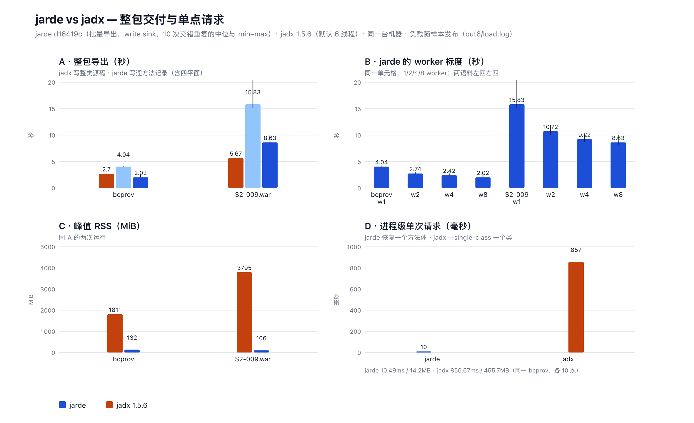

# jarde

jarde 是纯 Rust、library-first 的 JVM artifact 分析引擎，提供 CLASS/JAR/WAR 读取、物理身份导航、符号查询、JVM 方法 IR 与 Java 源码恢复。核心库离线运行，CLI 是薄适配层。

项目正在按 JADX 的测试和实现逐项提高 Java 恢复质量。固定清单包含 **71 个特性单元、612 个 Java 测试文件**，目前仍为部分覆盖；阶段归档不代表任意 JVM 方法均可恢复。最新交付、验收证据和下一步统一见 [handoff.md](handoff.md)，特性范围见 [JADX 对标账本](openspec/evidence/jadx-feature-inventory-2026-09-27/summary.md)。

- [能力与边界](docs/support-matrix.md)：按维度阅读能力，结合主规格与各项验收证据。
- [OpenSpec 入口](openspec/README.md)：现行规格与实施流程。

恢复报告分别表达结构质量、表示形态、内容、覆盖、执行和验证状态。`Produced` 或 `Structured` 不证明可编译或语义等价；需要语义证据时，必须保留原件并做受控编译和执行对照。库生产请求不会自动运行 JVM 或外部反编译器。接口契约见 [recovery-validation](openspec/specs/recovery-validation/spec.md)。

## 支持范围

- Rust edition 2024；MSRV **1.88.0**。
- P0 支持目标限 **64-bit**。Linux x86_64 已由 `ubuntu-24.04` CI 验证；Linux aarch64 有历史本地证据，本轮复核环境为 macOS arm64。32-bit 未验证且不受支持。
- 生产库离线运行，不启动 JVM、外部反编译器或网络访问。JDK 仅用于显式 ignored 的指令 oracle 与受控编译/执行对照。
- 所有结果分别表达 coverage、execution、diagnostics 和 usage；`VerificationStatus::NotPerformed` 不得解释为 JVM verification 成功。

## Library quickstart

仓库中的 [`examples/inspect_class_header.rs`](examples/inspect_class_header.rs) 是可编译检查的公共 API 示例，只接受 standalone CLASS：

```sh
CARGO_BUILD_JOBS=1 CARGO_INCREMENTAL=0 \
  cargo run --example inspect_class_header -- \
  tests/fixtures/historical/ecj-4.6.1/v52/HistoricalControlFlow.class
```

示例使用 `Engine`、`ArtifactInput::Path`、`ClassTarget::Root`、`InspectionMode::Strict` 和有限 `Limits`，并打印版本、类名、成员数量、verification 与最终 usage。ZIP/JAR/WAR 需要先枚举并把**完整枚举所得的 `PhysicalEntry`**传给 `ClassTarget::Entry`；不能只用 ordinal 或 path 重新定位。

### 列出类与成员，并交回物理身份

[`examples/navigate_artifact.rs`](examples/navigate_artifact.rs) 是可编译检查的导航示例，接受 standalone CLASS 或 ZIP/JAR/WAR：

```sh
CARGO_BUILD_JOBS=1 CARGO_INCREMENTAL=0 \
  cargo run --example navigate_artifact -- fuzz/corpus/query/minimal-jar
```

它走完整条链，且**不需要调用方拼装任何身份**：

1. `Engine::list_class_candidates(snapshot, scope, budget)` —— 只按 raw name 划分 scope，**零 Header 读取**；每个 entry 恰好出现一次（类候选或普通 resource），报告里的 `class_headers` 为 0。
2. `Engine::list_class_declarations(snapshot, scope, budget)` —— 真实读取每个候选，交回 `ClassDeclarationItem`：`definition`（location + class bytes digest/length + variant）、`this_class`、class access flags、super/interfaces、raw path 与声明名的一致性，以及成员表停止位置；未确认的候选列在 `unconfirmed` 里。
3. `Engine::list_members(snapshot, &definition, budget)` —— 用上一步交回的身份读取同一份物理定义，一次有界读取给出类声明、字段与方法；方法项带 raw name、descriptor、access flags 和**可直接用于方法请求**的 `PhysicalMethodId`。
4. `Engine::find_targets(snapshot, scope, &query, budget)` —— 点分隔名（`com.demo.A`）与内部名（`com/demo/A`）指向同一物理身份；同名多定义与同名多 descriptor 返回**全部**候选而不静默取第一个；无匹配返回空候选与已扫描范围。

同名不同 origin（上层目录 entry 与显式展开的嵌套库、重复 ordinal、相同字节）**全部**返回：不合并、不 first-wins，选择依据是每条候选自带的物理身份而不是遍历顺序。把返回的身份回传给 `list_members` 或方法请求，读到的就是那份物理定义。

**列举只读 Header**：它不解析声明、不加载、不构建 CFG/SSA/Region/Java AST，不推断 WAR/Boot 布局或 classpath 前缀，不给 MR 选择结论，也不证明类可加载、可链接或已验证。要版本与 dialect 平面用 `Engine::inspect_header`；要方法体用方法请求或 `Engine::recover_method`。摘要见 [五维支持矩阵](docs/support-matrix.md#导航列举与身份交接add-artifact-navigation2026-09-20)。

### 任务导向操作：一个目标、一个有界预算、一个显式环境

[`examples/task_operations.rs`](examples/task_operations.rs) 是可编译检查的任务级示例，接受 standalone CLASS：

```sh
CARGO_BUILD_JOBS=1 CARGO_INCREMENTAL=0 \
  cargo run --example task_operations -- \
  tests/fixtures/historical/ecj-4.6.1/v52/HistoricalControlFlow.class
```

它不再要求宿主拼装 P2 请求，而是把「给 artifact 与一个目标 → 得到结果」收进库内：

1. **一个目标选择**：`ClassRef`/`MethodRef`/`BodyRef` 接受 friendly 名称（点分隔/内部类名、成员名与可选 descriptor）或调用方已有的物理身份，两者收敛到同一 `PhysicalDefinitionId`/`PhysicalMethodId`；名称路径复用导航匹配与歧义规则。歧义不是失败：操作返回 `OperationOutcome::Ambiguous`（候选 + 生效 `limits` + `coverage`/`execution`/`diagnostics`）且**不执行任何分析**，调用方回传候选自带身份后才继续；身份不属于本次 artifact 是 `operation_target_snapshot_mismatch`，不会被同名定义替换。选择先看搜索自身是否完成，再看候选数：搜索因损坏候选、预算耗尽、取消或成员表中断而未完成时返回 **`OperationOutcome::Incomplete`**（同样带已确认候选、`coverage`、`execution`、`diagnostics` 与实际用量，且同样不执行分析）——零或一个已确认候选既不能当「未找到」也不能当「唯一」，未完成的搜索不会退回 `operation_target_not_found`；完整搜索真的没有匹配才是输入错误，完整搜索确认多个候选才是 `Ambiguous`。
2. **操作自选 stage**：`MethodOperation::{Analysis, Recovery}` 各有固定 stage 表（`MethodOperation::stages()`，今天是整条 P2 前缀），`Engine::analyze_target`/`Engine::recover_target` 不接受调用方的 stage 列表，并在报告里发布实际集合（`stages`）；把同一列表显式交给 `Engine::analyze_method` 得到同一调度与同一 stage 结果，底层入口的 `analysis_no_stages` 与 `ir_pass_*` 校验保持原语义。
3. **有界默认预算 + 少量覆盖**：`task_limits(&overrides)`/`task_budget(&overrides)` 是默认集的唯一来源，`OVERRIDABLE_BUDGET_DIMENSIONS` 只列 5 个高频维度（`output_bytes`、`elapsed_millis`、`result_items`、`class_headers`、`method_bodies`）；未知维度是 `budget_override_dimension_unknown`，0 是 `budget_override_invalid`，都不静默取默认。报告发布生效的完整 `Limits`（`report.limits`）与 `UsageSnapshot`（`report.usage`）；覆盖真的截断工作时得到真实 `Partial`/`Cancelled` 并带终止维度。
4. **三种显式环境策略**：`EnvironmentRequest::build` 按 `EnvironmentPolicy::{SingleClass, PlainJar, ExplicitClasspath}` 组装既有 validator 能校验的声明（roots + `parent_first` delegation + `class_path` module mode，一个 loader、一个 domain、无 provider）。它**不推断**：Manifest `Class-Path`、WAR/Boot 布局检出、嵌套库都不生成 roots（后两者需要调用方显式声明的 root）；`EnvironmentPolicy::Layout` 在本阶段是明确的 `environment_policy_layout_not_provided`，不返回一组声称等价于容器加载的 roots。
5. **类视图**：`Engine::class_view(snapshot, scope, request, budget)` 一次类 Header 读取 + 一次成员列举 + 按需方法 Body，全部共享一个总预算；每请求的 `class_headers` 恰好 1（不会逐方法重读），`method_bodies` 只在真的请求了带 `Code` 的成员时 +1。`abstract`/`native` 以 `ClassViewBody::NotDeclared` 如实陈述（不伪造空 body），损坏成员记录只停它自己的记录：类、前缀成员与其它 body 仍然发布（A13），未走到或读取失败的成员以 `ClassViewBody::Refused` 隔离。顶层 `execution` 在库内汇总搜索、类读取与每个被请求 body 的停止：任一 body 未完成，直接库调用读到的顶层就不是 `Complete`（宿主不必再遍历 body 补算）；每个 body 保留自己的结果、coverage 与诊断，类/成员的结构 coverage 按自身证据报告（成员表确实读完就仍是 `complete_within_schema`），而取消或共享维度耗尽会停止启动后续 body。
6. **引用按 owning method 组织**：`ReferenceGrouping::{from_query, from_declaration}` 只重组 item 列表，把方法体内命中按物理方法身份分组并保留 BCI/evidence，类级与 resource 命中留在 `class_level`/`resources`（不分配给任何方法）；`ReferenceFinding::class()` 区分常量池候选、结构 use-site 与 `ResolvedDeclaration` 三类，扫描自身的 `coverage`/`execution`/`diagnostics`/未决候选计数原样保留（不补全候选、不改变解析状态）。
7. **恢复呈现先给交付内容**：`RecoveryPresentation::of(&RecoveryReport)` 只读报告既有字段（`content`、`quality`、`outcome`、`execution`），`parts()` 按 content → quality → 停止原因排序；它不读 `text`、不剥注释、不数 token，因此说明文本里出现 `return` 之类字面量不改变呈现。

**明文边界**：本层不新增 crate、依赖、持久状态或后台服务，不发明 `Session`/`Workspace`/`Project`，不做自动 classpath 推断、依赖下载、批量/整 artifact 恢复，也不承诺性能。WAR 布局策略依赖 `bind-prefixed-load-roots`，跨请求复用依赖 `bound-container-lookup`：两者落地前不实现、不验收重叠部分。摘要见 [五维支持矩阵](docs/support-matrix.md#任务导向操作add-task-oriented-operations2026-09-20)。

## JSON CLI quickstart

CLI 从 stdin（或 `--request FILE`）读取一个不超过 1 MiB 的 JSON 请求。下面检查已提交的 ECJ 4.6.1 / classfile 52.0 fixture 中 `finallyPath(I)I`；方法名和 descriptor 按 JVM 原始字节数组传递：

```sh
CARGO_BUILD_JOBS=1 CARGO_INCREMENTAL=0 cargo run -p jarde-cli -- <<'JSON'
{
  "input_path": "tests/fixtures/historical/ecj-4.6.1/v52/HistoricalControlFlow.class",
  "limits": {
    "input_bytes": 1048576,
    "archive_entries": 1024,
    "entry_bytes": 1048576,
    "read_bytes": 2097152,
    "class_bytes": 1048576,
    "attribute_bytes": 1048576,
    "code_bytes": 262144,
    "result_items": 10000,
    "output_bytes": 4194304,
    "class_headers": 1024,
    "method_bodies": 1024,
    "ir_items": 1048576,
    "ir_edges": 1048576,
    "analysis_steps": 1048576,
    "normalization_clones": 4096,
    "nested_depth": 8,
    "dependency_depth": 64,
    "elapsed_millis": 30000
  },
  "operation": {
    "kind": "inspect_method_bytecode",
    "target": { "kind": "root" },
    "selector": {
      "name": [102, 105, 110, 97, 108, 108, 121, 80, 97, 116, 104],
      "descriptor": [40, 73, 41, 73]
    }
  }
}
JSON
```

十八项 limit 在 CLI 中逐项必填，缺失即协议错误。P2 的 `class_headers`/`method_bodies` 计读取尝试，`ir_items` 计派生存储项，`ir_edges` 计图/def-use 边，`analysis_steps` 计分析工作，`normalization_clones` 计子程序克隆；`nested_depth` 与 `dependency_depth` 为独立高水位。这些维度已接入真实管线。契约要求增长前计费；复核发现的 Frame throw-site × locals 临时存储与部分 Frame/SSA 装配漏计已由 4.3b 关闭（frame 槽存储按槽在分配前计费，SSA 发布改为 clone 前计费），但计费仍是**预算上界**而非逐 pass 构造计数器。限制不承诺进程 RSS 或硬实时中断。

成功响应 exit code 为 0、`status` 为 `"ok"`，并包含精确的 `transport.response_bytes`（含结尾换行）。调用方仍须检查报告里的 `execution`、coverage 和 diagnostics：方法分析内部的 Partial/Cancelled 不被提升为 transport 错误，也不表示分析完成。协议错误及无法建立报告的打开/定位失败保持 `status: "error"`；具体边界见对应入口测试。

方法分析保持 `representation=Bytecode`、`syntax_status=NotJava`、`compile_status=NotAttempted`、`verification=NotPerformed`。产出 CanonicalCFG 后为 Conservative，否则 Fallback；只有本次 Ssa 阶段 Completed 才报告 LocalInvariants。仅 Frame 完成、阶段停止或 abstract/native 无 Body 都是 Unproven。库/CLI 逐字段对照见 [`json_cli.rs`](crates/jarde-cli/tests/json_cli.rs)，实际公开调用见 [`resolve_and_analyze.rs`](examples/resolve_and_analyze.rs)。

Library 可用 `Budget::with_cancellation_token` / `CancellationToken` 注入协作取消；P0 CLI 不暴露取消 token 注入，只支持 `elapsed_millis`。取消和 elapsed 都在协作检查点生效，不是强制抢占或硬超时。

### P1 查询（structural XRef）

`query` operation 接受 relation、target、`physical` scope、consumer schema、`max_items` 和可选 `cursor`；snapshot 由适配层打开并在报告里回显。下面的请求在已提交的 ECJ 4.6.1 fixture 上查找 `java/lang/Object.<init>()V` 的调用点（owner/name/descriptor 是 JVM 原始字节数组）：

```sh
CARGO_BUILD_JOBS=1 CARGO_INCREMENTAL=0 cargo run -p jarde-cli -- <<'JSON'
{
  "input_path": "tests/fixtures/historical/ecj-4.6.1/v52/HistoricalControlFlow.class",
  "limits": {
    "input_bytes": 1048576,
    "archive_entries": 1024,
    "entry_bytes": 1048576,
    "read_bytes": 2097152,
    "class_bytes": 1048576,
    "attribute_bytes": 1048576,
    "code_bytes": 262144,
    "result_items": 10000,
    "output_bytes": 4194304,
    "class_headers": 1024,
    "method_bodies": 1024,
    "ir_items": 1048576,
    "ir_edges": 1048576,
    "analysis_steps": 1048576,
    "normalization_clones": 4096,
    "nested_depth": 8,
    "dependency_depth": 64,
    "elapsed_millis": 30000
  },
  "operation": {
    "kind": "query",
    "relation": "mentions_symbol",
    "target": {
      "kind": "symbol",
      "value": {
        "kind": "method",
        "owner": [106,97,118,97,47,108,97,110,103,47,79,98,106,101,99,116],
        "name": [60,105,110,105,116,62],
        "descriptor": [40,41,86]
      }
    },
    "physical": { "kind": "snapshot_all" },
    "consumers": { "version": 1, "kinds": ["invocation"] },
    "max_items": 0,
    "cursor": null
  }
}
JSON
```

响应 `status: "ok"`，`report.items` 含一条 `consumer: "invocation"`、`operation: "invoke_special"`、CP index 8、BCI 1、opcode 183 的 item，`execution.status` 为 `complete`，`coverage.dimensions.artifact_structural.state` 为 `complete_within_schema`。`max_items` 只限制每页条目、不改变查询含义；`page.cursor` 是为同一查询身份签发的续页 token（`QUERY_ENGINE_SCHEMA = 2`，绑定 snapshot、view、relation、完整 target 与 consumer schema），跨目标或跨快照重放会被拒为 `query_cursor_mismatch`。请求未实现类别（`verification`/`debug`）时不会返回 `complete_within_schema`；`references_definition`/`may_dispatch_to` 返回 `analysis: unsupported_analysis` 并保留原始常量池候选。预算、取消或损坏输入只会产生 `partial`/`cancelled`/`failed` 与定位诊断，不会伪装成完整无命中。

### 物理树枚举与显式前缀加载位置（`bind-prefixed-load-roots`）

`enumerate_artifact_tree` 是薄的 JSON operation：它打开 `input_path`，把该 snapshot 交给库的既有入口，返回库自己的 report（`containers`/`entries`/`layout_nodes`/`coverage`/`execution`/`diagnostics`），limit 仍逐项必填。它不声明 root、不推导 loader 委派、顺序或 classpath，也不改写 snapshot；普通 `enumerate` 仍只报告顶层容器。

```sh
CARGO_BUILD_JOBS=1 CARGO_INCREMENTAL=0 cargo run -p jarde-cli -- --request app-tree.json
# app-tree.json 的 operation 只有一项：
#   "operation": { "kind": "enumerate_artifact_tree" }
```

拿到真实的 container origin 与 entry 身份后，**调用方自己声明**加载位置（`LoadRoot`，JSON 拼写即其 `kind`）：

| 形状 | JSON | 含义 |
| --- | --- | --- |
| `StandaloneClass { snapshot }` | `{"kind":"standalone_class","snapshot":"…"}` | 整个 CLASS 快照本身就是一个定义，内部名由它自己的 `this_class` 给出 |
| `Container { origin, prefix }` | `{"kind":"container","origin":{"snapshot":"…","root_container":"root","steps":[]},"prefix":[87,69,66,45,73,78,70,47,99,108,97,115,115,101,115,47]}` | 快照的一个 container（完整 origin 链，可指向 nested container）加**归档内 raw 字节前缀** |
| `External { id }` | `{"kind":"external","id":"host-jdk"}` | 未提供的声明；不解析，报告 `unreadable_root` |

查名按 `prefix + internal_name + b".class"` 逐字节拼接：不 trim、不 URL 解码、不大小写折叠、不折叠 `.`/`..`/反斜杠，也不要求 ZIP 里存在对应的目录 entry。前缀为空或以 `/` 结尾；非空却不以 `/` 结尾是环境问题 `invalid_root_prefix`（该 root 上的诊断，不补分隔符）。选中候选的 Header 内部名必须与请求名一致，否则返回该候选自身的 `resolution_definition_name_mismatch`，不尝试下一个 root。

这个形状**替换**了旧的 `snapshot`/`artifact_tree` 两种 root（**BREAKING**，无兼容层、无 schema 适配）：旧 JSON 变体不再能反序列化。前缀只影响 container 目录内的查找 key（`ArchiveNameBytes` 参与环境身份，不进入 container facts cache 的 key），跨 root 优先级仍由声明顺序与 loader 委派决定。**支持边界**：前缀是通用机制，等于 Servlet/Boot 专用加载规则**未实现**——不读 `classpath.idx`、不自动排序 `BOOT-INF/lib`、不执行 launcher，`BOOT-INF/classes/` 只是同一种前缀的受控样本。

### 任务导向命令（`add-task-oriented-cli`）

命令行现在有两个入口：`--request`/stdin 的 JSON 控制面**保持原样**（18 项 limit 逐项必填、既有 6 个 operation、`status`/`result`/`transport` envelope、0/1 退出语义都不变），以及新增的任务链子命令。子命令只做三件事：把 friendly 参数翻成库请求、把库返回的那一份报告渲染成文本或 JSON、按报告自己的平面给出退出状态。

| 命令 | 调用的库入口 | 参数做什么 |
| --- | --- | --- |
| `list-classes` | `Engine::list_class_candidates` / `Engine::list_class_declarations`（`--evidence candidates\|declarations`，默认 `declarations`） | 传递 scope 与证据等级 |
| `list-members` | `Engine::list_members` | 把 `--definition` 的物理身份原样传入（不重拼、不按名字重找） |
| `references` | `Engine::query` + `ReferenceGrouping::from_query` | 把类名/成员/relation/consumer 交给库的扫描与分组 |
| `class-view` | `Engine::class_view` | 把类名或定义身份、以及要打开的 `--body` 传入 |
| `recover` | `Engine::recover_target` | 把 `--method`/`--class-name`、环境策略、profile 与 loader 传入 |

公共参数：`--input PATH`、`--scope JSON`（默认 `{"kind":"snapshot_all"}`，可声明 `artifact_tree` 的真实 container 身份）、`--budget DIMENSION=LIMIT`（可重复；五个可覆盖维度 `output_bytes`/`elapsed_millis`/`result_items`/`class_headers`/`method_bodies`，其余保持有界默认，未知维度或 0 是用法错误）、`--format text|json`（默认 `text`）、`--output FILE`。需要身份或文档的参数（`--definition`、`--method`、`--body-method`、`--scope`、`--root`、`--profile`）接受库自己的 JSON 文档，或 `@FILE`。

**JSON 与文本同源**：`--format json` 写的就是库报告自身的序列化（`OperationOutcome` 连 `outcome` 标签一起），没有 envelope、没有改名、没有 CLI 专有字段，因此可以对同一请求做逐字段对照；`--format text` 是同一份文档的投影，每行都是 `JSON 字段路径 = 值`，可逐项回到 JSON 字段。唯一的正文例外是恢复的 Java 文本：它按 `recovered.recovery.text` 的字段值逐字节写出，所以 `--format text --output A.java` 得到的就是报告里的那段代码。

**诊断与正文分离**：文本模式下正文（或内容字段行）走标准输出/`--output`，`limits`/`usage`/`coverage`/`execution`/`diagnostics` 五个记账平面走标准错误；JSON 模式下它们都是文档里的字段。失败（用法/输入错误、交付失败）不写标准输出，而是把库自己的 `error` + `usage` 文档写到标准错误。`--output` 与标准输出走同一次序列化与同一个 `output_bytes` 检查：收费被拒时**不创建文件**，执行停止时写出的是报告自己的 `partial`/`cancelled` 平面而不是伪装成功的文档。

**退出状态**：

| 状态 | 含义 | 验证用的 fixture |
| --- | --- | --- |
| `0` | 报告自己发布的每个执行平面都是 `complete` | `list-classes --input app.jar --format json` |
| `1` | 文档无法交付（写文件或标准输出失败） | `... --output <不存在的目录>/x.json` |
| `2` | 用法/输入错误：参数、身份文档、库的请求级拒绝、`output_bytes` 不足以交付文档 | 缺 `--consumer` 的 `references`；`recover --class-name p/Absent` |
| `3` | 名称歧义，需要调用方选择（库未执行任何操作，候选就是报告） | 两个 origin 的 `class-view --class-name p/Base` |
| `4` | 执行未完整：`partial`/`cancelled`/`failed`，**即使已交付可靠前缀也不为 0** | `list-classes --evidence declarations --budget class_headers=1` |

**任务链**（每个后续命令吃前一条命令打印的物理身份，不需要手工重拼）：

```sh
J=app.jar
# 1. 列类：`items[i].definition` 就是要交给下一条命令的身份
cargo run -q -p jarde-cli -- list-classes --input $J --evidence declarations --format json
# 2. 列方法：身份原样传回，`items[i].identity` 是方法身份
cargo run -q -p jarde-cli -- list-members --input $J --definition @definition.json --format json
# 3. 看引用：符号（类名 + 成员名 + descriptor）与声明的 consumer 类别
cargo run -q -p jarde-cli -- references --input $J --class-name p/Base --member method \
  --member-name foo --descriptor '()V' --consumer invocation --format text
# 4. 打开代码：方法身份原样传入，环境由调用方声明
cargo run -q -p jarde-cli -- recover --input $J --method @method.json --policy plain-jar \
  --format text --output Base.java
```

**`recover` 的 JSON/text 报告（上面的恢复示例）适用同一读法契约（契约原文，`recovery-validation`／`java8-recovery` 规格）**：每个平面 SHALL 只被读作它自己的结构性问题：representation 说明表示形态，quality 说明区域结构的强度，syntax/compile/semantic/verification 各自说明对应证据是否存在，coverage 与 execution 说明工作范围与完成度，content 说明交付物是否含发射语句。任意组合——包括 quality=Structured、content=contains_statements、execution=complete、coverage=CompleteWithinSchema 且无诊断同时成立——MUST NOT 构成语义等价或值正确的声明；已知反例中存在这样同时成立、却计算了与字节码不同值的产物。需要语义证据的调用方 MUST 执行受控编译/执行对照，或把产物当作假设并保留其未证明状态；MUST NOT 用任一平面组合代替该动作。`Produced` 与 `content` MUST 分开统计与表述：同一轮 sweep 的 182,883 个请求中有 30,452 个是 Produced 而产物不含语句；报告、README、支持矩阵与 benchmark 协议 MUST NOT 把这类计数表述为语句恢复率或语义恢复率，MUST 分别命名「引擎 content 分类」与旧 token/启发式口径。content 与其余平面一样是结构性的，MUST NOT 被读作值等价或语义正确的证据。

`class-view` 是另一条“打开代码”的路径：`--body 'foo()V'` 只为被请求的那个方法计一次 `method_bodies`，同一个类的其他方法不会被读取（`native`/`abstract` 这类无 Body 的成员不计尝试，返回 `not_declared`）；`--body-method` 接受方法身份。

**发现面**：导航命令只用库的列举与显式 `enumerate_artifact_tree`；普通枚举仍不递归（嵌套库只是一个普通 entry），`--scope {"kind":"artifact_tree","root_container":…}` 才进入嵌套 container 的 entries。CLI 不自行解包、不按路径推断 container、不生成 root：加载位置只能由 `--root`（`LoadRoot` 文档）或 `--policy` 显式声明。**不包含**：GUI/MCP、交互式 TUI、自动 classpath 推断、配置持久化、颜色/分页、性能承诺（整 artifact 批量导出已由 `export` 提供，见 [Benchmark](#benchmark)）；不新增 crate 或依赖。验收见 [`task_cli.rs`](crates/jarde-cli/tests/task_cli.rs)。

## Benchmark

以下是历史冻结版本的同机测量，不代表当前主线性能或覆盖率。

jarde 交付的单位是**方法体 + 它的四个平面**（content/quality/representation/诊断），不是整类源码。
在 vulhub 语料上（10 次交错重复的中位、逐配置预热；原语料 12 个 artifact）：

| 场景 | jarde | jadx 1.5.6（对照） |
| --- | --- | --- |
| 整包导出，bcprov-jdk15on-152.jar（2,430 类 / 14,495 方法体） | **2.02 s**（8 worker） | 2.70 s（默认 6 线程） |
| 整包导出，S2-009.war（7,200 类 / 53,247 方法体） | 8.63 s（8 worker） | 5.67 s |
| 单点请求：一个方法体（进程级，10 次） | **10.5 ms / 14 MB RSS** | 857 ms / 456 MB（`--single-class`，一个类） |
| 峰值 RSS，整包 | **73–132 MiB** | 1,811 / 3,795 MiB |

交付物不同（jadx 写整类源码，bcprov 2,419 个文件；jarde 写逐方法记录，bcprov 19,865 条 / 390.8 MB，
含四平面与诊断），上表是**同一轮同机对照**，不作吞吐胜负结论。行为门禁（把产物贴回类里编译执行、
与原类逐输入比对，600 个抽样方法）**421/424 可比方法与原类一致（99.3%）**；11/600 自报结构化但
过不了 javac。每条诊断码只描述该版本在本次运行记录的事实，`resolution_definition_unbound`
是"被遮蔽的定义不建立运行时语义"的如实上报，MUST NOT 读作恢复失败。



口径与限制（语料校验、形状、负载、未测项）见 [benchmark 说明](docs/benchmark.md) 与
[benchmark 协议](openspec/benchmark-protocol.md)。

## 规格与验证

| 内容 | 入口 |
| --- | --- |
| 当前产品、验收与下一步 | [handoff](handoff.md) |
| 现行规格与实施流程 | [OpenSpec](openspec/README.md) |
| 架构、不变量与管线 | [架构基线](JVM_Rust_Engine_Final_Architecture.md) |
| 技术选型与验收要求 | [依赖选型](openspec/dependencies.md)、[验收映射](openspec/acceptance.md) |
| 历史阶段与复核 | [阶段路线](openspec/roadmap.md)、[完成复核](openspec/completion-review.md) |
| 历史交接 | [截至 2026-10-19 的快照](docs/history/handoff-through-2026-10-19.md) |
| Clippy 专项债务 | [clippy-debt](docs/clippy-debt.md) |

本地验证使用 `CARGO_BUILD_JOBS=1 CARGO_INCREMENTAL=0 RUST_TEST_THREADS=1`；构建须保留至少 5 GiB 磁盘余量，target 上限 1 GiB，完成后清理编译残留。当前恢复任务沿用 handoff 中的受控验证入口。

OpenSpec 静态验证：

```sh
openspec validate --all --strict --no-interactive
```
